# 02 - Product Plan: Asset Management & Tracking (Multi-tenant SaaS + Self-hosted edition)

Status: DRAFT for founding-team review. Decisions adopted 2026-11-17 (section 12). Date: 2026-11-16 (updated 2026-11-17: Expo app and Self-hosted edition added to the MVP by team decision; updated again 2026-11-17 after desk validation, which replaced Phase 0 with in-build validation; updated a third time 2026-11-17 for the "team change": one human founder plus Claude as AI engineer and designer, delivery in milestone slices M1-M6, Self-hosted first; decisions 19 and 22, section 5.5).
Primary input: `docs/01_feature_matrix.md` (research-based). Supporting detail: `research/snipe_it.md`, `asset_panda.md`, `lansweeper.md`, `freshservice.md`. Validation: `docs/04_validation_report.md` and the four reports in `docs/validation/` (competitor, market, technical, RLS/PgBouncer spike).

## How to read this document

- Feature IDs such as `2.3` refer to rows in `01_feature_matrix.md`. "Tier" (Table-stakes / Differentiator / Enterprise-Niche) is the matrix's mechanical tier.
- Evidence tags:
  - **[M]** = grounded in the matrix / research files.
  - **[J]** = my industry judgment, applied where the matrix under-counts basics because research was thin (`?` marks). Examples: REST API, custom fields, SSO, dashboards, locations. These are table-stakes for any modern SaaS regardless of what the research file happened to record.
- Labels: **"(decided 2026-11-17, decision N)"** (or "decision N" in tables) marks a default the team adopted on 2026-11-17 (section 12; N is the decision number); decisions revised after validation say **"Decided (2026-11-17, after validation)"**. **"(proposed)"** marks an agent-added detail that no decision covers; it stays visibly unapproved until the team signs it off. **"(validation: competitor|market|technical|spike)"** cites one of the four validation reports in `docs/validation/`.
- Pricing numbers are the adopted list-price hypothesis (decision 8, revised after validation) and are validated with design partners during the self-hosted beta (recruited before M4; decision 20) before publishing; the team and the delivery approach (milestones M1-M6, Self-hosted first) are decided (decisions 19, 22), but the calendar timeline is not: it is re-estimated after M1 from measured pace; other numbers (SLAs, NFR targets) are **proposals**, not facts. Competitor facts are limited to what the research and the 2026-11-17 competitor validation state. Several research items are snippet-based and unverified; the matrix says so and so do we where it matters.
- **Team and delivery (decided 2026-11-17, decisions 19 and 22, "team change"; replaces the earlier "5-6 engineers + 1 designer" assumption).** The team is **one human founder (a developer: product owner, reviewer, accounts/legal/payments, device testing, customer contact) plus Claude as AI engineer and designer** (Claude orchestrates AI sub-agents that write code and designs; Claude reviews and verifies). No engineers or designer are hired. Delivery is in **milestone slices M1-M6**, each ending in working, verifiable software (section 5.1), and the **Self-hosted edition reaches real users first (M4); Cloud SaaS follows in M6**. The earlier "closed beta ~month 5 / public GA ~month 8" timeline is superseded: the calendar is re-estimated after M1 from measured pace, and this document gives no month numbers for M1-M6. The MVP scope in section 5 keeps its confirmed "cut line" (section 5.4); the repair log stays an MVP Must (promoted to Must after validation for the K-12/loaner use case). Roles and how work continues across sessions are in section 5.5; the founder-only checklist is in section 11 (risk 29). Where this document still quotes "engineer-months", read it as **sizing in team-months, historical** (made for the earlier team assumption) and as a relative size, not a schedule.
- Phase labels: "MVP" is the v1 scope, delivered through M1-M6; "GA" means the public Cloud launch (M6) unless a line says otherwise; the Self-hosted edition is released earlier, at M4.
- **Validation status (2026-11-17).** The team cannot run the 4-week Phase 0, so Phase 0 is removed (decision 20, revised). Instead, desk validation was done on 2026-11-17 (four reports in `docs/validation/`, summarised in `docs/04_validation_report.md`), and what desk research cannot validate (willingness to pay, who owns non-IT assets, paid self-hosted demand, K-12 requirements, native vs web scanning, import experience) moves to in-build validation with 5-10 design partners in the self-hosted beta (recruited before M4), with keep/kill metrics in decision 20. Limits of the desk work: review sites and Reddit were blocked or snippet-only, and most buyer evidence is secondhand. Two complaint themes (import pain, weak API) are carried as "assumed, untested".

---

## 1. Executive summary

**What we are building.** A multi-tenant SaaS (Cloud edition) that gives small and mid-sized organizations one place to track every asset they own: laptops and phones, software licenses, and the physical equipment that is not IT (tools, AV gear, lab equipment, furniture, vehicles-light). It is delivered with a fast, modern UI, first-class mobile scanning, and an open API at every price tier. The same codebase also ships as a single-tenant, closed-source **Self-hosted edition** under a commercial license key (Docker Compose bundle in the MVP; team decision 2026-11-17; section 6.15).

**Why there is room.** The research shows the market splits in two. Enterprise suites (ServiceNow, Maximo, SAP, Infor/HxGN, Flexera) are powerful but are consistently called complex, slow to implement (5-7 months cited for Flexera and Maximo) and expensive; most publish no prices [M, complaint themes 1, 2]. The SMB tools each cover only a slice: Snipe-IT is strong on check-out, labels, API, SSO/SCIM but has no discovery, no work orders, no contracts and a dated UI and beta mobile app; Asset Panda spans physical assets and maintenance but has no software licensing, is criticized on cost and data migration, and (corrected by validation) does have a REST API and documented SAML SSO, with webhooks unverified; Lansweeper has the best discovery but no mobile app or check-out found (QR/barcode generation exists in Lansweeper Classic) and SQL-dependent reporting; Freshservice bundles ITAM into ITSM per agent, with ITAM and discovery starting at the Growth plan (validation: competitor) [M, gaps 1, 2, 3, 5, 8, 11].

**Strategy.** Win the "outgrew spreadsheets / outgrowing Snipe-IT / can't afford enterprise" buyer: a 50-1,000 person organization whose IT or Operations team owns both IT and non-IT assets. **Lead message (proposed after validation; validation: market): "outgrew spreadsheets or Snipe-IT: scan from a phone, no-ops hosting (or self-host), import in minutes, API on every tier".** "IT + physical assets in one tool" is a supporting claim, because buyer-voiced demand for it was weak in the desk research (validation: market). Compete on time-to-value (first useful inventory in under a day), mobile scanning that actually works, and a full REST API plus signed webhooks on every tier, including Free. Price transparency and unlimited users are not differentiators (most SMB tools publish prices and several offer unlimited users; validation: competitor); we keep them as table stakes, together with the pricing promises "no minimum band" and "retired/disposed assets don't count".

**What ships when (decided 2026-11-17, decisions 19, 20, 22; Phase 0 removed; team change: milestone slices M1-M6, Self-hosted first).**
- **Team and delivery (decided 2026-11-17, "team change"):** one human founder plus Claude as AI engineer and designer, shipping in milestone slices M1-M6 (section 5.1), each ending in working, verifiable software. The Self-hosted edition is the first to reach real users (M4); Cloud SaaS follows in M6, once accounts, billing, monitoring and on-call alerting exist. The earlier "closed beta ~month 5 / public GA ~month 8" timeline is superseded; the calendar will be re-estimated after M1 from measured pace.
- **v1 / MVP (delivered through milestones M1-M6; M1 foundations and registry, M2 operations, M3 Expo app, M4 Self-hosted edition (first release to real users), M5 importer/reports/API completeness, M6 Cloud launch; see the realism flag in section 5.1):** registry with custom fields, check-in/out, **loaner pool and repair log (Must; decision 1)**, QR/barcode labels, Expo (React Native) native app for technician/field flows (scanning, check-out/in, transfer, stocktake, photos, repair log; online-first with retry queue; App Store/Play Store + MDM; push notifications a Should, Cloud-only at MVP), web app as the admin/desktop UI (Next.js static export; keyboard-wedge/USB scanner and manual tag entry; web camera scanning a Should), license seats, consumables/accessories, CSV (with a Google Admin ChromeOS device CSV template) + Snipe-IT importers, alerts, reports, REST API + webhooks, RBAC, audit log, and the **Self-hosted edition** (Docker Compose bundle, offline-verified license file, single-tenant; section 6.15). No discovery agent yet; MDM/directory sync (Intune + Entra ID, and Google Admin ChromeOS devices) is the automation story, which the confirmed cuts move to v1.1 (decided 2026-11-17, decisions 22, 1; section 5.4). Validation runs in the build: 5-10 design partners are recruited before M4 and join the self-hosted beta (decision 20).
- **v2 (after M6 and v1.1; dates set after the post-M1 re-estimate, the earlier "~months 9-14" is historical):** discovery agent + installed-software inventory feeding license compliance, contracts, warranty alerts, POs (Should), no-code reports, workflow rules + approvals, SCIM (SAML targets MVP as a Should, may slip to v1.1), multi-company (the MSP console is a Could pending demand; decision 6), light maintenance (PM, inspections; work orders Should), full offline-first mode in the Expo app (local SQLite + sync queue, conflict rules); Self-hosted extras: Helm chart, air-gapped install (Enterprise), self-hosted SAML via a bundled Keycloak broker and SCIM (decided 2026-11-17, decision 27, revised after validation).
- **v3+ (year 2 onwards):** agentless/cloud discovery, SaaS discovery, CMDB relationships, ITSM connectors, AI (NL query, normalization, contract/invoice extraction), EU data residency, deeper EAM. Beyond v3, SAM, FAM and CMMS are candidate paid add-on modules; EAM only on an explicit upmarket decision; DAM out of scope (section 13).

**Architecture in one line.** Shared PostgreSQL 18 behind PgBouncer with `tenant_id` + row-level security (RLS), modular monolith in TypeScript (NestJS on the Fastify adapter) in a Turborepo + pnpm monorepo, Next.js static-export web app for admin/desktop plus an Expo native app for field flows (both in MVP; offline-first is v2), S3 for files, Postgres-backed jobs and search at MVP; with a path to dedicated "cells" for large tenants. One backend image serves both editions; infrastructure dependencies sit behind adapters so the Self-hosted edition runs single-tenant on Docker Compose (section 6.15).

**Biggest risks.** MVP schedule (no calendar commitment; re-estimated after M1) and the capacity of a one-human team (bus factor, review bandwidth, AI-generated code quality and security, Cloud ops burden; risks 21, 26-29); scope creep into ITSM/EAM; competing head-on with free self-hosted Snipe-IT; support burden of customer-run environments and unproven paid demand for self-hosting (kill metric in decision 13); SSO vendor cost versus the SAML/SCIM add-on price; app-store review; single-maintainer dependency on pg-boss; multi-tenant data-leak risk; SOC 2 lead time; discovery agent complexity. Mitigations are in section 11.

---

## 2. Positioning & target segment

### 2.1 Recommended beachhead

**Primary: SMB / lower-mid-market (50-1,000 employees; roughly 300-10,000 tracked assets) where one small IT or Operations team owns both IT assets and physical equipment.** Typical buyers: IT managers / sysadmins at schools and school districts, nonprofits, healthcare clinics and small hospitals' departments, professional-services firms, light manufacturing/logistics, media/AV-heavy organizations, and growing tech companies with 100-500 laptops plus office equipment.

Positioning statement (proposed, reordered after validation; validation: market): *"Outgrew your spreadsheet or Snipe-IT? Scan from any phone, skip the hosting (or self-host it), import your data in minutes, and get a full API on every tier. Every laptop, license and piece of equipment in one place."* The lead is the migration and mobile-scanning story; "IT + physical in one tool" is the supporting claim until buyer interviews show who owns non-IT assets (validation: market).

Editions (team decision 2026-11-17): **Cloud (SaaS)** is the default, zero-ops way to buy; the **Self-hosted edition** (single-tenant, closed source, commercial license key, Docker Compose in the MVP) serves buyers who must or want to run it on their own infrastructure. Same codebase and features; see section 6.15.

### 2.2 Why this segment (tied to the matrix)

| Matrix evidence | Implication |
|---|---|
| Gap 1: no single product covers IT assets + physical/fixed assets + light maintenance at SMB price. IT-focused SMB tools (LS, ME, FS, SIT) have no work orders (6.1); AP spans physical + maintenance but lacks discovery (3.1 not found, 3.2 partial) and software licenses (5.x not found) [M] | Our product is the "IT + physical + licenses" union, with maintenance deliberately light. Buyer-voiced demand for the union was weak in the desk research, so it is a supporting claim, not the lead (validation: market) |
| Gap 2: scan-the-network and scan-the-shelf together is not evidenced anywhere [M] | Medium-term differentiator (v2 agent + v1 mobile scanning) |
| Gap 3: SaaS / license management for SMB; FS's ITAM available to new signups from 31 March 2026 (validation: competitor), ITAM from the Growth plan [M] | v2 headline: license compliance fed by discovery, SaaS discovery at v3 |
| Gap 4: no one advertises self-serve import + mapping + de-duplication; enterprise implementations run 5-7 months [M]. Import pain is **assumed, untested**: no buyer-voiced support in the desk research (validation: market); tested in the self-hosted beta | Onboarding is a product feature, not a services engagement |
| Gap 5: webhooks/SCIM/API libraries evidenced only for SIT [M]. **Corrected (validation: competitor):** Asset Panda has a REST API (key id + secret, admin-only, 400 calls / 3 min / IP) and documented SAML SSO; webhooks unverified. "Weak API" as a complaint is **assumed, untested** | A full API + signed webhooks on every tier, including Free, remains unusual among SMB tools (GoCodes charges $1,200/yr, itemit GBP 699/yr, Sortly gates it to Enterprise) and is our distinctive claim |
| Gap 8: transparent pricing only from SIT and ME [M]. **Corrected (validation: competitor):** most SMB tools publish prices (Reftab, Sortly, GoCodes, EZOfficeInventory, Assetbots, Shelf, itemit, ManageEngine, Snipe-IT) | Public price list is table stakes, not a differentiator; "no minimum band" and "retired assets don't count" are the commitments that matter |
| Complaint themes 1, 2, 4, 8 (complexity, cost, dated UI, mobile gaps) [M]; theme 5 (import pain) is assumed, untested | Best-supported: pricing opacity and mobile (vs Snipe-IT's beta app). These are our design brief; import pain is kept in the brief but tested in the beta |

### 2.3 Secondary segments (sequence, not initial focus)

1. **Multi-site / multi-company organizations (school districts with many buildings, groups with several entities)** (v2): multi-company is evidenced only for MX, INF, SIT (12.3) and permission/audit gaps are a Freshservice complaint [M, gap 10]. Cheap to support if the tenant model is designed for hierarchy from day one (section 6). **MSPs are no longer a v2 target (decided 2026-11-17, decision 6, after validation):** the MSP console is a v2 Could pending demand (5 MSP interviews or beta signal), because MSP asset data lives in RMM/PSA/documentation suites and no practitioner demand for a standalone multi-tenant asset tool was found (validation: market). The `company_id` column stays.
2. **Education and public-sector verticals**: Asset Panda has vertical editions and government contracts and claims SOC 2 / HIPAA / GovRAMP badges [M]. We should not attack there until SOC 2 Type II exists and procurement-friendly packaging exists. Treat schools as a beachhead for IT-plus-AV-equipment use cases, not for government compliance. K-12 buyers need Google Admin (ChromeOS) data and loaner/repair workflows, so the MVP ships a Google Admin CSV template, the loaner pool and the repair log, with Google Admin sync in v1.1 (decisions 1, 9). **K-12 timing note (proposed):** dates are re-estimated after M1 (the earlier ~May-June 2027 beta and GA ~month 8 timeline is superseded); a self-hosted beta (after M4) may suit a summer-collection pilot only if the measured pace allows, and the Cloud launch (M6) should not be counted on for 2027 school budget cycles; target 2028 budgets (validation: market).

### 2.4 Who we are NOT for (initially)

- **Asset-intensive enterprise EAM** (utilities, oil and gas, plants): work orders at depth, job plans/failure codes, labor/crew qualification, condition-based and predictive maintenance, linear/GIS assets, safety permits, IoT ingestion (matrix 6.4, 6.8-6.12, 1.12, 13.2-13.5, all Enterprise/Niche; zero SMB products have them).
- **Large-enterprise SAM** needing publisher-specific modeling (Microsoft/Oracle/SAP rules), vendor-audit defense, cloud license management (5.10, 5.11, 5.13: Enterprise/Niche).
- **Organizations that want a full ITSM / service desk replacement.** We integrate with ITSM tools; we do not become one (8.3 is table-stakes in the matrix, but it is carried by products whose core is ITSM; building it would double scope).
- **FinOps / sustainability / ERP-deep finance buyers** (7.7-7.10, 12.12).
- **Air-gapped buyers (initially).** Self-hosted (12.7 is table-stakes in the matrix because of Snipe-IT and ManageEngine) is now in scope: the Docker Compose edition ships in the MVP (team decision 2026-11-17; section 6.15). Fully air-gapped installs (offline image tarball + offline license) and Kubernetes/Helm are v2, aimed at Enterprise (decided 2026-11-17, decision 27).
- **Government requiring GovRAMP/FedRAMP** until a later compliance phase.

---

## 3. Product principles

Each principle is derived from a recurring complaint or market gap in the matrix. After the 2026-11-17 market validation, the complaint themes are not equally supported: pricing opacity (theme 2) and mobile (theme 8, Snipe-IT's beta app in particular) are best supported; import pain (theme 5) and weak API (theme 7) are **assumed, untested** (no buyer-voiced support found; validation: market) and are tested in the closed beta (decision 20).

| # | Principle | Derived from | What it means in practice |
|---|---|---|---|
| P1 | **Time-to-first-value in hours, not months.** | Complaint 1 (complexity, 5-7 month implementations), 5 (painful import; assumed, untested), gap 4 | Guided onboarding wizard; sensible defaults and templates by industry (IT office, school, clinic); CSV import with AI-assisted column mapping, de-dup, dry-run preview and undo; target: first 100 assets imported and labeled in under 30 minutes. No consultant required. |
| P2 | **Predictable, no-surprise pricing.** | Complaint 2 (best-supported theme; opacity and minimum-band jumps), gap 8 (corrected: price transparency is table stakes among SMB tools, not a differentiator; validation: competitor) | Public price list (table stakes); unlimited users (justified by broad check-out and request access, not by market complaints about per-user pricing); no add-ons for core asset tracking (future modules such as SAM Pro, FAM and CMMS are separately priced; section 13); asset bands with published overage; **"no minimum band" and "retired/disposed assets don't count"**; price-protection. |
| P3 | **Open by default: full API and signed webhooks at every tier.** | Complaint 7 (weak API; assumed, untested), gap 5 (corrected: Asset Panda has an API too) | Every UI action has a documented REST endpoint; **full REST API + signed webhooks on every tier, including Free (our distinctive claim)**; API keys on the Free tier; OIDC login free on all tiers; SAML/SCIM are a paid per-connection add-on on Pro and included in Enterprise (decided 2026-11-17, decision 7; priced above SSO-vendor cost, section 8.2). Rate limits scale by tier but access does not. |
| P4 | **Modern, low-click UX.** | Complaint 4 (dated UI, too many clicks) | Keyboard-first command palette, inline editing, bulk actions everywhere, global search under 200 ms, dark mode, accessible (WCAG 2.2 AA target), i18n from day one (Snipe-IT ships 55+ languages [M]). |
| P5 | **Mobile-first scanning, not a mobile afterthought.** | Complaint 8; matrix 4.5 table-stakes yet incomplete in AP/SIT; gap 13 | Camera scan, check-in/out, stocktake, photos on a phone in a native Expo app distributed via App Store/Play Store and MDM. Mobile feature parity for core workflows is a release gate. |
| P6 | **Configurable data model without consultants.** | Complaint 6 (rigid customization) | Custom fields, categories, statuses, and relationships configurable by admins; no code; no per-field cost. |
| P7 | **Reporting that non-technical people can build.** | Complaint 3, gap 6 | No-SQL report builder, saved views, scheduled email reports, share links; export everything. |
| P8 | **Security and audit are not enterprise add-ons.** | Complaint 12 (permissions/audit granularity), gap 9, 10 | Granular RBAC and an immutable audit log in every tier (retention varies by tier); published security page, SOC 2 roadmap, DPA. |
| P9 | **Fast at scale.** | Complaint 10 (large datasets slow) | Performance budgets in CI: list view of 50k assets p95 < 500 ms; search p95 < 200 ms. |
| P10 | **Do fewer things, correctly.** | Matrix tiers; gap 1 | Each module has an "in / out" line (section 4). We integrate for ITSM, ERP, MDM rather than rebuild them. |
| P11 | **Painless upgrades and responsive support: zero-effort on Cloud, one-command when self-hosted.** | Complaint 9, 13 (upgrade pain, self-hosting burden, support) | Cloud: continuous delivery, zero-effort upgrades. Self-hosted: one-command upgrade (expand/contract migrations, any supported version upgrades directly to latest, migrations run automatically with a pre-upgrade backup prompt; section 6.15). Public changelog and release notes; support SLA documented per tier, human response on all paid tiers. |

---

## 4. Module map

Product = 13 modules. For each: purpose, key features (matrix IDs), inspiration. "In" = we build; "Out" = we do not (or integrate).

### M1. Core Registry (assets, models, categories, locations, custom fields)
- **Purpose:** the system of record for every tracked item.
- **Key features:** asset master record 1.1; categories/types 1.2; custom fields 1.3 [J: table-stakes despite low matrix prevalence; AP and SIT both have it]; manufacturer/model catalog 1.4; parent-child assets 1.5; locations (hierarchical) 1.6; depreciation 1.7; consumables / accessories / components 1.8; attachments/photos 1.9; non-IT / physical coverage 1.10; EOL/EOS enrichment 1.11 (v3, depends on catalogue data).
- **Out:** linear/GIS assets 1.12.
- **Inspiration:** Snipe-IT (models, categories, custom fields, locations, components, accessories, consumables, depreciation, multi-company, asset cloning) [M]; Asset Panda (flexible fields, photos, document attachments, multiple asset classes in one platform) [M]; Flexera (normalized manufacturer/model catalogue, 1.4/13.9) [M].

### M2. Lifecycle & Check-out
- **Purpose:** who has what, where it is, what state it is in, and how it got there.
- **Key features:** lifecycle statuses (configurable) 2.1, 2.7; history / chain of custody 2.2; check-in/out 2.3; assignment to users/locations/assets and transfers 2.4; end-user acceptance with signature 2.5; stocktakes/physical audits 2.6; disposal/retirement 2.8; reservations 2.9; requestable assets 2.10; kits 2.11; lease tracking 2.12; loaned-asset tracking 2.14 with a **loaner pool** (a designated pool of loaner/spare devices with quick check-out, due dates and overdue alerts; MVP Must for the K-12 loaner workflow, decided 2026-11-17, decision 1; details proposed); hardware refresh planning 2.13 (v3, light).
- **Inspiration:** Snipe-IT (one-click check-in, acceptance with digital signature, kits, requestable assets, upcoming-audit reports) [M]; Asset Panda (reservations, leased equipment, chain-of-custody) [M]; ManageEngine (configurable states with automated state actions, role-restricted status transitions 10.7, loaned assets) [M]; ServiceNow (lease, refresh planning) [M].

### M3. Tagging & Mobile
- **Purpose:** physical-world link; fastest possible data capture.
- **Key features:** barcode 4.1 and QR 4.2 generation + scanning; label design and printing 4.4 (PDF sheets in MVP, thermal printer templates v2); mobile-responsive web UI 4.10; Expo native technician app 4.5 (MVP, online-first with retry queue; see 6.5) with push notifications (MVP Should, Cloud-only at MVP; a license-gated self-hosted push relay run by us in v1.1 (proposed; validation: technical)); web camera scanning 4.1/4.2 (Should, promoted from Could as a fallback if store review slips and to let the beta compare native vs web scanning; iOS Safari still lacks BarcodeDetector, so a ZXing fallback stays); installable PWA 4.5 (Could); photo / signature capture 4.9; offline mode with sync queue 4.6 (v2, in the Expo app: local SQLite + sync queue, conflict rules; see 6.5); GPS capture on scan 4.7 (v2, opt-in); mobile stocktake and inspections 2.6, 6.3; RFID 4.3 (v3+, via Bluetooth RFID reader integration).
- **Inspiration:** Asset Panda Pro (scan, update, transfer, inspections with photos and signatures, claimed limited-connectivity operation) [M]; Snipe-IT (barcodes, labels, mobile-friendly web) [M]; Maximo / Infor (offline mode) [M]. Pain points to avoid: AP mobile incomplete vs desktop, SIT official app only beta [M, complaint 8].

### M4. Discovery & Inventory Automation
- **Purpose:** keep the registry fresh without manual typing.
- **Key features:** CSV/XLS bulk import 3.7 (MVP, including a documented **Google Admin ChromeOS device CSV template**: decided 2026-11-17, decision 1); MDM / RMM / directory connectors 3.6 (first connectors: Intune + Entra ID, a Should that the confirmed cuts move to v1.1 (decided 2026-11-17, decision 22; section 5.4), and **Google Admin (ChromeOS) device sync in v1.1** alongside it (decision 1); v2: more); generic HTTP/JSON connector 3.8 (v2); agent-based discovery 3.2 and multi-OS coverage 3.3 (v2); installed-software inventory feeds M5 (5.5); agentless/network discovery 3.1, active+passive scanning and unmanaged device detection 3.10, distributed probes 3.9 (v3); cloud infrastructure discovery 3.4 (v3, read-only IAM role); OT/IoT 3.5 (Won't).
- **Inspiration:** Lansweeper (agentless + agent, active + passive, multi-OS, network devices, IT/OT/IoT) [M]; ManageEngine (distributed probes, agent still beta so quality bar is an opening) [M]; Snipe-IT (native MDM/RMM sync adapters for Jamf, Intune, NinjaOne, Kandji, Google Workspace, Meraki plus a Custom HTTP adapter) [M]. Pain points: Lansweeper weaker Linux/Mac, ME agentless clear only for Windows [M, complaint 11].

### M5. Software & SaaS Licenses
- **Purpose:** know what licenses we own, who/what uses them, and when they expire; later, whether we are compliant.
- **Key features:** license records 5.1 and seat/entitlement tracking 5.2 (MVP, manual assignment to users/assets); expiry/renewal alerts 5.4 (MVP); installed-software inventory from discovery 5.5 (v2); compliance over/under-licensing 5.3 (v2); multi-pack / suite 5.12 (v2); SaaS discovery via SSO/OAuth app grants and spend 5.8, 7.11 (v3); reclamation / optimization suggestions 5.7 (v3); usage metering 5.6 (v3, only where cheap, e.g. last-login from IdP); shadow-IT / prohibited software 5.9 (v3).
- **Out:** publisher-specific modeling 5.10, audit defense 5.11, cloud license management 5.13.
- **Inspiration:** Snipe-IT (seat model, history, expiry emails, multi-pack) [M]; Freshservice (core/CPU/CAL inventories, compliance alerts, unused-license identification, prohibited software, SaaS management) [M]; ServiceNow and Flexera (reclamation, optimization depth) [M]; ManageEngine (usage metering) [M].

### M6. Maintenance & Work Orders (deliberately "light EAM")
- **Purpose:** keep physical equipment serviced; log repairs; not a CMMS.
- **Key features:** repair/maintenance logging 6.6 (**MVP Must** (was Should; decided 2026-11-17, decision 1, for K-12 repair workflows), also Must in v2: simple "maintenance record" with cost and attachments); preventive-maintenance schedules (calendar-based) 6.2 (v2); inspections / checklists 6.3 (v2, reuses mobile photo/sign); simple work orders 6.1 (assignee, due, status, cost; Should in v2, Must in v3, matching section 5.2); spare parts 6.5 via consumables (v2); calibration 6.7 (v3); meter-based PM (v3).
- **Out (Won't):** condition-based, job plans/failure codes, crews, graphical scheduling, IoT ingestion, safety permits (6.4, 6.8-6.12).
- **Inspiration:** Asset Panda (Maintenance, PM, repair tracking, inspections, calibration modules) [M]; Maximo / Infor as the depth ceiling we intentionally do not chase [M].

### M7. Contracts, Vendors & Finance
- **Purpose:** the money and paper trail around assets.
- **Key features:** vendor/supplier records 7.4 (MVP: simple); warranty tracking 7.5 (MVP: warranty end date/field on asset, alert in v2); per-asset cost / TCO 7.6 (MVP: purchase cost; straight-line depreciation is a Should in MVP and a Must in v2; maintenance cost roll-up in v2); contract tracking with renewal alerts 7.1 (v2); purchase orders 7.2 (light: PO to receiving to asset creation; Should in v2, Must in v3, matching section 5.2); multi-currency 7.3 (v2); software/SaaS spend analytics 7.11 (v3); cost-center / showback 7.7 (v3, basic department tagging earlier); ERP/accounting connectors 7.9 (v3: start with export + one accounting tool); budget 7.8, FinOps 7.10 (Won't).
- **Inspiration:** Freshservice (contract renewal tracking, PO management) [M]; ManageEngine (contracts, POs, multi-currency, GL codes) [M]; ServiceNow (lease, showback) [M]; Snipe-IT (depreciation types) [M]. Pain point: AP has no contracts/vendors/POs [M].

### M8. CMDB & Relationships (light)
- **Purpose:** simple relationships between assets, not an ITIL CMDB.
- **Key features:** parent-child assets 1.5 (v2, see M1) and typed "depends on / installed in" relationships 8.2 (v3); relationship graph view (v3); ITSM/CMDB integration 8.6 (v3: Freshservice, Jira, ServiceNow connectors; incident-to-asset linking 8.4 via those connectors); discovery auto-populates relations 8.7 (v3).
- **Out:** built-in service desk 8.3, change management, CMDB health/duplicate cleanup 8.8 (basic dedupe in importer instead), shared ITAM/ITSM/security model 8.9.
- **Inspiration:** ManageEngine (relationship maps, custom CI types) [M]; ServiceNow / Freshservice (CMDB breadth we do not copy) [M].

### M9. Reporting, Dashboards & Alerts
- **Purpose:** answer "where is my money / risk / stuff" without SQL.
- **Key features:** standard reports 9.1 (MVP); dashboards 9.3 [J: table-stakes, matrix shows SIT only activity view, FS/LS/AP unconfirmed]; export CSV/XLS/PDF 9.5 (MVP: CSV/XLSX; PDF v2); no-code custom report builder 9.2 (v2); scheduled reports 9.4 (v2); alerts for expiry/low stock/renewals/overdue check-in 9.6 (MVP); Slack/Teams notifications 9.7 (MVP Should: Slack + Teams webhooks; moves to v1.1 under the confirmed cuts (decided 2026-11-17, decision 22)); compliance/audit/depreciation reports 9.8 (v2); BI integration 9.9 (v3: read-only SQL endpoint / warehouse export).
- **Inspiration:** ManageEngine (built-in + custom reports, scheduled reports, dashboards, BI) [M]; Snipe-IT (email alerts for expected check-in, expiring license, low inventory, upcoming audits; Slack/Teams) [M]; anti-pattern: Lansweeper SQL-dependent custom reports [M, complaint 3].

### M10. Workflow & Automation
- **Purpose:** automate the repetitive: onboarding/offboarding, renewals, approvals.
- **Key features:** event-triggered rules ("when status becomes X, notify / assign / webhook") 10.3 (v2); approval steps for requests/checkouts 10.1 (v2); role-restricted status transitions 10.7 (v2); renewal/expiry automation 10.9 (v2); onboarding/offboarding bundles ("new hire kit") 10.5 (v2, builds on kits 2.11); custom workflow designer visual 10.2 (v3; v2 ships form-based rules); auto-create ticket from asset event 10.6 (v3 via ITSM connectors); escalations / scheduled jobs 10.4 (v3); low-code forms 10.8 (Won't).
- **Inspiration:** ManageEngine (workflow designer, approvals, state actions) [M]; Freshservice (onboarding / lifecycle automation, renewal automation) [M]; Snipe-IT (notifications + webhooks only: the floor) [M].

### M11. Integrations & API
- **Purpose:** be the best-behaved citizen in the customer's stack.
- **Key features:** REST API 11.1 (MVP) with OpenAPI spec [J]; webhooks 11.2 (MVP); SAML SSO 11.3 (MVP Should / v1.1, Cloud; a paid per-connection add-on on Pro, included in Enterprise) and OIDC login free on all tiers (MVP Must; built-in OIDC also in the Self-hosted edition, whose SAML (via a bundled Keycloak broker) and SCIM are v2 (decided 2026-11-17, decisions 4, 7, 27; section 6.15)); LDAP/AD 11.4 (v2 via directory sync from Entra ID / Google Workspace first; raw LDAP only if demanded); SCIM 11.5 (v2, paid add-on on Pro, included in Enterprise); prebuilt connectors 11.6 (Intune moves from the MVP (Should) to v1.1 (decided 2026-11-17, decision 22), with Google Admin ChromeOS device sync in v1.1 (decision 1); other Google Workspace, Jamf in v2; NinjaOne, Kandji, Meraki later); iPaaS/low-code 11.7 (v2: Zapier/Make/Pipedream apps); client libraries 11.9 (v2: TypeScript and Python generated from OpenAPI; PowerShell module since Snipe-IT documents PowerShell [M]); enterprise integration bus 11.8 (Won't).
- **Inspiration:** Snipe-IT (REST API, webhooks, SCIM, SAML, LDAP, Custom HTTP adapter, low-code ecosystem, PowerShell docs, community MCP server) [M]; Flexera (generic connectors) [M].

### M12. Admin, Security & Tenancy
- **Purpose:** trust.
- **Key features:** RBAC 12.1 with location/company scoping 12.4; audit log 12.2; multi-company 12.3 (v2; the MSP console is a v2 Could pending demand, decision 6); published compliance attestations 12.5 (SOC 2 roadmap, section 9); data residency 12.6 (v3: EU region); IP allow-listing 12.8 (Pro+, v2); built-in backups and tenant-level export 12.9 (MVP: full data export; automated platform backups always); vulnerability / EOL risk visibility 12.10 (v3, once software/EOL data exists); self-hosted 12.7 (MVP Must: single-tenant Docker Compose edition with a signed license file, section 6.15; Helm chart and air-gapped install v2); security-compliance tracking 12.11, sustainability 12.12 (Won't).
- **Inspiration:** Snipe-IT (role groups, multi-company, site IP restrictions, backups) [M]; Asset Panda (compliance badges as a buying signal) [M]. Anti-pattern: Freshservice complaints on permission granularity and missing audit logs [M, complaint 12].

### M13. AI Layer (assistive, not agentic-first)
- **Purpose:** remove data-entry and reporting friction for SMB teams with no analysts.
- **Key features (all v2-v3 unless noted):** AI-assisted import column mapping and duplicate resolution (MVP Could); data normalization / catalog enrichment of manufacturer/model strings 13.9; natural-language query ("laptops older than 4 years in Chicago") 13.1; contract/invoice/warranty document extraction 13.10 (SMB-sized version); license reclamation suggestions 13.6; photo-based condition notes during inspection 13.8; first-party MCP server 13.11 (v2/v3, cheap if API is clean).
- **Out:** predictive maintenance, health scoring, auto work orders from predictions (13.2-13.5), investment optimization (13.12), AI-usage discovery 13.7 (maybe v3+).
- **Inspiration:** Asset Panda UrsaAI (Q&A over records, attention surfacing, condition from photos; vendor claim) [M]; ServiceNow Now Assist (higher tier / add-on, which is our contrast: include AI in all paid tiers with fair-use) [M]; Flexera (normalization, document intelligence) [M]; Snipe-IT community MCP server [M].

---

## 5. Phased roadmap with MoSCoW

### 5.1 Release plan

| Phase | Window (decided 2026-11-17, decisions 19, 22; Phase 0 removed, decision 20) | Theme | Exit criteria |
|---|---|---|---|
| **v1 / MVP** | Milestones M1-M6 (decided 2026-11-17, "team change", decisions 19, 22): Self-hosted edition to real users at M4, Cloud SaaS launch at M6; **no calendar dates: re-estimated after M1 from measured pace** (the earlier "closed beta ~month 5 / GA ~month 8" is superseded) | "Inventory + scan + import + open API" | 5-10 design partners recruited before M4 for the self-hosted beta and the in-build keep/kill metrics of decision 20 read out; Expo technician app live in App Store/Play Store (online-first; M6 submission); 20 design-partner orgs active by the Cloud launch (M6); median time from signup to 100 labeled assets under 1 day; zero cross-tenant isolation findings in external pen test; p95 perf budgets met; Self-hosted Docker Compose bundle passes fresh-install and N-2 upgrade tests (section 6.15) |
| **v2** | After M6 and v1.1 (dates set after the post-M1 re-estimate; the earlier "~months 9-14" is a historical sizing) | "Discovery, licenses, contracts, automation, offline field app" | Agent on Windows/macOS/Linux GA; Expo app upgraded to offline-first (local SQLite + sync queue, conflict rules); license compliance report used by 30% of Pro customers; SAML/SCIM live; SOC 2 Type I complete, Type II window running; Self-hosted Helm chart, air-gapped install (Enterprise) and self-hosted SAML/SCIM (decision 27) |
| **v3+** | After v2 (dates not set; the earlier "year 2 onwards" is historical) | "Depth and intelligence" | Agentless/cloud/SaaS discovery; AI query + normalization; EU region; ITSM connectors; SOC 2 Type II report in hand |

**Milestone slices (decided 2026-11-17, "team change", decisions 19 and 22).** The MVP is delivered as six slices, each ending in working, verifiable software (tests green, runnable, demonstrable); the milestone order replaces the earlier phase calendar. "Later" items (v1.1 / v2 / v3) are unchanged.

| Milestone | Scope | Ends with |
|---|---|---|
| **M1** | Monorepo; tenancy with RLS and the isolation harness; auth (email/password, MFA-ready); asset registry (assets, categories, manufacturers, models, custom fields, status labels); web admin | Runs locally via Docker Compose; the pace measured here drives the timeline re-estimate |
| **M2** | Locations; users/people; check-out, check-in, transfer; history; QR/Code128 labels (PDF sheets); CSV import with dry run; Google Admin ChromeOS CSV template; accessories/consumables; loaner pool; repair log | Core operating loop (scan, assign, audit) works end to end on the web |
| **M3** | Expo mobile app: scan, check-out/in, stocktake, photos; online-first with retry queue | Field flows work on real devices (device-tested by the founder) |
| **M4** | Self-hosted edition bundle: Compose, Caddy, PgBouncer, license JWS, adapters, install and upgrade tests | **First edition to reach real users (Self-hosted first)**; self-hosted beta with design partners (recruit before M4) |
| **M5** | Snipe-IT importer; reports and dashboard; webhooks; licenses (seats/expiry); audit log UI; REST API completeness and OpenAPI | Migration, reporting and integration story complete |
| **M6** | Cloud SaaS launch on AWS (multi-tenant ops, billing/Stripe, monitoring, on-call alerting); app-store submission; SAML/SCIM add-on | Cloud edition public; external pen test with isolation scope done before launch |
| **Later** | v1.1 (confirmed cuts), v2, v3 items as listed in the phase table | Unchanged |

**Why Self-hosted first.** A one-person team cannot carry 24/7 cloud operations. Self-hosted puts operations on the customer, so it reaches real users first (M4); Cloud follows in M6 once accounts, billing, monitoring and on-call alerting are in place. Both editions still share one codebase and one backend image (section 6.15).

**K-12 timing note (proposed; validation: market).** Timing is re-estimated after M1 and no month numbers are given here. Target 2028 budgets for K-12 purchases; a summer-collection pilot with school districts needs a self-hosted beta (after M4) running before then, which the measured pace will confirm or rule out.

Indicative sequence (decided 2026-11-17, decisions 19, 22; replaces the earlier month-based calendar for 5-6 engineers + 1 designer, which is superseded; ordered by milestone with no month numbers, because the timeline is re-estimated after M1 from measured pace; no Phase 0 validation sprint, validation happens in the build with design partners, decision 20): M1 foundations (monorepo, tenancy with the RLS/PgBouncer isolation suite, auth, RBAC, CI/CD gates, design system, Next.js static-export web shell and generated api-client, asset registry with custom fields; early spikes for static-export deep links and refresh, and for the Expo store-readiness items); M2 locations, check-out/in and transfer, history, attachments, labels, CSV import (with the Google Admin ChromeOS template), consumables/accessories, loaner pool and repair log; M3 Expo app scanning flows (scan, check-out/in, stocktake, photos; first TestFlight/internal-testing builds so store signing and review lead time are not discovered at the end); design-partner recruitment completes before M4; M4 Self-hosted edition to real users, with the self-hosted beta with 5-10 design partners (native-vs-web scanning comparison and import-on-real-data tests run here); M5 Snipe-IT importer, licenses, alerts, reports/dashboard, webhooks, audit log UI, REST API completeness and OpenAPI, Expo push notifications (S); M6 Cloud launch: multi-tenant ops, billing, monitoring and on-call alerting, App Store/Play Store submission and review, hardening, external pen test, docs, onboarding polish, SAML/SCIM add-on. Self-hosted packaging (proposed): dependency adapters (object storage, SMTP email, master-key/secrets, stdout/Prometheus observability) are built into the foundations from M1; the Docker Compose bundle, license file verification and enforcement, and Caddy web image land in M4, together with install and upgrade testing (fresh install, N-2 -> latest with seeded data), install/upgrade/hardening docs, signed images + SBOM. Intune sync, Google Admin ChromeOS sync and Slack/Teams are v1.1 under the confirmed cuts (decisions 22, 1; section 5.4), so they are not in the sequence above.

**Realism flag (added in review; resolved 2026-11-17, decisions 19 and 22).** The checklist in 5.3 holds roughly 50 line items, several of which are each a multi-week sub-project: Snipe-IT importer (about 8 object types plus history), CSV import with dry-run/undo/rollback, Intune sync with conflict rules, SAML, passkeys, virus-scanned file pipeline, signed webhooks with delivery log, billing, 100% UI/API parity with OpenAPI, KMS envelope encryption, PITR with restore drills, external pen test. Team decision 2026-11-17: the Expo native app now ships in the MVP, a net of about +1 engineer-month (sizing in team-months, historical) versus the previous PWA-based MVP (the Expo work was partly offset by dropping web camera scanning and the installable PWA to Could; after validation web camera scanning is back at Should as a fallback if store review slips, decided 2026-11-17, see 5.4). Expo plus app-store review and release overhead (developer accounts, signing, store listings and privacy forms, review cycles, EAS pipelines, TestFlight/internal testing) is a multi-week item on its own and adds pressure on the schedule. **Second team decision, also 2026-11-17: the Self-hosted edition (commercial license, Docker Compose) now ships in the MVP, an estimated further +1.5-2 engineer-months (packaging, dependency adapters, license system, Caddy/web image, install and upgrade tests, docs; section 6.15; sizing in team-months, historical). Cumulative with the earlier +1 for Expo, the MVP has grown by roughly +2.5-3 team-months versus the original SaaS-only PWA plan (historical sizing). Plainly: the original 6-month target no longer holds.** The earlier re-baseline (closed beta ~month 5, public GA ~month 8, assuming 5-6 engineers + 1 designer to be hired) is superseded. **Resolved (decided 2026-11-17, decisions 19 and 22, "team change"): the team is one human founder plus Claude as AI engineer and designer, with no hires, and delivery switches from one big MVP to milestone slices M1-M6 (5.1), each ending in working, verifiable software. The Self-hosted edition reaches real users first (M4); Cloud follows in M6. The timeline is re-estimated after M1 from measured pace; until then there are no calendar commitments and this document states no month numbers.** The confirmed cuts stay in force. There is no Phase 0: validation continues in the build with design partners recruited before M4 (decision 20, revised after validation). The repair log stays an MVP Must (it was promoted to Must after validation for the K-12/loaner use case; decisions 19 and 22, updated 2026-11-17); SAML/SCIM is an M6 item and may slip to v1.1 if capacity requires. The main capacity constraints are now founder review bandwidth and verification of AI-written code (risks 26 and 27, section 11). The validation changes (Google Admin CSV template, loaner pool, repair log Must, store-readiness items) are small, but they replace no earlier item, so watch the cut line. The confirmed cuts to offset the Self-hosted edition are in 5.4 (Intune connector and Slack/Teams to v1.1, import undo to v1.1 keeping dry run, fixed label templates only, and self-hosted SAML/SCIM, Helm and air-gapped install to v2). Second-tier cut order (after the 5.4 cut line, before touching tenancy, audit log, scanning or the CSV importer): Slack/Teams and the Intune connector (first to slip), label template editor (keep a few fixed sheet templates), passkeys, import undo (keep dry run), webhook delivery-log UI (keep retries), configurable dashboards. Already cut to offset Expo: installable PWA (Could) and web camera scanning (Could, later promoted to Should as a fallback; see 5.4). Never cut (including for the Self-hosted edition): RLS and the isolation test harness, audit log, pen test, backups with a tested restore.

### 5.2 MoSCoW per feature and phase

Legend: **M** Must, **S** Should, **C** Could, **W** Won't (for that phase). A feature marked M in a phase must ship in that phase. Where a feature is "W" in MVP and "M" in v2, it is a committed deferral. "Basis": [M] matrix tier / [J] judgment.

#### Registry (M1)

| Feature (ID) | Matrix tier | Basis | MVP | v2 | v3+ |
|---|---|---|---|---|---|
| Asset master record (1.1) | Table-stakes | M | **M** | | |
| Categories / types (1.2) | Table-stakes | M | **M** | | |
| Custom fields, typed, per category (1.3) | Differentiator (under-counted) | J | **M** | | |
| Manufacturer / model catalog (1.4) | Differentiator | M | **M** (manual) | S (suggestions) | C (AI normalization) |
| Hierarchical locations (1.6) | Differentiator (under-counted) | J | **M** | | |
| Attachments / photos (1.9) | Differentiator | M | **M** | | |
| Non-IT / physical asset coverage (1.10) | Table-stakes | M | **M** (by design: generic model) | | |
| Consumables / accessories (1.8) | Table-stakes | M | **M** | | |
| Components (1.8) | Table-stakes | M | C | **M** | |
| Depreciation: straight-line (1.7) | Table-stakes | M | S | **M** | |
| Depreciation: other methods | n/a | J | W | S | |
| Parent-child assets (1.5) | Differentiator | M | C (data column only) | **M** | |
| EOL / EOS enrichment (1.11) | Differentiator | M | W | C | **M** |
| Linear / GIS assets (1.12) | Enterprise/Niche | M | W | W | W |
| Saved views / filters, bulk edit | n/a | J | **M** | | |

#### Lifecycle (M2)

| Feature (ID) | Tier | Basis | MVP | v2 | v3+ |
|---|---|---|---|---|---|
| Lifecycle statuses, configurable (2.1, 2.7) | Table-stakes / Diff. | M | **M** (configurable labels, fixed state types) | S (automated state actions via rules) | |
| History / chain of custody (2.2) | Table-stakes | M | **M** | | |
| Check-in / check-out (2.3) | Differentiator (core to our wedge) | M | **M** | | |
| Assignment and transfers (2.4) | Table-stakes | M | **M** | | |
| End-user acceptance / e-signature (2.5) | Differentiator | M | S | **M** | |
| Stocktake / physical audit (2.6) | Table-stakes | M | **M** | | |
| Disposal / retirement (2.8) | Differentiator | M | **M** (status + reason + date) | S (disposal workflow, certificate) | |
| Kits (2.11) | Differentiator | M | W | **M** | |
| Reservations / booking (2.9) | Differentiator | M | W | S | C |
| Requestable assets (2.10) | Differentiator | M | W | **M** (self-service portal, light) | |
| Lease tracking (2.12) | Differentiator | M | C (field on asset) | S | |
| Loaned assets (2.14): loaner pool (pool of loaner/spare devices, quick check-out, due dates, overdue alerts) | Differentiator | M | **M** (decision 1; was C; K-12 loaner workflow; validation: market) | | |
| Hardware refresh planning (2.13) | Enterprise/Niche | M | W | C | S |

#### Tagging & Mobile (M3)

| Feature (ID) | Tier | Basis | MVP | v2 | v3+ |
|---|---|---|---|---|---|
| QR generation + camera scan (4.2) | Table-stakes | M | **M** (camera scan in the Expo app; web: generation only) | | |
| Barcode (Code128 etc.) scan + generation (4.1) | Table-stakes | M | **M** (camera scan in the Expo app) | | |
| Web keyboard-wedge / USB scanner input + manual tag entry (4.1, 4.2) [J] | Table-stakes | J | **M** | | |
| Web camera scanning (4.1, 4.2) [J] | Differentiator | J | **S** (was C; fallback if store review slips, and lets the beta compare native vs web scanning; iOS Safari lacks BarcodeDetector, so ZXing fallback) | | |
| Label printing: PDF label sheets, template editor (4.4) | Differentiator | M | **M** (fixed standard sheet templates only; the template editor moves to v1.1 (decision 22)) | S (thermal printers) | |
| Mobile-responsive web (4.10) | Differentiator | M | **M** | | |
| Installable PWA (4.5; Next.js static export; manifest + service worker) | Table-stakes | M | C | | |
| Native technician app, Expo / React Native (4.5) [J] | Differentiator | J | **M** (technician flows: scan, check-out/in, transfer, stocktake, photos, repair log; online-first with retry queue; app stores + MDM; EAS Build/Submit/Update; EAS Update code signing needs the EAS Production plan, about $199/mo + usage, budgeted; OTA for fixes only; store-readiness items in 5.3) | **M** (offline-first upgrade) | |
| Push notifications, Expo push (9.6) [J] | Differentiator | J | S (Cloud-only at MVP; Expo tokens belong to our Expo project, so self-hosted servers cannot send directly) | M (v1.1: license-gated push relay for self-hosted, proposed; none when air-gapped) | |
| Photo capture on mobile (4.9) | Differentiator | M | **M** (in the Expo app) | | |
| Signature capture (4.9) | Differentiator | M | C | **M** | |
| Offline mode with sync queue (4.6) | Differentiator | M | W (online-first with retry queue in the Expo app) | **M** (for scan/audit/check-out; delivered in the Expo app via local SQLite + sync queue, conflict rules) | |
| GPS capture (4.7) | Differentiator | M | W | C | |
| Mobile work-order execution (4.8) | Enterprise/Niche | M | W | S | |
| RFID (4.3) | Differentiator | M | W | W | C |
| NFC tag read | n/a | J | W | C | |

#### Discovery & Automation (M4)

| Feature (ID) | Tier | Basis | MVP | v2 | v3+ |
|---|---|---|---|---|---|
| CSV / XLSX import with mapping, dry run, undo (3.7) | Differentiator by matrix (AP "not confirmed"; under-counted, basic in practice) | J | **M** (mapping, dry run; undo moves to v1.1 (decision 22)) | | |
| Migration importers: Snipe-IT (API-based), generic spreadsheet templates, Google Admin ChromeOS device CSV template | n/a | J (GTM) | **M** (Snipe-IT + spreadsheets + Google Admin CSV template (decision 1); Snipe-IT importer must carry over ChromeOS devices loaded by google2snipe) | S (Asset Panda / Lansweeper / Freshservice export mappers; Asset Panda has CSV/Excel export and a records API) | |
| MDM / directory connector (3.6): Microsoft Intune + Entra ID users | Table-stakes | M | **S** (moves to v1.1 under the confirmed cuts (decision 22)) | **M** (+ Jamf, Kandji, NinjaOne) | |
| Google Admin (ChromeOS) device sync (3.6) [J] | n/a | J | W (v1.1, alongside Intune; decision 1; CSV template covers the MVP) | **M** (+ other Google Workspace directory sync) | |
| Generic HTTP/JSON connector (3.8) | Differentiator | M | W | S | |
| Discovery agent, Win/macOS/Linux (3.2, 3.3) | Table-stakes | M | W | **M** | |
| Installed-software inventory (5.5) | Table-stakes | M | W | **M** | |
| Agentless / network scan, SNMP, unmanaged devices (3.1, 3.10) | Table-stakes / Diff. | M | W | C | **M** |
| Distributed probes / collectors (3.9) | Differentiator | M | W | W | S |
| Cloud infra discovery (3.4) | Differentiator | M | W | W | S |
| OT / IoT discovery (3.5) | Differentiator | M | W | W | W |

#### Software & Licenses (M5)

| Feature (ID) | Tier | Basis | MVP | v2 | v3+ |
|---|---|---|---|---|---|
| License records + seats, manual assign to user/asset (5.1, 5.2) | Table-stakes | M | **M** | | |
| Expiry / renewal alerts (5.4) | Table-stakes | M | **M** | | |
| Compliance: installed vs owned (5.3) | Table-stakes | M | W | **M** | |
| Multi-pack / suites (5.12) | Differentiator | M | W | S | |
| Usage signals (last login via IdP) (5.6) | Differentiator | M | W | C | S |
| SaaS discovery via SSO/OAuth grants (5.8) | Differentiator | M | W | C | **M** |
| Reclamation suggestions (5.7) | Differentiator | M | W | C | S |
| Shadow-IT / prohibited software (5.9) | Differentiator | M | W | C | S |
| Publisher-specific modeling, audit defense, cloud licenses (5.10, 5.11, 5.13) | Enterprise/Niche | M | W | W | W |

#### Maintenance (M6)

| Feature (ID) | Tier | Basis | MVP | v2 | v3+ |
|---|---|---|---|---|---|
| Maintenance / repair log with cost and attachments (6.6) | Differentiator | M | **M** (was S; decision 1, K-12 repair workflows; validation: market) | **M** | |
| Calendar-based PM schedules with reminders (6.2) | Differentiator | M | W | **M** | |
| Inspections / checklists (6.3) | Differentiator | M | W | S | |
| Simple work orders (6.1) | Differentiator | M | W | S | **M** |
| Spare parts via consumables (6.5) | Differentiator | M | W | S | |
| Calibration (6.7) | Differentiator | M | W | W | S |
| Meter-based PM | n/a | J | W | W | C |
| Condition-based, job plans, crews, IoT, permits (6.4, 6.8-6.12) | Enterprise/Niche | M | W | W | W |

#### Contracts, Vendors, Finance (M7)

| Feature (ID) | Tier | Basis | MVP | v2 | v3+ |
|---|---|---|---|---|---|
| Vendor records (7.4) | Differentiator | M | **M** (simple) | S (contacts, docs) | |
| Warranty fields + expiry (7.5) | Differentiator | M | **M** (fields) | S (alerts, reports) | |
| Purchase cost per asset (7.6) | Table-stakes | M | **M** | | |
| TCO roll-up (purchase + maintenance + license) (7.6) | Table-stakes | M | W | **M** | |
| Contracts with renewal alerts (7.1) | Differentiator | M | W | **M** | |
| Purchase orders, receive-to-asset (7.2) | Differentiator | M | W | S | **M** |
| Multi-currency / GL / cost-center fields (7.3, 7.7 basic) | Differentiator | M | C (cost-center/department field) | **M** | |
| SaaS / software spend analytics (7.11) | Differentiator | M | W | W | S |
| ERP / accounting connectors (7.9) | Enterprise/Niche | M | W | C (export) | S |
| Budget, FinOps (7.8, 7.10) | Enterprise/Niche | M | W | W | W |

#### CMDB & ITSM (M8)

| Feature (ID) | Tier | Basis | MVP | v2 | v3+ |
|---|---|---|---|---|---|
| Relationships / dependency graph (8.2) | Differentiator | M | W | C | S |
| ITSM connectors: Jira, Freshservice, ServiceNow (8.6) | Differentiator | M | W | C | **M** |
| Built-in service desk (8.3) | Table-stakes (carried by ITSM-first products) | M | W | W | W |
| Self-service portal (8.5) | Differentiator | M | W | S (with requestable assets) | S |
| CMDB health, shared ITAM/ITSM data model (8.8, 8.9) | Enterprise/Niche | M | W | W | W |

#### Reporting & Alerts (M9)

| Feature (ID) | Tier | Basis | MVP | v2 | v3+ |
|---|---|---|---|---|---|
| Standard reports (9.1) | Table-stakes | M | **M** (~10: inventory, by location, by assignee, aging, warranty/licence expiry, checkout history, stocktake variance, cost summary; the depreciation report (9.8) joins in v2 with depreciation) | | |
| Dashboard (9.3) | Differentiator (under-counted) | J | **M** (fixed widgets) | S (configurable) | |
| CSV / XLSX export (9.5) | Differentiator | M | **M** | S (PDF) | |
| Alerts: email + in-app (9.6) | Table-stakes | M | **M** | | |
| Slack / Teams (9.7) | Differentiator | M | **S** (moves to v1.1 under the confirmed cuts (decision 22)) | M | |
| No-code custom report builder (9.2) | Table-stakes | M | W | **M** | |
| Scheduled / shared reports (9.4) | Differentiator | M | W | **M** | |
| Compliance / audit reports (9.8) | Differentiator | M | C | **M** | |
| BI export / read-only SQL (9.9) | Differentiator | M | W | C | S |

#### Workflow (M10)

| Feature (ID) | Tier | Basis | MVP | v2 | v3+ |
|---|---|---|---|---|---|
| Rules / triggers (event -> action) (10.3) | Differentiator | M | W | **M** | |
| Approvals (10.1) | Differentiator | M | W | **M** | |
| Role-restricted transitions (10.7) | Differentiator | M | S (via RBAC) | M | |
| Renewal / expiry automation (10.9) | Differentiator | M | W (alerts only) | **M** | |
| Onboarding / offboarding kits (10.5) | Differentiator | M | W | S | |
| Visual workflow designer (10.2) | Table-stakes | M | W | W | S |
| Escalations (10.4), low-code forms (10.8) | Enterprise/Diff. | M | W | W | C |

#### Integrations & API (M11)

| Feature (ID) | Tier | Basis | MVP | v2 | v3+ |
|---|---|---|---|---|---|
| REST API + OpenAPI + API keys (11.1) | Differentiator (under-counted) | J | **M** | | |
| Webhooks, signed, retry (11.2) | Differentiator | M | **M** | | |
| OIDC login (Google, Microsoft) | n/a | J | **M** | | |
| SAML SSO (11.3) | Table-stakes | M | **S** (paid per-connection add-on on Pro, included in Enterprise (decision 7); target M6 (Cloud launch); slip to v1.1 allowed; Cloud only: self-hosted SAML is v2 via a bundled Keycloak broker (decision 27)) | **M** | |
| SCIM (11.5) | Differentiator | M | W | **M** (SAML + SCIM add-on on Pro, included in Enterprise (decision 7); Cloud; self-hosted SCIM (decision 27)) | |
| LDAP/AD (11.4) | Differentiator | M | W | C (Entra / Google directory sync first) | |
| Zapier / Make / Pipedream apps (11.7) | Differentiator | M | W | S | |
| SDKs, PowerShell module (11.9) | Differentiator | M | C (OpenAPI-generated TS/Python) | S | |
| MCP server (13.11) | Differentiator | M | W | C | S |
| Integration bus (11.8) | Enterprise/Niche | M | W | W | W |

#### Admin & Security (M12) and AI (M13)

| Feature (ID) | Tier | Basis | MVP | v2 | v3+ |
|---|---|---|---|---|---|
| RBAC with built-in roles (12.1) | Table-stakes | M | **M** | | |
| Custom roles + location/company scoping (12.1, 12.4) | Table-stakes / Diff. | M | S (location scoping) | **M** | |
| Audit log (12.2) | Table-stakes | M | **M** | | |
| MFA (TOTP/passkeys) | n/a | J | **M** | | |
| Full tenant data export (12.9) | Differentiator | M | **M** | | |
| Multi-company (12.3); MSP console | Differentiator | M | W (data model ready: `company_id`) | **C** (MSP console, pending demand; capability renamed "multi-company"; decision 6; validation: market) | |
| IP allow-list (12.8) | Differentiator | M | W | S | |
| SOC 2 Type I / II (12.5) | Differentiator | M | S (Type I in progress) | **M** | |
| EU data residency (12.6) | Enterprise/Niche | M | W | W | **M** |
| Self-hosted (12.7): single-tenant Docker Compose bundle, license file (section 6.15) | Table-stakes (by matrix) | M | **M** (team decision 2026-11-17) | **M** (Helm chart, air-gapped Enterprise install, self-hosted SAML via bundled Keycloak broker + SCIM; decision 27; push relay v1.1) | S (optional Vault / cloud KMS key adapter; dedicated single-tenant cell for Cloud customers) |
| AI import mapping | n/a | J | C | S | |
| AI NL query (13.1), normalization (13.9) | Diff. | M | W | C | **M** |
| AI document extraction (13.10), reclamation (13.6), photo grading (13.8) | Enterprise/Diff. | M | W | W | S |
| Predictive maintenance / health scoring (13.2-13.5) | Enterprise/Niche | M | W | W | W |

### 5.3 MVP feature checklist (the commitment)

This is the list the team ships. Items marked (S) are "Should": ship if on schedule, otherwise first to slip. Items marked "moves to v1.1" reflect the cuts confirmed to offset the Self-hosted edition (5.4; decided 2026-11-17, decision 22). Self-hosted items are grouped in their own block below (design in 6.15).

**Platform and tenancy**
- [ ] Tenant signup (Cloud; a Self-hosted install bootstraps its single tenant at first run), onboarding wizard, tenant settings, invitation flow
- [ ] Shared-DB multi-tenancy with RLS, tenant context on every request/job; automated isolation test suite in CI
- [ ] Auth: email + password with MFA (TOTP, passkeys optional), Google and Microsoft OIDC login, free on every tier (built-in OIDC also serves the Self-hosted edition); SAML SSO (S; paid per-connection add-on on Pro, included in Enterprise, decision 7; Cloud only, self-hosted SAML is v2 via a Keycloak broker)
- [ ] RBAC: built-in roles (Owner, Admin, Asset Manager, Technician/Auditor, Viewer/Employee) with optional location scoping (S)
- [ ] Immutable audit log of all writes (who, what, when, IP, before/after) with UI + API
- [ ] Billing (Cloud): Stripe subscriptions, plan limits (assets), free tier (250 active assets; retired/disposed assets do not count), usage meter, SAML/SCIM per-connection add-on billing; the same entitlements model reads the license file on Self-hosted (no Stripe)
- [ ] i18n framework, locale/timezone/currency formats (English only at launch)

**Registry**
- [ ] Assets (create/edit/clone/bulk edit/archive), asset tag auto-numbering with templates
- [ ] Categories, manufacturers, models (with model images and default depreciation / EOL fields)
- [ ] Typed custom fields (text, number, date, select, multi-select, checkbox, URL) scoped to category, filterable, importable, in API
- [ ] Hierarchical locations (company > site > building > room)
- [ ] Status labels (configurable names mapped to fixed state types: ready, assigned, in repair, archived/disposed, lost)
- [ ] Purchase info (date, cost, vendor/supplier, order no., warranty end), simple vendor records
- [ ] Attachments and photos (S3 or S3-compatible storage, virus scan, thumbnails)
- [ ] Accessories and consumables (quantities, min-stock alerts, checkout/consume log)
- [ ] Saved filters/views, global search, command palette

**Lifecycle**
- [ ] Check-out / check-in to user, location or asset; expected return date; transfer; notes; photo on check-in
- [ ] Full asset history timeline (chain of custody)
- [ ] Stocktake (audit) sessions by location or filter; scan to confirm; variance report; mark missing/found
- [ ] Disposal / retirement with reason and date
- [ ] Simple maintenance / repair record per asset: date, description, cost, attachments (Must since decision 1, was S; K-12 repair workflows)
- [ ] Loaner pool: a designated pool of loaner/spare devices with quick check-out, due dates, overdue alerts and bulk check-in (Must, decision 1; details proposed; modelled with the existing asset/assignment tables, no new entity)
- [ ] End-user acceptance (S)

**Tagging & mobile**
- [ ] QR and Code128 label generation; printable PDF label sheets with a few fixed templates (template editor moves to v1.1; decided 2026-11-17, decision 22)
- [ ] Expo (React Native) technician app (`apps/mobile`): camera scan (expo-camera), lookup, check-out/in, transfer, photo capture, stocktake, repair log, quick-create; online-first with a network-error retry queue (not full offline); distributed via App Store/Play Store + MDM; EAS Build/Submit/Update; same store app for both editions: first launch asks for the server URL or a setup QR (MDM managed app config can preset it; decided 2026-11-17, decision 28)
- [ ] Expo app release readiness: store accounts (Play Console as an organisation account), signing, listings and privacy forms; early TestFlight/internal-testing builds from M3; store review lead time planned into M6 (submission is a founder task, risk 29)
- [ ] Store-review readiness (proposed; validation: technical): permanent Cloud demo tenant with a non-expiring, no-MFA reviewer account; assess Apple guideline 4.8 (Sign in with Apple) and in-app account deletion (5.1.1(v)); public or unlisted distribution (not Apple Custom Apps); MDM managed config for the server URL; device-test qr/code128/datamatrix scanning in expo-camera
- [ ] EAS Production plan budgeted (about $199/mo + usage; needed for EAS Update code signing); model update MAUs across Cloud and self-hosted devices; OTA for fixes only (Apple 2.5.2)
- [ ] Push notifications via Expo push (S; Cloud-only at MVP; self-hosted relay is v1.1)
- [ ] Web app (Next.js static export, admin/desktop UI): keyboard-wedge / USB scanner input and manual tag entry for lookup, check-in/out and stocktake; web camera scanning (S, promoted from Could; ZXing fallback for iOS Safari); installable PWA is Could
- [ ] Fully responsive web UI

**Licenses**
- [ ] Software license records (key, vendor, seats, purchase, expiry, notes), seat assignment to users or assets
- [ ] Expiry/renewal reminders

**Import / automation**
- [ ] CSV/XLSX import: mapping assistant (AI-suggested (C)), validation, dry run, de-dupe on serial/tag, error report; rollback/undo moves to v1.1 (decided 2026-11-17, decision 22)
- [ ] Google Admin ChromeOS device CSV template and mapping (serial, asset ID, user, OU, status; decided 2026-11-17, decision 1)
- [ ] Snipe-IT importer (API-based: assets, models, categories, locations, users, licenses, accessories, consumables, history where available). Design (proposed; validation: competitor): API key as Bearer token; respect 120 req/min and 500 rows/page on hosted Basic (self-hosted sources can raise `API_THROTTLE_PER_MINUTE` / `MAX_RESULTS`); full object set incl. fieldsets, status labels, suppliers, companies, maintenances and files; bulk lists first, per-asset history last and optional (about 42 min for 5,000 assets at 120 req/min; test `/reports/activity` as a cheaper source); backoff on throttling, resumable, with a progress UI; carry over ChromeOS devices loaded by google2snipe. Do not reuse Snipe-IT code (AGPL-3.0)
- [ ] MDM/directory connectors: Microsoft Intune device sync + Entra ID user sync, and Google Admin (ChromeOS) device sync (S; both move to v1.1 under the confirmed cuts; decided 2026-11-17, decisions 22, 1), with field mapping and conflict rules

**Reporting and notifications**
- [ ] Dashboard (counts by status/category/location, expiring items, overdue returns, recent activity)
- [ ] ~10 standard reports with filters; CSV/XLSX export of any list
- [ ] Notifications: email + in-app (SMTP on Self-hosted); Slack and Teams webhooks (S; move to v1.1 under the confirmed cuts; decided 2026-11-17, decision 22); per-user preferences and digests

**API and integrations**
- [ ] Documented REST API (OpenAPI 3.1) covering 100% of UI resources; scoped API keys; pagination, filtering, idempotency keys; rate limits by tier
- [ ] Webhooks with HMAC signatures, retries, delivery log, event catalogue
- [ ] Full data export (CSV + JSON) per tenant

**Security and ops**
- [ ] Encryption at rest/in transit; secrets for integrations stored via KMS envelope encryption (Self-hosted: master key from file/env/Docker secret behind the same key adapter)
- [ ] PITR backups with tested restore (Cloud; Self-hosted backups are the customer's responsibility, with a documented pg_dump + MinIO backup script); observability (logs, metrics, traces with tenant_id); status page
- [ ] External penetration test with tenant-isolation scope before the Cloud launch (M6)
- [ ] Public docs, changelog, security page, DPA/subprocessor list, public pricing page

**Self-hosted edition (section 6.15; team decision 2026-11-17)**
- [ ] Docker Compose bundle: docker-compose.yml, .env template, bundled `postgres:18` (or BYO Postgres 16-18; CI matrix runs 16 and 18), bundled Redis, bundled PgBouncer 1.26.1+ in transaction mode with `max_prepared_statements` set, between the app roles and Postgres so self-hosted runs the same pooled code path that CI tests (proposed; migrator and pg-boss schema/maintenance connect to Postgres directly; BYO Postgres installs may point PgBouncer at their database), optional ClamAV profile; one backend image with api / worker / scheduler / migrate roles; single-tenant first-run bootstrap
- [ ] License verification: license file as a compact JWS (EdDSA/Ed25519, `kid` header; verified with Node crypto / `jose`, not hand-canonicalised JSON) checked offline with an embedded public key (customer, edition, asset band limit, enabled modules, expiry, support tier); control plane "local" mode replaces Stripe; enforcement warnings, grace period and read-only mode (decided 2026-11-17, decision 26); no mandatory phone-home; export always works
- [ ] Dependency adapters: S3-compatible object storage (bundled MinIO or customer S3; local filesystem volume fallback is decided 2026-11-17, decision 28), SMTP email, encryption master key from file/env/Docker secret, secrets from env/Docker secrets, stdout JSON logs + Prometheus `/metrics`
- [ ] Caddy web image: TLS in three modes (customer-provided certificate as the default; public ACME via Caddy, with a DNS-plugin build for no-inbound setups; `tls internal` for evaluation only), sets security headers, serves the Next.js static export, reverse-proxies `/v1` to the api. Android ignores user-installed CAs by default, so the Expo app will not trust an internal CA unless MDM installs trust or a network_security_config; add a mobile TLS test to CI (proposed; validation: technical)
- [ ] Release engineering: signed images (cosign v3, key-based `--key`; registry with OCI 1.1 referrers) + SBOM per release, release notes + upgrade guide, expand/contract migrations with automatic migrate role and pre-upgrade backup prompt
- [ ] CI tests: fresh install of the compose bundle; upgrade from N-2 to latest with seeded data; license verification tests
- [ ] Docs: install guide, upgrade guide, shared-responsibility and hardening guide, backup/restore guide

### 5.4 Cuts and justification

| Cut from MVP | Justification | Pre-agreed cut line (what slips first) |
|---|---|---|
| Discovery agent / agentless scan | Largest single engineering and security surface (cross-platform binary, signing, auto-update, enrollment, data ingestion pipeline, normalization). Complaint 11 shows discovery quality is where incumbents fail (Linux/Mac, agent beta); shipping a mediocre agent in MVP would hurt positioning. MDM connectors cover the managed fleet that SMB buyers already have; CSV covers the rest. | n/a (committed v2 headline) |
| Compliance engine (installed vs owned) | Needs reliable installed-software data first | n/a |
| Contracts / POs | Valuable but not needed to prove the core loop (scan, assign, audit); AP lacks them and still sells | n/a |
| Work orders / PM | Only AP evidences this in SMB; we want "light EAM" in v2, not a half-built CMMS in v1 | Repair log is now a Must (decision 1) and stays in the MVP (decisions 19 and 22; SAML/SCIM, an M6 item, is the first to slip to v1.1 if capacity requires) |
| Offline mode | Hard to do right (conflict handling, sync queue). MVP ships online-first with retry queue in the Expo app; true offline (local SQLite + sync queue, conflict rules) is a v2 Must because gap 13 shows offline is rare in SMB tools | n/a |
| Installable PWA (manifest + service worker); web camera scanning is now a Should | Offset for the Expo app now in MVP (team decision 2026-11-17); field scanning moves to the native app, web keeps keyboard-wedge/USB scanner and manual tag entry. After validation, web camera scanning is promoted from Could to Should as a fallback if store review slips and so the beta can compare native vs web scanning (validation: market); Serwist for the PWA must be spiked against static export before it is promoted (validation: technical) | Web camera scanning (S) slips before any Must; PWA stays Could |
| Workflow engine / approvals | Needs stable event model; rules in v2 reuse webhook/event infrastructure built in MVP | Role-restricted transitions rely on RBAC only |
| SCIM, LDAP, multi-company UI, MSP console | Enterprise-ish; data model prepared (company/group hierarchy columns) so v2 does not need a migration rewrite; the MSP console is a v2 Could pending demand (decision 6) | SAML is the first (S) to slip to v1.1 |
| Custom report builder | Expensive UX; MVP standard reports + CSV export satisfy early adopters, builder in v2 | n/a |
| AI features | No MVP dependency; import-mapping suggestion is the only (C) | Entire AI line |
| Self-hosted extras: Helm chart (Kubernetes), air-gapped install (offline image tarball + offline license), self-hosted SAML/SCIM, optional Vault / cloud KMS key adapter | The Docker Compose edition is now in the MVP (team decision 2026-11-17; section 6.15). These extras add packaging and support surface; self-hosted SAML/SCIM cannot use a bought SSO/SCIM vendor (it requires internet), and in-app SAML libraries (node-saml, samlify) have recent critical advisories, so self-hosted SAML goes through a bundled Keycloak broker with an OIDC-only app core (proposed; validation: technical). Self-hosted push is Cloud-only at MVP, with a license-gated relay in v1.1. All v2 unless noted (decided 2026-11-17, decisions 22, 27) | n/a (v2; air-gapped is Enterprise) |
| Cuts confirmed to offset the Self-hosted edition (about +1.5-2 engineer-months, sizing in team-months, historical, on top of +1 for Expo): Intune connector, Google Admin ChromeOS sync (new after validation, decision 1) and Slack/Teams to v1.1; import undo to v1.1 (keep dry run); label template editor (fixed templates only) | Already the first items in the 5.1 second-tier cut order, so they lose the least customer value. Decided 2026-11-17 (decisions 19, 22): the cuts are confirmed, not proposed | Order: Slack/Teams and Intune first, then label template editor, then import undo. Never cut: RLS + isolation tests, audit log, pen test, backups |

Cut line under the team change (decided 2026-11-17, decisions 19, 22): the cuts above are unchanged and now apply per milestone. If a milestone overruns the measured pace, the items in the "slips first" column move to v1.1 before any later milestone starts; SAML/SCIM (M6) is the first Should to slip. The old "fewer than 4 engineers moves SAML to v1.1" rule is replaced by this milestone rule, because there is no hiring plan.

### 5.5 Roles and continuity (decided 2026-11-17, decision 19, "team change")

| Role | Responsibilities |
|---|---|
| **Founder (one human, a developer)** | Product owner (priorities, scope, accepting each milestone); code and design reviewer; accounts, legal and payments (company, Stripe, cloud accounts, Apple/Google developer accounts, DPA and terms); device testing on real phones, scanners and printers; customer and design-partner contact; store submission; production and on-call alerts for the Cloud edition (M6 onward) |
| **Claude (AI engineer and designer)** | Architecture, implementation, tests, CI gates and designs; orchestrates AI sub-agents that write code and designs; reviews and verifies their output (tests, lint, isolation suite, security checks) before presenting it; keeps docs, backlog and decisions current; reports status, risks and measured pace at each milestone |

**Continuity across sessions.** Claude does not carry memory between sessions, so everything lives in git and in the docs: decisions and scope in `docs/02_product_plan.md` (section 12) and `docs/03_system_architecture.md`; the backlog in `docs/05_backlog.md`; engineering docs (setup, conventions, runbooks, ADRs) in `docs/engineering/`; design (tokens, screens, specs) in `docs/design/`. Each session starts by reading these and the current milestone, and ends by committing work and updating the backlog. Nothing important is kept only in chat.

---

## 6. Architecture outline (Cloud SaaS and Self-hosted edition)

Sections 6.1-6.14 describe the Cloud (multi-tenant SaaS) architecture. The same codebase and backend image also ship as a single-tenant Self-hosted edition; its differences are collected in 6.15 and referenced from the relevant subsections.

### 6.1 Multi-tenancy model

Options considered:

| Model | Isolation | Cost / ops | Scale | Per-tenant customization / residency | Fit |
|---|---|---|---|---|---|
| **A. Shared DB, shared schema, `tenant_id` + Postgres RLS** | Logical; enforced by DB policies | Lowest cost; single migration path; simple ops | Thousands of small tenants easily; noisy-neighbour risk managed with quotas | Residency by deploying a separate stack ("cell") per region | **Chosen (decision 2)** |
| B. Schema-per-tenant | Stronger blast-radius separation, easy per-tenant export/restore | Migrations multiply by tenant count (thousands of schemas strain Postgres catalog, connection pooling and migration time) | Degrades past ~low thousands of tenants | Easier per-tenant restore | Overkill for SMB-sized tenants |
| C. Database-per-tenant | Strongest isolation | Highest cost; ops burden; connection sprawl | Fine for tens of enterprise tenants | Easy dedicated/residency | Right for a few large customers, wrong default |

**Decided (2026-11-17, decision 2): A, with "cell" architecture as the escape hatch.**
- Every tenant-owned table has `tenant_id` (UUID, NOT NULL, part of composite PKs/unique constraints and every index that matters). Postgres RLS policies enforce `tenant_id = NULLIF(current_setting('app.tenant_id', true), '')::uuid` in both `USING` and `WITH CHECK` (the NULLIF is required: a pooled connection returns '' after a tenant transaction, and a bare cast raises error 22P02; validation: spike), with the setting applied per transaction by the data-access layer. The application DB role has no BYPASSRLS and is not the table owner; migrations run under a separate role.
- Defense in depth: application-layer tenant scoping (repository base class), RLS as the backstop, and CI checks: a lint that fails the build if a new table lacks `tenant_id` + policy; automated cross-tenant tests (create two tenants, try every endpoint with the wrong tenant context).
- **Cells:** a "cell" = one full stack (app + DB + object storage prefix/bucket) in a region. A thin control plane (tenant registry, routing, billing, plan limits) maps tenant -> cell. Start with one cell (US). Adding an EU cell (data residency, 12.6) or a dedicated cell for a large tenant (database-per-tenant in effect) needs no application change. This is the cheapest way to avoid being trapped by the shared-DB choice. Build the tenant -> cell lookup on day one even though there is one cell.
- **Self-hosted installs run single-tenant** (one tenant per install) with `tenant_id` + RLS left on: same code path as Cloud, no special-casing; `company_id` scoping remains available (section 6.15).
- Partition large append-only tables (audit log, history, webhook deliveries) by time; consider hash partitioning on `tenant_id` for the assets table only if a single tenant exceeds ~millions of rows.
- Per-tenant quotas and fair-share limits on API, jobs, imports and exports to contain noisy neighbours.
- Multi-company (v2; the MSP console is a v2 Could): model as a **tenant (organization account) containing multiple "companies" (scoping dimension)**; an optional MSP parent with delegated access to child tenants through the control plane is only built if demand appears. Add `company_id` as a scoping column (nullable at MVP, populated with a default company) so v2 does not require a migration of every table. Decided (2026-11-17, decision 6, after validation): "company" is a scoping column in the same tenant; the MSP parent-child tenant link and console are a v2 Could pending demand; the `company_id` column stays.

**RLS pitfalls to design against (added in review; updated by the RLS/PgBouncer spike, validation: spike; each needs an owner and a CI test):**
- **Connection pooling:** the tenant GUC must be set with `SET LOCAL` / `set_config('app.tenant_id', $1, true)` inside the same transaction as the queries. A plain session-level `SET` leaks the previous tenant's context to the next borrower under PgBouncer transaction pooling (the spike reproduced the leak with a pool_size=1 alias). Never run tenant queries outside an explicit transaction; assert in a test that a fresh pooled connection sees no tenant. **PgBouncer 1.26.1+ (the tested version) is the default pooler for Cloud as well as Self-hosted; RDS Proxy is optional and only after a staging pinning test** (AWS documents SET/set_config as pinning for PostgreSQL, and statements over 16 KB pin). Set `max_prepared_statements` (for example 100) on PgBouncer: at 0, named prepared statements break. The behaviour was identical on PostgreSQL 16 and 18.
- **Fail closed:** use `NULLIF(current_setting('app.tenant_id', true), '')::uuid` so an unset or empty value yields NULL (no rows) rather than an error path someone "fixes" by bypassing; policies need `WITH CHECK` as well as `USING` so inserts and updates cannot write another tenant's `tenant_id`. Add a test that a pooled connection that previously served a tenant transaction returns zero rows, not error 22P02. Wrap the setting call in a sub-select (`(SELECT NULLIF(current_setting(...), '')::uuid)`) so it is evaluated once per query, and keep `tenant_id` the leading column of indexes.
- **Roles:** table owners and superusers bypass RLS, so set `ALTER TABLE ... FORCE ROW LEVEL SECURITY` on every tenant table in addition to the non-owner, non-BYPASSRLS app role. **FORCE side effect:** the owner with no tenant set sees 0 rows, so backfills and cleanup jobs must set the tenant per run or use a controlled superuser path; FORCE never binds a superuser or BYPASSRLS role. Any extra role (read replica, BI/read-only SQL endpoint in v3, support tooling, analytics export) must be subject to RLS or served from per-tenant views; a shared reporting role with BYPASSRLS defeats the model.
- **Views and functions:** views run with the owner's rights and skip RLS unless created `WITH (security_invoker = true)` (PostgreSQL 15+, available on the PostgreSQL 18 choice); `SECURITY DEFINER` functions also bypass it. Add both to the CI lint.
- **Cross-tenant references:** foreign-key checks run internally without RLS, so a plain FK to `id` can point at another tenant's row. Use composite keys (`tenant_id, id`) for foreign keys, and expect unique-constraint errors to reveal that a value exists in another tenant unless uniqueness is also per tenant.
- **Partitions:** policies on a partitioned parent do not protect direct queries on a child partition (the spike showed direct partition access leaking). Rule: grant the app role privileges on partitioned parents only, never on partitions; partitions are created by the migrator role with no grants; add a lint and a direct-partition test to the CI isolation suite; per-partition FORCE + policy is optional defence in depth.
- **CI isolation suite through the pooler:** the suite runs through PgBouncer and includes the negative control (a session-level SET leak with a pool_size=1 alias must be detected), so the harness proves it can see a leak.
- **Migrations and backfills:** migrations run as the owner role; with FORCE set the owner sees 0 rows unless a tenant is set (a superuser or BYPASSRLS path would bypass RLS entirely), so data backfills must iterate tenants explicitly, setting the tenant per run, and be tested against two tenants; every new table migration must include the policy and the `tenant_id` index in the same change.
- **Background jobs and schedulers:** the queue tables (pg-boss / Graphile) are not tenant-owned and have no RLS, so **job payloads carry ids only** (no customer data). Each job payload carries `tenant_id` and the worker opens a transaction and sets the GUC before any tenant read or write. Cross-tenant sweeps (expiry scans, digests) should enumerate tenants from the control plane and run per tenant under the normal role, not use a BYPASSRLS role. Cached query results and search documents must include `tenant_id` in the key.
- **Restore granularity:** PITR restores the whole shared database; single-tenant restore relies on the per-tenant logical export (section 9) and is a manual, slower path. Say so in the SLA.

### 6.2 Tech stack (decided 2026-11-17, decision 3)

Decision 3: TypeScript end to end (one language across api/web/mobile with shared packages). The Django/DRF alternative is dropped; the former "Option B" column is removed from the table below.

| Layer | Choice (decision 3) |
|---|---|
| Language / framework | TypeScript end to end: NestJS 12 (ESM, Vitest) on Fastify 5, modular monolith, shipped as the one Docker image. Toolchain pins (proposed; validation: technical): Node 24 LTS (minimum 22.13), Next.js 16.4.x, Expo SDK 58, PgBouncer 1.26.1+, pg-boss 12.x; CI check for duplicate React in the monorepo; pnpm hoisted-linker fallback for Expo |
| Web frontend | Next.js 16 (App Router) with static export (`output: 'export'`), served from S3 + CloudFront; client-side data fetching against the NestJS REST API; admin/desktop UI with keyboard-wedge / USB scanner input and manual tag entry (Must); web camera scanning is a Should and the installable PWA (web manifest + service worker, e.g. Serwist, which must be spiked against static export before promotion) is Could. Static export rules out dynamic routes without `generateStaticParams`, rewrites/redirects/headers, Proxy (middleware), cookies, Server Actions and the default image loader, so the earlier "shell page + CloudFront Function rewrite" is replaced by query-string detail routes (for example `/assets/view?id=...`) or a single catch-all client-routed shell with SPA fallback (proposed); security headers are set by CloudFront (Cloud) and Caddy (Self-hosted); week-1 spike for deep links and refresh, and a CI check for unsupported features. No SSR, no business logic in Next.js API routes/server actions, Next.js never touches the database. A separate marketing/docs site may use Next.js SSG (outside product scope) |
| Repo / build | Monorepo (Turborepo + pnpm): `apps/api` (NestJS), `apps/web` (Next.js), `apps/mobile` (Expo, MVP); `packages/api-client` (generated from OpenAPI), `packages/schemas` (zod, shared validation), `packages/ui-tokens` |
| DB | **PostgreSQL 18** (managed: AWS RDS, which supports 18, or Aurora; PostgreSQL 16 community support ends 2028-11). Self-hosted bundle `postgres:18`; BYO Postgres 16-18 supported; CI matrix 16 + 18. Primary keys are UUIDv7 generated app-side (portable and client-creatable ids); PG18's native `uuidv7()` is optional. JSONB for custom field values with GIN indexes; pg_trgm + full-text for search |
| Pooler | PgBouncer 1.26.1+ in transaction mode, the default for Cloud and Self-hosted (RDS Proxy optional only after a staging pinning test); `max_prepared_statements` set (for example 100); see 6.1 |
| Data access | Query builder / ORM that allows per-transaction `SET LOCAL` for RLS (decided in ADR 0001: Prisma Client 7 with the pg driver adapter, every query inside an explicit transaction that sets the tenant) |
| Jobs / queue | Postgres-backed queue: pg-boss 12.x (Node 22.12+) at MVP behind a queue adapter so it can be swapped (single-maintainer risk, section 11); details in 6.8. Redis/BullMQ or SQS later |
| Cache / rate limit | Redis (small) |
| Search | Postgres FTS + trigram at MVP; OpenSearch (or Typesense) when needed |
| Files | S3 (SSE-KMS), pre-signed uploads, CloudFront for thumbnails |
| Auth | Buy for enterprise SSO on Cloud: an auth vendor (e.g. WorkOS, about $125/mo per SSO connection + $125/mo per Directory Sync connection, or Auth0) for SAML/SCIM connections, resold as the per-connection add-on in 8.2; first-party email/password + passkeys + OIDC. Self-hosted SAML: a bundled Keycloak broker with an OIDC-only app core (not in-app SAML libraries; proposed). Open-source alternative on Cloud: Keycloak/Ory (more ops) |
| Infra | AWS, ECS Fargate (no Kubernetes at this size), Terraform, GitHub Actions, one primary region (us-east) + DR snapshots cross-region |
| Observability | OpenTelemetry, Grafana/Loki or Datadog, Sentry, uptime + synthetic checks |
| Email | SES or Postmark |
| Mobile | MVP: native app with Expo (React Native) for technician/field flows only (expo-camera scanning, check-out/in, transfer, stocktake, photos, repair log; online-first with retry queue; Expo push notifications as a Should, Cloud-only at MVP); Expo SDK 58 (Node 22.13+); EAS Build/Submit/Update (OTA; code signing needs the EAS Production plan, about $199/mo + usage); built by EAS, not Docker. v2: full offline-first (local SQLite + sync queue, conflict rules) |
| Agent | Go (single static binary per OS) |
| Payments | Stripe Billing |

Each infrastructure dependency in this table (database, object storage, email, keys and secrets, cache, AV scan, SSO vendor, billing, ingress) sits behind an adapter so the same image runs on Cloud and Self-hosted; the Self-hosted substitutions are in 6.15.

Why a modular monolith: team of ~6; microservices add ops cost with no benefit before scale. Module boundaries (registry, lifecycle, licenses, integrations, notifications, reporting) enforced by code structure and a public-API-only rule between modules so extraction is possible later (discovery ingestion is the first likely extraction).

Why Postgres JSONB for custom fields (vs entity-attribute-value tables): simpler queries, indexable, easy API serialization; field definitions live in a `custom_field_definition` table and validation happens in the app. Revisit if filtering across millions of rows with many fields becomes slow (generated columns / expression indexes for hot fields).

### 6.3 Core services (logical modules inside the monolith, plus a few separate deployables)

1. **API** (NestJS; REST, session + token auth, tenant context middleware; the one Docker image) and the **web app** (Next.js static assets on S3 + CloudFront, no server runtime; on Self-hosted the static export is baked into the Caddy web image, 6.15).
2. **Worker service** (imports, exports, report generation, scheduled alerts, webhook delivery, integration syncs, thumbnailing, virus scan).
3. **Scheduler** (cron-like per-tenant jobs: expiry scans, digests).
4. **Notification service** (outbox pattern: domain events -> email/in-app/Slack/Teams/webhooks).
5. **Integration service** (connector framework: credential vault, sync state, mapping, rate-limit handling). Connectors run as jobs in workers.
6. **Ingestion service (v2)**: authenticated endpoint for agent/collector payloads; validates, normalizes and reconciles into the registry; separately scalable.
7. **Control plane**: tenant registry, plans, entitlements, billing webhooks, feature flags, admin/support tooling (with audited impersonation). In "local" mode (Self-hosted) it reads the signed license file instead of Stripe; module-level flags are unchanged (6.15).
8. **Search indexer** (when OpenSearch arrives).

### 6.4 Discovery agent approach (v2)

- **Form factor:** small Go binary per OS (Windows service, macOS launchd, Linux systemd) with signed installers (MSI, PKG, DEB/RPM), deployable via MDM/Intune/Jamf/GPO. Enrollment via a per-tenant token (short-lived) that exchanges for a per-device credential; token rotation and revocation in UI.
- **Network posture:** outbound-only HTTPS (443) to the ingestion endpoint (the Cloud endpoint or a Self-hosted install's base URL); no inbound ports; proxy support; TLS pinning optional. This avoids the firewall friction typical of on-prem scanners.
- **Data collected (transparent, documented):** hardware (make, model, serial, CPU, RAM, disks, MACs), OS version, installed software (registry/pkg databases), last logged-in user, last seen, optional location by IP/Wi-Fi. No file contents, no keystrokes, no browsing. Per-tenant data-collection policy toggles.
- **Reliability:** delta reporting, jittered schedule (daily default), local queue and backoff, self-update with signature verification and staged rollout rings. Cross-platform parity is a release gate (the competitor weak spot, complaint 11).
- **Reconciliation:** match by serial/UUID/MAC, merge with MDM/manual records with a confidence score; conflicts shown in a review queue ("discovered but not in registry", "in registry but not seen in 60 days").
- **Agentless / network (v3):** a customer-hosted "collector" container/VM per site (distributed probe, 3.9) doing SNMP, WMI/WinRM, SSH, ARP/ping sweeps; credentials stay on the collector in an OS-protected store; outbound-only to the cloud. Cloud discovery uses read-only cross-account roles (AWS) / service principals (Azure) / service accounts (GCP).
- **SaaS discovery (v3):** via IdP integrations (Entra ID, Google Workspace, Okta) listing OAuth grants and app assignments, plus optional expense/finance feeds.

### 6.5 Mobile approach

**Decision (team, 2026-11-17): a native Expo (React Native) app for technician/field flows ships in the MVP, online-first with a retry queue; full offline-first stays in v2. The Next.js static-export web app is the admin/desktop UI.** The earlier "Capacitor wrapper" option is dropped, and the earlier PWA-first MVP is superseded.
- MVP rationale: native camera scanning (expo-camera) is more reliable than browser scanning (BarcodeDetector is missing on iOS Safari, which needed a ZXing fallback), avoids iOS PWA limits (background sync, storage eviction), and opens the door to Bluetooth label printers, NFC/RFID plugins and push notifications. Answers "mobile incomplete vs desktop" (complaint 8) with a purpose-built field app. Cost is about +1 engineer-month net (sizing in team-months, historical) versus the previous MVP, offset in part by dropping web camera scanning (since promoted back to Should, below) and the installable PWA to Could.
- Web app scope: admin/configuration screens, desktop workflows, keyboard-wedge / USB scanner input and manual tag entry (Must). Web camera scanning (BarcodeDetector + ZXing; iOS Safari still lacks BarcodeDetector, so the ZXing fallback stays) is a **Should** (promoted from Could after validation as a fallback if store review slips, and so the self-hosted beta can compare native vs web scanning on task time and error rate; validation: market). An installable PWA (manifest + service worker) is Could.
- MVP native app (Expo SDK 58 / React Native, `apps/mobile`; Node 22.13+): scanning (expo-camera, which supports qr / code128 / datamatrix; device-test each symbology), check-out/in, transfer, stocktake, photos, repair log, loaner pool; online-first with a retry queue (same scope as the previous PWA scanning); push notifications via Expo push (Should); EAS Build/Submit/Update (OTA); distribution via App Store/Play Store and MDM (Intune etc.). **EAS Update code signing requires the EAS Production plan (about $199/mo + usage): budget it and model update MAUs across Cloud and self-hosted devices. OTA is for fixes only (Apple 2.5.2).** (validation: technical) Admin/configuration screens stay web-only. Pure native (Swift/Kotlin) is not planned; it would split the team.
- App-store review lead time: submit early TestFlight/internal-testing builds from M3 (the Expo milestone), so signing, store listings, privacy forms and first review rounds are not discovered in the last month.
- Store readiness (proposed; validation: technical): a permanent Cloud demo tenant with a non-expiring, no-MFA reviewer account; Play Console registered as an organisation account; assess Apple guideline 4.8 (Sign in with Apple, because the app offers Google/Microsoft login) and in-app account deletion (5.1.1(v)); public or unlisted distribution (not Apple Custom Apps); MDM managed configuration for the server URL.
- v2: full offline-first with local SQLite + a sync queue (this is how the "offline mobile (v2)" item, 4.6, is delivered).
- Offline sync design (v2; not in MVP): working set cached in SQLite (assets in selected locations, open stocktakes), queued mutations with idempotency keys, server-side conflict policy (last-write-wins on notes, reject-and-flag on status/assignment conflicts), explicit "unsynced items" UI.
- Code sharing: `packages/api-client` (generated from OpenAPI), `packages/schemas` (zod) and `packages/ui-tokens` are shared by web and mobile; UI components are not shared (Next.js DOM vs React Native).
- Decided: Expo in MVP (team decision, 2026-11-17). Net cost about +1 engineer-month (sizing in team-months, historical); Slack/Teams and the Intune connector were first in the 5.1 cut order and are now moved to v1.1 by the confirmed cuts in 5.4 (decided 2026-11-17, decision 22).
- Server URL: one store app serves both editions. On first launch the user enters the server URL or scans a setup QR; MDM managed app configuration can preset the URL (decided 2026-11-17, decision 28). Push: Expo push tokens belong to our Expo project, so customer servers cannot send pushes directly. MVP push is Cloud-only; v1.1 adds a license-gated push relay operated by us for Self-hosted installs (opt-in, needs outbound internet); air-gapped installs have no push (proposed; 6.15; validation: technical).
- Scanning UX: continuous scan mode for stocktakes, haptic/sound feedback, manual-entry fallback, torch toggle.

### 6.6 Files and images

S3 (on Self-hosted: any S3-compatible store behind the storage adapter, 6.15) with tenant-prefixed keys; uploads via pre-signed URLs with size/type limits; async virus scan (ClamAV) before availability; thumbnail/resize pipeline; EXIF stripping option; SSE-KMS (per-environment keys at MVP, per-tenant keys for Enterprise later); per-tenant storage quota by tier; signed, expiring download URLs only; lifecycle policy for deleted tenants' data.

### 6.7 Search

Global search (assets, users, licenses, locations, vendors) with Postgres FTS + trigram and tenant-scoped indexes at MVP; exact-match on tags/serials is the highest-value path (scan input). Move to OpenSearch/Typesense when tenant data or relevance needs outgrow Postgres (watch p95 and index size). Custom-field filters use JSONB indexes.

### 6.8 Background jobs

Transactional outbox + Postgres-backed queue; per-tenant concurrency limits and priority classes (interactive > scheduled > bulk); idempotent handlers; dead-letter queue with admin visibility; import/export jobs stream and are resumable; all jobs carry tenant context and set RLS context before touching data.

pg-boss 12.x rules (proposed; validation: technical): it uses `pg_advisory_xact_lock`, which is pooler-safe; keep `useListenNotify` false and no `notify: true` queues behind a pooler, and poll every 1-2 s; create the schema and run pg-boss upgrades in the migrator over a direct connection; runtime instances run with `createSchema`/`migrate`/`supervise`/`schedule` false and one maintenance instance runs as the owner; grant the runtime role on the `pgboss` schema (re-grant after upgrades); enqueue transactionally with `send(..., { db: { executeSql } })` inside the tenant transaction. The pgboss tables have no RLS, so job payloads carry ids only. pg-boss is single-maintainer: keep a queue adapter so it can be swapped (risk 24).

### 6.9 Notifications

Event-driven (outbox) with channels: in-app, email (digest or immediate), Slack and Teams incoming webhooks / apps, outbound webhooks. User-level and tenant-level preferences; templates with locale; throttling and de-duplication (e.g. one digest of 50 expiring licenses, not 50 emails); delivery log visible to admins.

### 6.10 Audit log

Append-only table partitioned by month; written in the same transaction as the change (guaranteed with the data); captures actor (user, API key, integration, system), action, entity type/id, before/after diff (sensitive fields redacted), IP, user agent, request ID. The application role has INSERT/SELECT only (no UPDATE/DELETE). UI + API + CSV export; retention by tier (30 days Free, 1 year Starter, 3 years Pro, custom Enterprise); streaming to SIEM (Enterprise, v3). Optional hash chaining for tamper evidence (v3). Separate from asset "history" (user-facing chain of custody), which is derived from the same events.

### 6.11 API design

- REST, JSON, `/v1` versioning, OpenAPI 3.1 as source of truth (docs, SDKs, tests generated from it). Resource parity with UI is a CI gate.
- Cursor pagination, filter/sort via query params, field selection, bulk endpoints (create/update up to N items), idempotency keys on POST, ETag/If-Match for optimistic concurrency, consistent error format (RFC 9457 problem details).
- Auth: scoped API keys (read/write per resource, expiry) at all tiers, with optional per-key IP restriction on Pro+ (v2, with the IP allow-list); OAuth2 client-credentials for integrations in v2.
- Rate limits per tenant by tier, returned in headers; documented; Free tier gets real access (reference point: Snipe-IT hosted API limits of 120/240 calls per min on its lower paid plans [M]; our Starter at 120 req/min matches the Snipe-IT Basic plan, while Free at 60 req/min is deliberately lower but still real access).
- **Webhooks:** event catalogue (asset.created/updated/checked_out/checked_in/status_changed, license.expiring, stocktake.completed, etc.), HMAC-SHA256 signing with timestamp, exponential retry with dead-letter, delivery log with replay, per-endpoint secret rotation, event filtering. Payloads identical to API representations.
- Changelog and deprecation policy (12 months).
- First-party MCP server (v2/v3) built on the same API.

### 6.12 Auth, SSO, SCIM, RBAC

- Identity: email + password (argon2id, breached-password check), MFA (TOTP, passkeys), OIDC social login (Google, Microsoft). SAML 2.0 SSO per tenant with JIT provisioning; SCIM 2.0 user/group provisioning (v2); SAML and SCIM are a paid per-connection add-on on Pro and included in Enterprise (decision 7, revised after validation), and OIDC login is free on all tiers. Cloud uses a bought SSO/SCIM vendor, with the add-on priced above the vendor's per-connection cost (8.2); Self-hosted cannot depend on a vendor that needs internet, so it uses built-in OIDC in the MVP and, in v2, a **bundled Keycloak broker with an OIDC-only app core** for SAML (the app does not embed SAML libraries: node-saml and samlify have recent critical advisories) (decided 2026-11-17, decisions 4, 27, revised after validation; broker details proposed; 6.15; validation: technical). Enforce SSO per tenant (Pro with the add-on, Enterprise). Session management with device list and revoke.
- RBAC: permissions as `resource:action` (e.g. `asset:checkout`, `license:manage`, `report:export`); roles are bundles of permissions; scope per role assignment (whole tenant, company, location subtree). Built-in roles at MVP; custom roles in v2 (Pro+). Permission checks centralised in one policy layer and mirrored in API docs.
- Employee/end-user role: can view own assets, acknowledge, request items (v2). Users who only receive assets must not be priced (unlimited users, justified by the need for broad check-out and request access; principle P2).
- Support access: time-boxed, tenant-approved, fully audited impersonation.

### 6.13 Observability and operations

(Self-hosted: stdout JSON logs, Prometheus `/metrics`, optional OTel exporter; 6.15.) OpenTelemetry traces with `tenant_id` and request ID baggage; structured logs; golden-signal dashboards; per-tenant usage and error views (find noisy neighbours); SLOs (proposed: 99.9% API availability, p95 latency budgets from P9); error budget policy; synthetic checks (scan flow, login); alerts to on-call; public status page; runbooks; feature flags; blue-green or rolling deploys with automatic rollback; DB migration safety (expand/contract).

### 6.14 Data residency

Day one: single US cell, with tenant -> cell mapping, per-cell buckets/KMS keys and no cross-region replication of customer data except encrypted DR backups (documented in DPA). v3: EU cell (Frankfurt or Dublin) selectable at tenant creation (cannot be changed without migration). Control-plane metadata (billing, account identity) minimised and documented. Matrix shows data residency evidenced for no product (12.6) [M], so it is a differentiator for EU-sensitive buyers but not an MVP blocker. Self-hosted installs keep all customer data in the customer's own environment (6.15), which also answers residency for buyers who need a specific location now.

### 6.15 Self-hosted edition

**Decision (team, 2026-11-17): a Self-hosted edition ships in the MVP / first release alongside Cloud (SaaS), closed source, under a commercial license key.** It replaces the earlier SaaS-only stance (decision 13). The team adopted the defaults below on 2026-11-17 (decisions 22-28; the pricing and Community terms were revised after validation, decisions 13, 23, 24); details marked "(proposed)" are agent-added specifics that no decision covers yet.

- **One codebase, two editions.** One backend Docker image (roles `api`, `worker`, `scheduler`, `migrate`); the edition is runtime config plus license, never a fork. Self-hosted is **single-tenant** (one tenant per install); `tenant_id` + RLS stay on (same code path as Cloud); `company_id` scoping is still available.
- **Packaging.** MVP: Docker Compose bundle (docker-compose.yml, `.env` template, install and upgrade docs). Helm chart (Kubernetes) and air-gapped install (offline image tarball + offline license, Enterprise) are v2 (decided 2026-11-17, decision 27). Minimum host (decided 2026-11-17, decision 28): Linux x86_64/arm64, Docker Engine 24+ / Compose v2, 4 vCPU, 8 GB RAM for up to about 10k assets; the bundle ships `postgres:18` and bring-your-own Postgres 16-18 is supported (CI runs 16 and 18; validation: technical). The bundle also includes PgBouncer 1.26.1+ (transaction mode, `max_prepared_statements` set) between the app roles and Postgres, so self-hosted runs the same pooled code path that CI tests (proposed); the migrator and pg-boss schema/maintenance use a direct Postgres connection.
- **License file.** A compact JWS signed with EdDSA/Ed25519 (with a `kid` header, verified with Node crypto / `jose` rather than hand-canonicalised JSON; proposed; validation: technical) carrying: customer, edition, asset band limit, enabled modules (for example `module:sam`), expiry, support tier. Verified **offline** by the app with an embedded public key; no mandatory phone-home; optional opt-in usage telemetry. The control plane runs in "local" mode and reads the license file instead of Stripe, using the same entitlements model and module-level flags as Cloud. Enforcement (decided 2026-11-17, decision 26): warnings at 90% of the asset limit and 30 days before expiry; after expiry a 30-day grace period, then read-only mode. Never data lockout; export always works. Pricing: about 0.8x the SaaS equivalent (section 8.3; decided 2026-11-17, decisions 13, 23, after validation); kill/continue metric on paid self-hosted conversions in section 11 (risk 23).
- **Dependency abstraction** (adapters; same image on both editions):

| Concern | Cloud (SaaS) | Self-hosted |
|---|---|---|
| Database, pooler | RDS Postgres 18 behind PgBouncer 1.26.1+ (RDS Proxy optional after a staging pinning test) | Bundled `postgres:18` container and PgBouncer 1.26.1+ in transaction mode between the app roles and Postgres (proposed; migrator and pg-boss schema/maintenance connect directly), or BYO Postgres 16-18 (PgBouncer may point at the customer database) |
| Object storage | S3 | Any S3-compatible store (bundled MinIO, or customer S3/Azure via the S3 API); local filesystem volume adapter as fallback (decision 28) |
| Email | SES | Any SMTP server |
| Encryption keys / secrets | AWS KMS envelope; Secrets Manager | Master key from file/env (Docker secret); env / Docker secrets. Vault / cloud KMS adapter in v2 |
| Jobs, search | pg-boss, Postgres FTS | Unchanged (OpenSearch optional later) |
| Cache / rate limit | Redis (small) | Bundled Redis container (decision 28) |
| AV scan | ClamAV service | Optional ClamAV container, on by default in the compose profile |
| Billing / entitlements | Stripe | License file (no Stripe) |
| SSO | Bought SSO/SCIM vendor | Built-in OIDC in MVP (decision 28); SAML v2 through a bundled Keycloak broker with an OIDC-only app core, plus SCIM (decision 27), because a bought vendor needs internet and in-app SAML libraries have recent critical advisories |
| Push | Expo push from the worker (Cloud-only at MVP) | None at MVP (Expo tokens belong to our Expo project, so customer servers cannot send); v1.1: opt-in license-gated push relay run by us (outbound internet needed); none when air-gapped (proposed) |
| Observability | CloudWatch / OTel | stdout JSON logs, Prometheus `/metrics`, optional OTel exporter |
| TLS / ingress, web app | CloudFront + ALB; static export on S3 + CloudFront | Bundled **Caddy** container, three TLS modes: customer-provided certificate (default), public ACME via Caddy (DNS-plugin build for no-inbound setups), `tls internal` for evaluation only; sets security headers; serves the Next.js static export baked into the Caddy image (the web container exists only on Self-hosted), reverse-proxies `/v1` to the api. Android ignores user-installed CAs by default, so the Expo app does not trust an internal CA unless MDM installs trust / a network_security_config; a mobile TLS test runs in CI (proposed; validation: technical) |

- **Mobile and clients.** Same store app for both editions; the user enters the server URL or scans a setup QR on first launch; MDM managed app config can preset the URL (decision 28). The v2 discovery agent and API clients point at the self-hosted base URL.
- **Releases and upgrades.** Cloud: continuous delivery (unchanged). Self-hosted (decided 2026-11-17, decision 25): monthly minor releases (semver), security patch releases as needed, support for the current and previous 2 minors (N-2). Migrations are expand/contract only; any supported version upgrades directly to latest; the migrate role runs automatically on upgrade with a pre-upgrade backup prompt. Signed images (cosign v3, key-based `--key`, in a registry with OCI 1.1 referrers; signature bundles also ship inside the offline tarballs in v2 air-gapped installs) and an SBOM are published per release; private registry access is gated by license (decision 25); release notes and an upgrade guide ship with every release. CI adds a fresh-install test of the compose bundle, an N-2 -> latest upgrade test with seeded data, and license verification tests.
- **Security and compliance.** The customer operates the infrastructure: shared-responsibility document, hardening guide, and a provided pg_dump + MinIO backup script (backups are the customer's responsibility). SOC 2 scope is Cloud plus our build/release pipeline, not customer environments (section 9). Security advisories with a critical patch release within 7 days, same as the Cloud SLA (decided 2026-11-17, decision 25).
- **Scope and timeline impact.** About +1.5-2 engineer-months in the MVP (packaging, adapters, license system, Caddy/web image, install and upgrade tests, docs; sizing in team-months, historical), cumulative with +1 for Expo. With the 2026-11-17 team change the Self-hosted edition is milestone **M4** and the first edition to reach real users (Self-hosted first; decisions 19, 22), with Cloud following in M6; the earlier month-based re-baseline is superseded and the timeline is re-estimated after M1. See the realism flag in 5.1, the confirmed offsetting cuts in 5.4 and risks 17-23 and 26-29 in section 11.

---

## 7. Core data model

### 7.1 Entity catalogue

All tenant-owned entities carry `tenant_id`, `created_at`, `updated_at`, `created_by`, soft-delete (`archived_at`), and expose `custom_data` (JSONB) where noted. MVP column = ships in v1.

| Entity | Purpose | Key relationships | Phase |
|---|---|---|---|
| Tenant | Customer account / organization; plan, region (cell), settings | root of everything | MVP |
| Company (scope) | Optional sub-organization within tenant (multi-company; MSP console is a v2 Could) | Tenant 1-N Company; default company at MVP | MVP (column) / v2 (UI) |
| User | Person: employee, admin, or external contact; may be assignable-only (no login) | belongs to Tenant; N-N Role via RoleAssignment | MVP |
| Role / RoleAssignment | Permission bundle; assignment with scope (tenant / company / location) | User N-N Role | MVP |
| Location | Hierarchical (parent_id); address, geo optional | Asset N-1 Location; self-ref | MVP |
| Category | Type of item (Laptop, Projector, Vehicle); `kind` = asset / accessory / consumable / component / license | owns CustomFieldDefinitions | MVP |
| Manufacturer | Brand | 1-N AssetModel | MVP |
| AssetModel | Make/model template (defaults: category, depreciation, EOL, image) | Asset N-1 Model | MVP |
| StatusLabel | Configurable label mapped to state type (deployable, deployed, pending, archived, lost) | Asset N-1 StatusLabel | MVP |
| CustomFieldDefinition | Typed field with validation, scoped to a Category | Category 1-N; values in `custom_data` JSONB on records | MVP |
| Asset | Individual tracked item: tag, serial, model, status, location, purchase info, warranty end, `parent_asset_id`, `custom_data`, external_source/external_id | N-1 Model, Location, Status, Vendor; 1-N Assignment | MVP |
| Assignment (Checkout) | Check-out/check-in event; assignee = user or location or asset; expected return; acceptance state; quantity (for accessories) | Asset / Accessory N-1; User/Location N-1 | MVP |
| Accessory | Quantity-tracked item that is checked out and returned (cables, docks) | Assignment, Category, Location | MVP |
| Consumable | Quantity-tracked item that is used up (toner, batteries); min-stock alert | StockMovement | MVP |
| Component | Part installed in/removed from an asset (RAM, drive); quantity | Asset N-N | v2 |
| License | Software license entitlement (product, vendor, seats, expiry, cost, key) | 1-N LicenseSeat; N-1 Vendor | MVP |
| LicenseSeat | A seat assigned to user or asset | License N-1; User/Asset N-1 | MVP |
| Vendor | Supplier / manufacturer contact / support provider | referenced by Asset, License, Contract, PO | MVP (simple) |
| Stocktake / StocktakeItem | Physical audit session and scanned results | N-1 Location; Items N-1 Asset | MVP |
| Attachment | File metadata (S3 key, mime, size, scan status); polymorphic link | any entity | MVP |
| AuditLog | Immutable event | N-1 Tenant, actor | MVP |
| ApiKey, WebhookEndpoint, WebhookDelivery | Open API surface | Tenant 1-N | MVP |
| ImportJob (and ImportRow errors) | Imports incl. Snipe-IT importer; rollback | Tenant 1-N | MVP |
| IntegrationConnection | Credentials (encrypted), mapping, sync state for connectors | Tenant 1-N | MVP (table; the Intune connector itself moves to v1.1 under the confirmed cuts, decision 22) |
| NotificationRule / Notification | Alert settings and delivered notifications | User | MVP |
| Contract | Support/maintenance/lease/SaaS contract; dates, cost, renewal terms | N-N Asset, License; N-1 Vendor | v2 |
| PurchaseOrder / POLine | Procurement; receive creates assets | N-1 Vendor; line -> Model | v2 (Should) / v3 (Must) |
| MaintenanceSchedule | Recurrence (calendar; later meter) for an asset or model | N-1 Asset; generates WorkOrders | v2 |
| WorkOrder / WorkOrderTask | Planned or reactive work: assignee, status, cost, parts, checklist | N-1 Asset; parts -> Consumable | v2 (Should) / v3 (Must) |
| MaintenanceRecord | Simple repair / maintenance log entry: date, description, cost, attachments (the 6.6 repair log; a Must since decision 1) | N-1 Asset | MVP (Must) |
| SavedView / Invitation | Saved filters per user; user invitation tokens | User; Tenant | MVP |
| InspectionTemplate / InspectionResult | Checklists with photo/sign | Asset / Category | v2 |
| Kit / KitItem | Bundled checkout | Model/Accessory/License | v2 |
| Reservation | Time-boxed booking | Asset, User | v2 |
| Request / Approval | Requestable assets, approval steps | User, Asset/Model | v2 |
| DiscoverySource / DiscoveredDevice / InstalledSoftware / SoftwareProduct | Raw discovery data kept separate from registry until reconciled | -> Asset (matched) ; InstalledSoftware -> License compliance | v2 |
| Rule / RuleExecution | Event -> condition -> action automation | Tenant | v2 |
| AssetRelationship (CI link) | typed edge between assets (depends_on, installed_in, connected_to) | Asset N-N Asset | v3 |
| Report / ScheduledReport | Saved report definitions and schedules | User | v2 |
| SaaSApp / SaaSGrant | Discovered SaaS applications and user grants | -> License | v3 |
| CostCenter / Department | Allocation dimension | Asset, License | v2 |

### 7.2 Modeling decisions

- **Assets vs quantities:** individual assets (unique tag/serial) are separate from accessory/consumable stock (quantity-based) as in Snipe-IT's resource split [M]. This keeps asset queries fast and semantics clean.
- **Assignment target:** one `Assignment` table with nullable `user_id`, `location_id`, `parent_asset_id`; a check constraint guarantees exactly one target. History = all assignment rows per asset.
- **Custom fields:** definitions in a table, values in `custom_data` JSONB, validated by the app; imports and API treat them as first-class.
- **Discovered vs managed:** discovery writes to `DiscoveredDevice` and reconciles into `Asset` by rules, so a bad scan can never silently corrupt curated records.
- **Money:** amounts stored as integer minor units plus ISO currency; tenant base currency from MVP.
- **IDs:** UUIDv7 (time-sortable) for primary keys, generated app-side for portability and client-created ids (PostgreSQL 18's native `uuidv7()` is optional); human-readable asset tags are separate and unique per tenant.
- **Soft delete + audit:** nothing hard-deleted from user actions; tenant offboarding triggers a retention-then-purge job.

### 7.3 MVP entity-relationship diagram

All tables additionally have `tenant_id` (shown on most; omitted from the rest for readability) and relate to TENANT.

```mermaid
erDiagram
    TENANT ||--o{ USER_ACCOUNT : has
    TENANT ||--o{ LOCATION : owns
    TENANT ||--o{ CATEGORY : owns
    TENANT ||--o{ ASSET : owns
    TENANT ||--o{ VENDOR : owns
    TENANT ||--o{ LICENSE : owns
    TENANT ||--o{ API_KEY : issues
    TENANT ||--o{ WEBHOOK_ENDPOINT : configures
    TENANT ||--o{ IMPORT_JOB : runs
    TENANT ||--o{ INTEGRATION_CONNECTION : connects
    TENANT ||--o{ AUDIT_LOG : records

    USER_ACCOUNT ||--o{ ROLE_ASSIGNMENT : granted
    ROLE ||--o{ ROLE_ASSIGNMENT : grants
    LOCATION |o--o{ ROLE_ASSIGNMENT : scopes

    LOCATION |o--o{ LOCATION : parent_of
    CATEGORY ||--o{ CUSTOM_FIELD_DEF : defines
    CATEGORY ||--o{ ASSET_MODEL : classifies
    MANUFACTURER ||--o{ ASSET_MODEL : makes
    ASSET_MODEL ||--o{ ASSET : instance_of
    STATUS_LABEL ||--o{ ASSET : state_of
    LOCATION |o--o{ ASSET : holds
    VENDOR |o--o{ ASSET : supplied
    ASSET |o--o{ ASSET : parent_of

    ASSET |o--o{ ASSIGNMENT : checked_out
    ACCESSORY |o--o{ ASSIGNMENT : checked_out
    USER_ACCOUNT |o--o{ ASSIGNMENT : receives
    LOCATION |o--o{ ASSIGNMENT : receives

    CATEGORY ||--o{ ACCESSORY : classifies
    CATEGORY ||--o{ CONSUMABLE : classifies
    LOCATION |o--o{ ACCESSORY : stocked_at
    LOCATION |o--o{ CONSUMABLE : stocked_at
    CONSUMABLE ||--o{ STOCK_MOVEMENT : logs

    LICENSE ||--o{ LICENSE_SEAT : has
    VENDOR |o--o{ LICENSE : sells
    USER_ACCOUNT |o--o{ LICENSE_SEAT : uses
    ASSET |o--o{ LICENSE_SEAT : hosts

    LOCATION |o--o{ STOCKTAKE : scoped_to
    STOCKTAKE ||--o{ STOCKTAKE_ITEM : contains
    ASSET ||--o{ STOCKTAKE_ITEM : scanned_as
    ASSET ||--o{ MAINTENANCE_RECORD : serviced_by

    WEBHOOK_ENDPOINT ||--o{ WEBHOOK_DELIVERY : attempts
    IMPORT_JOB ||--o{ IMPORT_ROW : processes
    USER_ACCOUNT |o--o{ AUDIT_LOG : acts_in

    TENANT {
        uuid id PK
        string name
        string slug
        string plan
        string cell
        string base_currency
    }
    USER_ACCOUNT {
        uuid id PK
        uuid tenant_id FK
        string email
        string name
        boolean can_login
        string auth_provider
        boolean mfa_enabled
        string employee_ref
    }
    ROLE {
        uuid id PK
        uuid tenant_id FK
        string name
        json permissions
        boolean is_builtin
    }
    ROLE_ASSIGNMENT {
        uuid id PK
        uuid tenant_id FK
        uuid user_id FK
        uuid role_id FK
        uuid scope_location_id FK
    }
    LOCATION {
        uuid id PK
        uuid tenant_id FK
        uuid parent_id FK
        string name
        string kind
        string address
    }
    CATEGORY {
        uuid id PK
        uuid tenant_id FK
        string name
        string kind
        string tag_prefix
    }
    CUSTOM_FIELD_DEF {
        uuid id PK
        uuid tenant_id FK
        uuid category_id FK
        string key
        string label
        string data_type
        boolean required
        json options
    }
    MANUFACTURER {
        uuid id PK
        uuid tenant_id FK
        string name
        string support_url
    }
    ASSET_MODEL {
        uuid id PK
        uuid tenant_id FK
        uuid category_id FK
        uuid manufacturer_id FK
        string name
        string model_number
        int default_depreciation_months
        date eol_date
    }
    STATUS_LABEL {
        uuid id PK
        uuid tenant_id FK
        string name
        string state_type
        string color
    }
    VENDOR {
        uuid id PK
        uuid tenant_id FK
        string name
        string contact_email
        string url
    }
    ASSET {
        uuid id PK
        uuid tenant_id FK
        uuid model_id FK
        uuid status_id FK
        uuid location_id FK
        uuid vendor_id FK
        uuid parent_asset_id FK
        string asset_tag
        string serial
        string name
        date purchase_date
        int purchase_cost_minor
        string currency
        date warranty_end
        json custom_data
        string external_source
        string external_id
        datetime archived_at
    }
    ASSIGNMENT {
        uuid id PK
        uuid tenant_id FK
        uuid asset_id FK
        uuid accessory_id FK
        uuid user_id FK
        uuid location_id FK
        uuid parent_asset_id FK
        int quantity
        datetime checked_out_at
        date expected_return
        datetime checked_in_at
        string acceptance_state
        string note
    }
    ACCESSORY {
        uuid id PK
        uuid tenant_id FK
        uuid category_id FK
        uuid location_id FK
        string name
        int qty_total
        int min_qty
    }
    CONSUMABLE {
        uuid id PK
        uuid tenant_id FK
        uuid category_id FK
        uuid location_id FK
        string name
        int qty_on_hand
        int min_qty
    }
    STOCK_MOVEMENT {
        uuid id PK
        uuid tenant_id FK
        uuid consumable_id FK
        int qty_delta
        string reason
        uuid by_user_id FK
        datetime at
    }
    LICENSE {
        uuid id PK
        uuid tenant_id FK
        uuid vendor_id FK
        string product_name
        string license_key_encrypted
        int seats_total
        date purchase_date
        date expires_at
        int cost_minor
        string currency
    }
    LICENSE_SEAT {
        uuid id PK
        uuid tenant_id FK
        uuid license_id FK
        uuid user_id FK
        uuid asset_id FK
        datetime assigned_at
    }
    STOCKTAKE {
        uuid id PK
        uuid tenant_id FK
        uuid location_id FK
        string name
        string state
        datetime started_at
        datetime closed_at
    }
    STOCKTAKE_ITEM {
        uuid id PK
        uuid tenant_id FK
        uuid stocktake_id FK
        uuid asset_id FK
        string result
        uuid scanned_by FK
        datetime scanned_at
    }
    AUDIT_LOG {
        uuid id PK
        uuid tenant_id FK
        uuid actor_user_id FK
        string actor_type
        string action
        string entity_type
        uuid entity_id
        json diff
        string ip
        datetime at
    }
    API_KEY {
        uuid id PK
        uuid tenant_id FK
        string name
        string hash
        json scopes
        datetime expires_at
    }
    WEBHOOK_ENDPOINT {
        uuid id PK
        uuid tenant_id FK
        string url
        string secret_encrypted
        json event_types
        boolean active
    }
    WEBHOOK_DELIVERY {
        uuid id PK
        uuid tenant_id FK
        uuid endpoint_id FK
        string event_type
        int status_code
        int attempt
        datetime at
    }
    IMPORT_JOB {
        uuid id PK
        uuid tenant_id FK
        string source
        string state
        json mapping
        int rows_total
        int rows_failed
    }
    IMPORT_ROW {
        uuid id PK
        uuid tenant_id FK
        uuid job_id FK
        int row_no
        string outcome
        string error
    }
    MAINTENANCE_RECORD {
        uuid id PK
        uuid tenant_id FK
        uuid asset_id FK
        date performed_on
        string description
        int cost_minor
        string currency
    }
    INTEGRATION_CONNECTION {
        uuid id PK
        uuid tenant_id FK
        string provider
        string credentials_encrypted
        json field_mapping
        datetime last_sync_at
    }
```

Notes on the diagram: `ATTACHMENT` (polymorphic: `entity_type`, `entity_id`, S3 key, mime, size, scan_status) and `NOTIFICATION` / `NOTIFICATION_RULE` are MVP entities omitted from the diagram because they attach to most entities and would clutter it. `ASSIGNMENT` enforces by check constraint that exactly one of `asset_id` / `accessory_id` is set and exactly one of `user_id` / `location_id` / `parent_asset_id` is set. `ASSET.parent_asset_id` exists in MVP schema but parent-child UI is v2. `|o--o{` marks optional parents (nullable FKs such as root locations, unassigned assets, tenant-wide role scope). `MAINTENANCE_RECORD` is a Must entity (the repair log, decision 1); the loaner pool reuses `ASSET` and `ASSIGNMENT` (no new entity; proposed). Also omitted for readability but MVP: `COMPANY` (a table holding one default row per tenant, so `company_id` can be populated from day one; UI is v2), `SAVED_VIEW`, `INVITATION`. Diagram entities that are not in the MVP checklist: none. Deferred entities (Component, Contract, PO, WorkOrder, Kit, Reservation, Request, Rule, discovery tables) are deliberately absent.

---

## 8. Pricing & packaging (list-price hypothesis adopted 2026-11-17, decision 8, revised after validation; validate with design partners before publishing)

### 8.1 Pricing metric: recommendation

**Recommend: flat tiers by number of active assets, unlimited users (including admins and technicians), no add-ons for core asset tracking (future modules such as SAM Pro, FAM and CMMS are separately priced; section 13).**

How competitors price, per the matrix [M]:
- Freshservice: per agent per month ($19 / $49 / $99, billed annually; confirmed) plus ITAM "Asset Units" from $125/mo per 500-unit pack. ITAM and discovery start at Growth ($49/agent/mo); Starter is not listed; Pro adds software asset management and contracts (validation: competitor). Complaints that add-ons add up.
- Lansweeper: both cloud (Lansweeper Platform / Sites) and on-prem (Classic); pricing is quote-only and third-party figures are unverified and conflict (the earlier $239 / $439 per month figures could not be reproduced); SAM add-on per asset; complaint that cost rises with asset count.
- Asset Panda: quote-only (7-day trial); third-party snippets conflict (about $50/mo for 5 users / 1,000 assets, about $60/user/month; its own marketing says asset-based pricing with unlimited users); complaint: most common is cost, extra costs, asset cap on free plan.
- Snipe-IT hosted: flat tiers $39.99 / $99.99 / $249.99 per month, unlimited users and assets, with API limits of 120 / 240 / unlimited requests per minute; AGPL-3.0 and free to self-host.
- ManageEngine AssetExplorer: public prices; cloud about $2,345/yr for 500 assets, on-prem about $1,795/yr for 500 (about 0.77x cloud); free edition 50 nodes cloud / 25 on-prem.
- Other SMB tools (validation: competitor): Reftab (free 50 assets; tiers from $31.25/mo, unlimited users), Sortly (per item and user; API only on Enterprise), EZOfficeInventory (from $81.41/mo for 500 items, unlimited users), GoCodes ($1,100/yr for 500 assets, 5 users; API add-on $1,200/yr), Assetbots (free 200 assets; $49/mo for 1,000 assets), Shelf.nu (AGPL, free self-host; Team $370/yr unlimited). Price transparency is the norm among these, and several offer unlimited users.

Rationale for per-active-asset with unlimited users (the market validation found no buyer-voiced complaint about per-user pricing, so unlimited users is justified by broad check-out access, not by market pain, and is not claimed as a differentiator; validation: market):
- **Per-user** punishes our core value (broad end-user check-out, acceptance, requests, self-service) and creates an incentive to share logins. Asset Panda's third-party price snippets are partly per-user (unverified), but the research does not attribute its cost complaints to per-user pricing specifically [M].
- **Per-technician/agent** (Freshservice) fits ITSM seats, but asset managers, auditors and facilities staff are numerous and part-time; it penalizes exactly our "IT + operations" wedge.
- **Per-asset** aligns price with the value delivered and scales with organization size, but Lansweeper's per-asset pricing draws the complaint "rises with count" [M]. Mitigations built into the proposal: published bands, retired/disposed/archived assets and consumables/accessory quantities do not count, free-tier cap high enough to be useful (250 active assets), price lock for existing customers on annual commitments, no surprise overage (soft limit + 30-day grace + notification before billing step). **Pricing promises (decided 2026-11-17, decision 8): "no minimum band" and "retired/disposed assets don't count"**; Lansweeper's reported minimum-band and renewal jumps are the cautionary tale (validation: market).

### 8.2 Tiers (list-price hypothesis, decision 8)

The tiers below are the Cloud (SaaS) editions. Self-hosted licenses are priced in 8.3.

| | **Free** | **Starter** | **Pro** | **Enterprise** |
|---|---|---|---|---|
| List price (hypothesis, decision 8; monthly, billed annually; monthly billing ~20% higher) | $0 | $49 | $149 base | Custom (anchor: from ~$600) |
| Included active assets (retired/disposed do not count; no minimum band) | 250 (was 100; decision 8) | 500 | 2,500 (+$40 per extra 1,000 up to 10,000) | 10,000+ (volume bands, negotiated) |
| Users | Unlimited | Unlimited | Unlimited | Unlimited |
| Core registry, custom fields, locations, check-out, labels, mobile app scanning (Expo), stocktakes | Yes | Yes | Yes | Yes |
| Licenses and consumables/accessories | Yes (up to 25 licenses) | Yes | Yes | Yes |
| CSV import + Snipe-IT importer | Yes | Yes | Yes | Yes |
| REST API + webhooks | Yes (60 req/min) | Yes (120 req/min) | Yes (600 req/min) | Custom |
| Email alerts / Slack + Teams (Slack/Teams from v1.1 under the confirmed cuts; decision 22) | Email | Yes | Yes | Yes |
| MDM / directory connectors (first to ship are Intune + Entra ID and Google Admin ChromeOS, both in v1.1 by decisions 22, 1; limits above 1 apply from v2) | 1 | 2 | Unlimited | Unlimited |
| Audit log retention | 30 days | 1 year | 3 years | Custom + SIEM streaming |
| Login | Email, MFA, Google/Microsoft OIDC (free on every tier) | Same | Same; SAML SSO (MVP Should, may slip to v1.1) and SCIM (v2) as a paid per-connection add-on (below); enforce SSO | SAML + SCIM included, + dedicated IdP support |
| SAML / SCIM per connection (decision 7; prices proposed, must stay above vendor cost: WorkOS about $125/mo SSO + $125/mo Directory Sync per connection) | No | No | Add-on: **$199/mo per SAML connection; $299/mo SAML + SCIM** (proposed; negotiate vendor volume pricing; revisit) | Included |
| Roles | Built-in | Built-in + location scoping | Custom roles (v2), IP allow-list (v2) | Same |
| Discovery agent (v2) | No | Up to 100 endpoints | Included for all active assets | Included |
| Contracts / POs / maintenance (v2) | No | Contracts | Yes | Yes |
| Workflow rules / approvals (v2) | No | 3 rules | Unlimited | Unlimited |
| Reports | Standard | Standard + scheduled (v2) | + custom builder (v2), BI export (v3) | Same |
| Multi-company (v2; MSP console is a Could pending demand, decision 6) | No | No | Up to 5 companies | Unlimited |
| AI features (v3) | Import mapping | + NL query (fair use) | Included (fair use) | Included |
| Data residency (EU cell, v3), dedicated cell, security review support | No | No | No | Yes |
| Support | Community / docs | Email, 2 business days | Email + chat, 1 business day | Named contact, SLA, onboarding |
| SOC 2 report access (Type I at the Cloud launch (M6), Type II after the observation window; dates set after the post-M1 re-estimate) | No | No | On request under NDA | Yes |

Packaging rules:
- No feature is "sold separately" in the base product: no add-ons for core asset tracking, and the only metered thing is active assets (and optionally storage beyond fair use). Future modules (SAM Pro, FAM, CMMS; section 13) are separately priced products, not features withheld from the base tiers.
- Security basics (MFA, audit log, OIDC login) are in the Free tier. **SAML and SCIM are a paid per-connection add-on on Pro and included in Enterprise** (decided 2026-11-17, decision 7, revised after validation), because each connection costs us vendor fees and a flat Pro price would run at a loss on SSO-heavy tenants; OIDC (Google/Microsoft) login stays free on every tier. This replaces the earlier "SAML/SCIM included from Pro" default (the "SAML on every paid tier" alternative remains dropped).
- Pricing promises (decision 8): **"no minimum band"** and **"retired/disposed assets don't count"**.
- Nonprofit/education discount (proposed: 30%) to win reference customers, only after verifying we can support it. K-12 competitors price by enrollment or free (CTL Rocket, Incident IQ), so a 30% discount on per-asset bands may still lose to free; consider an enrollment-based or flat district plan after 5-8 district IT conversations (proposed; validation: market).
- Public pricing page, calculator, and a 14-day trial of Pro for Free-tier signups. A published side-by-side with hosted Snipe-IT ($399.99/yr, unlimited assets) with a plain-language reason to pay about $588/yr is part of the page.

Competitive reading (verified facts, validation: competitor; rewritten after validation): the pricing page is table stakes, not a differentiator, because most SMB tools publish prices and several offer unlimited users. Starter ($49 for 500, $588/yr) is about 1.5x Snipe-IT hosted Basic ($39.99/mo or $399.99/yr, unlimited assets and users, API 120 req/min) and Shelf Team ($370/yr, unlimited), the same price as Assetbots Starter ($49/mo for 1,000 assets) for half the assets and as Sortly Advanced ($49 for 500 items, 2 users), and well under GoCodes ($1,100/yr for 500 assets), EZOfficeInventory Essential ($81.41/mo for 500 items), ManageEngine cloud ($2,345/yr for 500 assets) and Freshservice Growth ($49 per agent plus asset units). Pro ($149 for 2,500, $1,788/yr) is about 1.8x Snipe-IT Small Business ($99.99/mo, unlimited assets), in line with GoCodes ($2,750/yr for 2,000 assets) and with 3 Freshservice Growth agents ($147/mo before asset units, which already include ITAM and discovery), and well under ManageEngine cloud ($6,245/yr for 2,000 assets). Lansweeper and Asset Panda are quote-only, so no like-for-like comparison is claimed. The premium over Snipe-IT hosted (unlimited assets) must be justified by the mobile app, the importer, SOC 2 and support; the real alternatives for price-sensitive buyers are free self-hosted Snipe-IT and Shelf.nu, so the Free tier, the free self-hosted Community license (8.3) and the migration importer matter more than list price. The distinctive claim is "full REST API + signed webhooks on every tier, including Free" (GoCodes charges $1,200/yr for its API, itemit GBP 699/yr, Sortly gates it to Enterprise).

Unit-economics check required before launch: target gross margin at least 75-80% per Pro tenant; need measured infra cost per 1,000 assets and support cost per tenant (unknown today). The SAML/SCIM add-on must stay above vendor cost: SAML + SCIM at $299/mo against about $250/mo of WorkOS fees (SSO + Directory Sync) leaves a thin margin before volume discounts (risk 22).

### 8.3 Self-hosted license pricing (decided 2026-11-17, decisions 23, 24, revised after validation)

The team decided (2026-11-17) that a Self-hosted edition ships in the MVP under a commercial license, and **kept it in the MVP after validation, repriced** (decisions 13, 23, 24). Model: an **annual license per asset band**, priced at about **0.8x the equivalent SaaS tier** (was 1.25x). Rationale: ManageEngine's on-prem price is about 0.77x its cloud price (on-prem $1,795/yr vs cloud $2,345/yr at 500 assets), and no evidence was found that buyers pay a premium to self-host (validation: competitor). Each paid license includes updates and support; the free Community license gets all releases but docs + community support only. Users stay unlimited. A free **Community** license up to **250 assets** (was 100; matches the new Free tier) competes directly with free self-hosted Snipe-IT and Shelf.nu [M]. Enterprise is custom. **Kill/continue metric (proposed):** track paid self-hosted conversions and review 6 months after the first Self-hosted release (M4); reconsider if there are fewer than 10 paying self-hosted customers (risk 23). The beta also tests whether at least 3 prospects would pay for Self-hosted versus free Snipe-IT (decision 20).

| | **Community** | **Self-hosted Starter band** | **Self-hosted Pro band** | **Self-hosted Enterprise** |
|---|---|---|---|---|
| Annual license (about 0.8x the SaaS annual equivalent; decision 23) | $0 | About $470 / year (SaaS Starter $49 x 12 x 0.8) | About $1,430 / year (SaaS Pro $149 x 12 x 0.8) | Custom |
| Asset band limit (in the license file) | 250 | 500 | 2,500 (extra 1,000-asset bands priced at the same ratio) | 10,000+ (negotiated) |
| Users | Unlimited | Unlimited | Unlimited | Unlimited |
| Updates | All releases, including security patches (decision 24) | Yes (N-2 support window) | Yes (N-2 support window) | Yes, plus negotiated support terms |
| Support | Docs + community only, no SLA (decision 24) | Email, 2 business days | Email + chat, 1 business day | Named contact, SLA; offline license for air-gapped installs (v2) |
| Add-on modules (SAM Pro, FAM, CMMS; section 13) | Core features only: no add-on modules, OIDC login only (decision 24) | Via module flags in the license file | Via module flags in the license file | Via module flags in the license file |

Rules: the license is verified offline (no mandatory phone-home); enforcement is warn at 90% of the asset limit and 30 days before expiry, a 30-day grace period after expiry, then read-only mode, never data lockout (section 6.15). Cloud and Self-hosted use the same entitlements model and module-level flags. The multiplier and the Community limit need validation with design partners before publishing. Self-hosted SAML (v2) goes through a bundled Keycloak broker; the per-connection SAML/SCIM add-on (8.2) applies to Cloud, and its self-hosted packaging is not yet priced (proposed: included in the Self-hosted Enterprise license and offered as an add-on on the Pro band).

---

## 9. Security & compliance plan

| Area | Plan | Timing |
|---|---|---|
| **SOC 2** | Use a compliance-automation platform (Vanta/Drata/Secureframe class) from M1 to collect evidence and policies. Scope: Security + Availability + Confidentiality (add Privacy later), covering the Cloud (SaaS) service plus our build/release pipeline (supply chain: signed images, SBOM, release process); customer-operated Self-hosted environments are out of scope (see the shared-responsibility row below). Type I when the Cloud edition is launch-ready (M6); begin the Type II observation window immediately after (3-6 months); Type II report after that (calendar months are set after the post-M1 re-estimate; the earlier ~month 8-9 / ~month 14-17 dates are superseded). Until then publish a trust page with controls, pen-test summary, and a pre-filled security questionnaire (CAIQ/SIG-lite). Note: only Asset Panda claims badges in the research (SOC 2, HIPAA, GovRAMP, vendor claim) [M]; this becomes a differentiator vs Snipe-IT, which shows none [M]. | Policies in M1-M2; Type I at the Cloud launch (M6); Type II after the observation window (decided, decision 15; dates re-estimated after M1) |
| **GDPR / privacy** | DPA template, subprocessor list, DSAR tooling (export/delete user data), data minimisation in agent and logs, retention schedule, privacy-by-design review for each new data source (agents especially). Records of processing. EU cell at v3. Appoint DPO or external service when EU revenue justifies it. Cookie/consent for marketing site. | DPA before the first customer (self-hosted beta, M4; founder task) and at the Cloud launch (M6) (proposed); EU cell v3 (decided, decision 18) |
| **Encryption** | TLS 1.2+ everywhere (HSTS); AES-256 at rest (RDS, S3 SSE-KMS); integration credentials, license keys and webhook secrets envelope-encrypted via KMS with application-level encryption (ciphertext in DB); passwords argon2id; API keys stored hashed. Per-tenant KMS keys (BYOK) as an Enterprise option later. | MVP (proposed) |
| **Backups / DR** | (Cloud; Self-hosted backups are the customer's responsibility.) Managed PITR (continuous log shipping; the committed RPO is below), daily snapshots retained 35 days, cross-region encrypted copy, S3 versioning; quarterly restore drills with timed results; per-tenant logical export to support single-tenant restore requests. Proposed targets: RPO 15 min, RTO 4 h (MVP); tighten in v2. | MVP (decided, decision 22: never cut) |
| **Tenant isolation testing** | (1) RLS on every tenant table, CI lint enforcing it; (2) non-owner, non-BYPASSRLS app role; (3) automated two-tenant test harness that replays every API route with a foreign tenant's IDs and tokens (expects 404/403) and runs on each PR, through PgBouncer with a negative control (a session-SET leak must be detected), plus a direct-partition test and a lint that the app role has no grants on partitions (validation: spike); (4) job/worker tests that assert tenant context is set; (5) fuzz IDs in file URLs, webhooks and exports; (6) external pen test with explicit multi-tenant scope before the Cloud launch (M6) and annually; (7) bug bounty (private) after the Cloud launch; (8) search index and cache keys include tenant. | MVP (decided, decision 22: never cut) |
| **Application security** | OWASP ASVS L2 as the checklist; SAST/DAST/SCA/secret scanning in CI; dependency pinning; CSP, CSRF protection, SSRF protection on webhook and connector fetches (block internal IP ranges); file upload scanning; rate limiting; brute-force and credential-stuffing controls; security headers. | MVP (proposed) |
| **Access and ops** | Least privilege IAM, SSO + MFA for staff, no standing production access, break-glass with logging, audited customer-support impersonation with tenant consent, secrets in a vault, endpoint management for staff laptops (eat our own cooking). | MVP (proposed) |
| **Vulnerability management** | Patch SLAs (critical 7 days), container image scanning, quarterly access reviews, incident response plan with customer-notification timelines (72 h GDPR). | MVP (critical patch 7 days decided, decision 25; rest proposed) |
| **Self-hosted: shared responsibility** | The customer operates the infrastructure (host and OS, network, TLS certificates, Postgres, object storage, key material, patch adoption, and backups). We provide a shared-responsibility document and hardening guide; a documented pg_dump + MinIO backup script; signed images (cosign v3) and an SBOM per release; three documented TLS modes (customer certificate by default; internal CA for evaluation only, with an MDM trust note for the mobile app); release notes, security advisories and patch releases (critical patch release within 7 days, same as the Cloud SLA; decided 2026-11-17, decision 25). Encryption keys come from a master key in a file/env/Docker secret (Vault / cloud KMS adapter in v2). Customer environments are not covered by our SOC 2 report; the release pipeline is. Section 6.15. | Docs and pipeline at MVP (decided, decisions 13 and 25) |
| **Later** | ISO 27001 (if EU/enterprise demand), HIPAA BAA (if healthcare segment emerges; Asset Panda claims HIPAA [M]), GovRAMP/FedRAMP only if a public-sector strategy is adopted. | v3+ |

---

## 10. Go-to-market notes

1. **Migration importers as the primary acquisition lever.** Snipe-IT's REST API is documented and broad [M], so a one-click "import from Snipe-IT" (enter URL + API token; we map models, categories, locations, users, assets, licenses, accessories, consumables and history where exposed) is feasible at MVP. It targets self-hosters who carry the ops burden (complaint 13), cumbersome upgrades and weak support (complaint 9), dated UI (complaint 4). Those who want to keep hosting can move to our Self-hosted edition instead of Cloud (free Community license up to 250 assets; section 8.3; decided 2026-11-17, decision 24, revised after validation). The Snipe-IT importer is verified feasible (validation: competitor): the API key goes in as a Bearer token; hosted Basic allows 120 requests/min and 500 rows per page; the importer reads the full object set (fieldsets, status labels, suppliers, companies, maintenances, files), pulls bulk lists first and per-asset history last and optional (about 42 minutes for 5,000 assets at 120 req/min; test `/reports/activity` as a cheaper source), backs off on throttling, is resumable and shows progress; self-hosted sources can raise `API_THROTTLE_PER_MINUTE` and `MAX_RESULTS`. For Asset Panda, Lansweeper, Freshservice: ship documented CSV-export-to-our-template mappers in v2 (Asset Panda is confirmed to export CSV/Excel/PDF and has a records API; Lansweeper and Freshservice export formats are still unverified, so verify before promising); Excel/Google Sheets templates and a Google Admin ChromeOS CSV template at MVP. Promise: "Import in 30 minutes, no data loss, free assisted migration for annual plans." Import pain is assumed, not proven (validation: market), so the self-hosted beta tests import success on real messy data. Success metric: time from signup to 100 assets labeled.
2. **Product-led growth with a genuinely useful Free tier** (250 active assets, unlimited users, full API and webhooks included): fast self-serve, viral inside the org through employee acknowledgements and "scan this label" pages. **Lead message (proposed; validation: market): "outgrew spreadsheets or Snipe-IT: scan from a phone, no-ops hosting (or self-host), import in minutes, API on every tier"**; "IT + physical in one tool" is the supporting claim.
3. **SEO and comparison content:** "Snipe-IT alternative", "Asset Panda alternative", "Lansweeper alternative for small teams", "asset tracking for schools", "IT asset tracking template" (spreadsheet-to-product funnel, with free downloadable spreadsheet and an "import this" button). The comparator set also includes Assetbots, Reftab, Sortly, GoCodes, EZOfficeInventory and Shelf.nu (a second free open-source anchor). Use only verified competitor facts; every comparison page cites sources and is reviewed by legal.
4. **Price page and ROI calculator:** a public price list is table stakes (most SMB tools publish prices), not a differentiator; it still matters for self-serve conversion. Lead the page with "no minimum band", "retired/disposed assets don't count" and "full API on every tier", plus a side-by-side with hosted Snipe-IT.
5. **Integration marketplace presence:** listing in Microsoft, Google Workspace, Jamf and Slack directories; Zapier/Make apps (v2); good OpenAPI docs and a public Postman/Insomnia collection as developer-attraction content.
6. **Channel partners:** IT consultants and systems integrators for K-12/nonprofit IT who deploy asset tracking for small clients. The MSP channel program and MSP console are on hold (the console is a v2 Could pending 5 MSP interviews or beta signal; decision 6; validation: market), because no practitioner demand for a standalone multi-tenant asset tool was found.
7. **Design-partner program (5-10 self-hosted beta partners, recruited before M4; first 20 customers by the Cloud launch (M6)):** free 12 months for case studies and weekly feedback; seed from Snipe-IT / sysadmin communities, local school districts and nonprofits. Target one clear vertical template pack (for example K-12 IT + AV + classroom equipment, with Google Admin CSV import, loaner pool and repair log) to make the first reference story concrete. The beta carries the keep/kill metrics of decision 20. K-12 timing: dates are re-estimated after M1; target 2028 budgets (section 5.1).
8. **Sales motion:** self-serve to about 2,500 assets; light inside sales for Pro/Enterprise expansion, security reviews, and annual contracts; founder-led until ~$500k ARR.
9. **Onboarding as marketing:** templates by industry, sample data, a 5-minute video, labels shipped as printable PDFs, optional partner label-printing kit (physical labels bundle) as a later upsell.
10. **Metrics:** activation (100 assets or first stocktake within 7 days), weekly active admins, scans per tenant per week, import success rate, Free-to-Starter conversion, logo churn by band, net revenue retention.

---

## 11. Risks & mitigations

| # | Risk | Likelihood / impact | Mitigation |
|---|---|---|---|
| 1 | **Scope creep** into ITSM, full EAM or enterprise SAM because every competitor has it | High / High | Section 4 "Out" lists; MoSCoW cut line; quarterly scope review against the beachhead; integrate rather than build ITSM; future modules gated per section 13 |
| 2 | **Free, self-hosted Snipe-IT and Shelf.nu** (AGPL, free self-host) cap willingness to pay for core tracking; our own Self-hosted edition now competes with them head-on | High / Medium | Compete on UX, mobile, importers, discovery (v2), SOC 2 and support, and on no-ops for Cloud; Free tier that is useful (250 assets); free self-hosted Community license up to 250 assets (section 8.3; decided 2026-11-17, decision 24, revised after validation); make migration trivial in both directions (data export builds trust); beta metric: at least 3 prospects would pay for Self-hosted versus free Snipe-IT (decision 20) |
| 3 | **Cross-tenant data leak** (existential for B2B SaaS) | Low / Critical | RLS + app-layer scoping + CI isolation harness + external pen test + cell architecture; incident response drills |
| 4 | **Discovery agent complexity and trust** (security teams distrust agents; cross-platform bugs mirror competitor complaints) | Medium / High | Defer to v2; narrow, documented data collection; signed binaries; staged rollouts; start with MDM connectors; consider integrating existing endpoint data (Intune/Jamf) before asking customers to install anything |
| 5 | **Research gaps lead to wrong priorities** (many `?` marks; review data snippet-based; Lansweeper deployment conflict now resolved: it sells both cloud and on-prem). Desk validation on 2026-11-17 corrected several competitor facts (Asset Panda API/SAML, Freshservice ITAM from Growth, ManageEngine cloud edition and public prices) but is limited: review sites and Reddit were blocked and most buyer evidence is secondhand (see `docs/04_validation_report.md` and `docs/validation/`) | Medium / Medium | In-build validation with 5-10 self-hosted beta design partners (recruited before M4) and the keep/kill metrics in decision 20 (no Phase 0), a human read of the blocked review threads, and a re-check before locking v2; validate importer formats on real customer files; treat matrix tiers as hypotheses |
| 6 | **Incumbent response / price war** (Freshservice bundling, Snipe-IT hosted improvements, Asset Panda mobile fixes) | Medium / Medium | Avoid competing on price alone; deepen workflows and integrations; keep unit costs low |
| 7 | **SOC 2 time and cost, security review blockers** for mid-market deals | Medium / Medium | Start automation tooling in M1-M2; Type I at the Cloud launch (M6); transparent trust page; keep enterprise-only asks out of core roadmap |
| 8 | **Mobile: app-store review/release overhead and field-use limits** (store review delays, signing, iOS/Android OS updates; offline, Bluetooth printers, RFID/NFC still to come) hurt field use cases or the schedule | Medium / Medium | Expo native app in MVP (decided 2026-11-17, decision 10); online-first with resilient retry queue; submit early TestFlight/internal-testing builds from M3 to absorb app-store review lead time (store accounts and submission are founder tasks, risk 29); EAS Update (OTA) for JS fixes; offline-first, Bluetooth printers and NFC/RFID plugins in v2; explicit validation with beta customers before committing to offline promises |
| 16 | **Two client codebases (web + Expo) increase UI effort** (applies from MVP) | Medium / Medium | Expo app limited to technician flows; shared `api-client`/`schemas` packages; admin web-only; the installable PWA cut to Could to offset the cost (web camera scanning was also cut, then promoted back to Should after validation as a fallback) |
| 9 | **Import quality and data-onboarding failures** (assumed to be the top complaint; untested, no buyer-voiced support in the desk research) | Medium / High | Treat import as a flagship feature: dry run, undo, dedupe, mapping assistant, sample-based QA with real customer files, white-glove migration for early customers |
| 10 | **Pricing mismatch** (asset-band model discourages growth or under-monetizes) | Medium / Medium | Test with design partners; keep user count unlimited; cap price changes; review after 6 months of billing data; consider annual-only discount to anchor |
| 11 | **Small team capacity / burnout** with 13 modules in view (now one human founder plus Claude as AI engineer and designer; see also risks 26 and 27) | High / High | Milestone slices M1-M6, each ending in verifiable software; strict phase gates; "one big bet per quarter"; buy rather than build (auth SSO/SCIM, billing, email, compliance automation); modular monolith |
| 12 | **Third-party connector fragility** (Intune/Jamf API changes, rate limits) | Medium / Low-Medium | Connector framework with retries, backoff, contract tests, per-connector health UI; limit the first release (v1.1 under the confirmed cuts, decision 22) to one connector |
| 13 | **AI hype/privacy** (customers wary of data going to LLMs) | Medium / Medium | AI is opt-in, tenant-controlled, zero-retention provider terms, documented subprocessors; keep AI assistive and verifiable |
| 14 | **Support burden** from a free tier with unlimited users | Medium / Medium | Docs and in-product help first; community forum; tiered support; fair-use limits; automated onboarding checks |
| 15 | **Licensing/legal on competitor comparisons and importers** | Low / Medium | Use public APIs and customer-supplied credentials/exports only; review terms of service; avoid trademarks misuse; legal review of comparison pages |
| 17 | **Support burden of customer environments** (Self-hosted installs vary: host, Docker version, proxies, certificates, BYO Postgres/S3) | High / Medium | Documented supported platform (Linux x86_64/arm64, Docker 24+ / Compose v2; decided 2026-11-17, decision 28); shared-responsibility and hardening guides; fresh-install and upgrade tests in CI; paid support tiers carry the response SLA; Community license gets docs + community support only, no SLA (decision 24) |
| 18 | **Version fragmentation** across Self-hosted customers | Medium / Medium | Support window of current + previous 2 minors (N-2; decided 2026-11-17, decision 25); expand/contract migrations so any supported version upgrades directly to latest; N-2 -> latest upgrade test with seeded data; release notes and upgrade guide per release |
| 19 | **License tampering / piracy** of a closed-source, self-run product | Medium / Low-Medium | Ed25519-signed license verified offline with an embedded key; entitlements enforced server-side; signed images; private registry access gated by license (decided 2026-11-17, decision 25); accept some leakage rather than add phone-home or data lockout (read-only after grace, export always works) |
| 20 | **Slower patch adoption by self-hosters** leaves known-vulnerable versions in the field | Medium / High | Security advisories and patch releases (critical within 7 days; decided 2026-11-17, decision 25); one-command upgrade with automatic migrations and backup prompt; N-2 support so out-of-window versions are explicitly unsupported |
| 21 | **MVP schedule** after adding Expo (+1) and Self-hosted (+1.5-2 engineer-months; sizing in team-months, historical) with a one-human team: the earlier re-baseline (closed beta ~month 5, public GA ~month 8, 5-6 engineers + 1 designer) is superseded by the 2026-11-17 team change; there is no calendar commitment and the timeline is re-estimated after M1 from measured pace; the validation changes add small items (Google Admin CSV template, loaner pool, repair log promoted to Must, store-readiness work, web camera scanning at Should, EAS Production plan); residual risk: the measured pace is slower than the scope assumes, or the cuts are not exercised early | High / High | Milestone slices M1-M6, each ending in working, verifiable software; Self-hosted first (M4) so real users arrive before Cloud operations; re-estimate after M1 and again at each milestone; confirmed cuts (Intune connector, Google Admin sync, Slack/Teams, import undo, label template editor to v1.1; self-hosted SAML/SCIM, Helm, air-gapped to v2); web camera scanning (S) slips before any Must; SAML/SCIM (M6) is the first Should to slip to v1.1 (the repair log stays an MVP Must, promoted after validation for the K-12/loaner use case); never cut RLS + isolation tests, audit log, pen test, backups (section 5.4; decided 2026-11-17, decisions 19, 22) |
| 22 | **SSO vendor margin:** the per-connection SAML/SCIM add-on ($199 / $299 per month, proposed) sits close to vendor cost (WorkOS about $125/mo SSO + $125/mo Directory Sync per connection), so a vendor price change or low volume discounts erase the margin | Medium / Medium | Keep the add-on priced above vendor cost with a floor; negotiate volume pricing; revisit price after the first 10 connections; Enterprise includes SAML/SCIM so model its cost into the Enterprise anchor; keep the SSO behind an adapter so the vendor can be swapped (Keycloak/Ory as the open-source fallback); decision 4 revisit clause (validation: technical) |
| 23 | **Self-host demand unproven:** no evidence that buyers pay to self-host (free Snipe-IT and Shelf.nu exist); the Self-hosted edition costs +1.5-2 engineer-months (sizing in team-months, historical) plus ongoing support; Self-hosted first (decided 2026-11-17) raises the stakes, since it is the first edition real users see | Medium / High | Kill/continue metric (proposed): track paid self-hosted conversions and review 6 months after the first Self-hosted release (M4), with at least 10 paying self-hosted customers as the threshold, otherwise reconsider; beta test that at least 3 prospects would pay vs free Snipe-IT; priced at about 0.8x SaaS (section 8.3); keep one codebase so the edition can be frozen cheaply |
| 24 | **Single-maintainer dependency on pg-boss** (the job queue at MVP) | Medium / Medium | Queue adapter so it can be swapped (Graphile Worker, BullMQ or SQS); pin pg-boss 12.x; pooler-safe configuration (no LISTEN/NOTIFY behind PgBouncer); migrator owns schema creation and upgrades; job payloads carry ids only (6.8) |
| 25 | **App-store review rejection or delay** (Apple/Google review, reviewer access, sign-in and account-deletion rules, self-hosted server URL entry) | Medium / High | Permanent Cloud demo tenant with a non-expiring, no-MFA reviewer account; Play Console organisation account; assess Apple 4.8 (Sign in with Apple) and in-app account deletion (5.1.1(v)); public or unlisted distribution (not Apple Custom Apps); MDM managed config for the server URL; TestFlight/internal builds from M3; web camera scanning (S) as a fallback; EAS Update for fixes only (Apple 2.5.2); budget the EAS Production plan (section 6.5; validation: technical, market). Complements risk 8 |
| 26 | **Single-human bus factor and review bandwidth** (team change, decided 2026-11-17): one founder is the only human reviewer, tester, account holder and customer contact; illness, leave or overload stops all work, and AI output can arrive faster than it can be reviewed | High / High | Everything in git and docs (section 5.5) so any session or any future hire can resume; small milestone slices with explicit acceptance checks; CI gates and automated tests so review focuses on behaviour and risk rather than syntax; Claude flags review-heavy items and batches them; escrow of account recovery and credentials (password manager, recovery contacts); measure review time per milestone in the post-M1 re-estimate |
| 27 | **AI-generated code quality and security** (team change): sub-agent code can pass superficial checks yet hide tenancy, authorization, injection or dependency flaws; subtle isolation bugs are existential (risk 3) | Medium / Critical | Tests first and required in CI; the RLS isolation suite on every PR; lint, type-check, SAST/SCA and secret scanning as merge gates; Claude re-verifies sub-agent output independently; dependency pinning and SBOM; security-critical modules (tenancy, auth, licensing, crypto) get founder review; **external pen test with tenant-isolation scope before the Cloud launch (M6)** |
| 28 | **Cloud operations burden for one person** (team change): 24/7 availability, incidents, backups, patching and noisy tenants cannot be carried by one human without a team | High / High | **Self-hosted first**: the customer carries operations, so no 24/7 cloud burden before M6; Cloud launches only once accounts, billing, monitoring and on-call alerting to the founder are in place; managed services (RDS, Fargate, SES, Stripe, bought SSO/SCIM), no Kubernetes; runbooks in `docs/engineering/`; tested backup restore; status page and support expectations set honestly (no 24/7 SLA on Free/Starter) |
| 29 | **Things only the founder can do** (team change): accounts, legal, payments, store submission and customer conversations cannot be done by Claude and block milestones if left late | Medium / High | Founder checklist below, each item scheduled against the milestone that needs it (lead times for Apple/Google D-U-N-S and store review are weeks, so start early); Claude lists the next founder actions at the start of every milestone |

**Founder checklist (decided 2026-11-17, "team change"; items only the human founder can complete).**
- [ ] Company entity, bank account, and a D-U-N-S number (needed for Apple Developer Program and Google Play organisation accounts; lead time is weeks, start before M3)
- [ ] Apple Developer Program (organisation) and Google Play Console (organisation) accounts; signing credentials; store listings, privacy forms and review submission (M6; TestFlight/internal builds from M3)
- [ ] Legal documents: terms of service, privacy policy, DPA template, subprocessor list, Self-hosted commercial license/EULA (before M4, the first real users), plus legal review of competitor-comparison pages
- [ ] Payments: Stripe account and tax settings (M6), license-key issuing and invoicing for Self-hosted (M4)
- [ ] Cloud accounts and domains: AWS organization, billing alerts, domain/DNS, email sending domain, GitHub organization, error/uptime monitoring with alerts routed to the founder (before M6)
- [ ] Device testing on real phones, label printers and scanners (M3 onward; scanning symbologies on low-end Android and older iOS)
- [ ] Customer conversations: recruit 5-10 design partners before M4, run the self-hosted beta, collect the decision 20 metrics
- [ ] External pen test vendor selection and contract (before M6); compliance-automation platform account for SOC 2 (M1-M2)
- [ ] Credential and account-recovery escrow (risk 26)

---

## 12. Decisions (adopted 2026-11-17)

The team adopted every recommendation below on 2026-11-17; resolutions of either/or items are noted. Decisions 1, 6, 7, 8, 9, 13, 14, 20, 23, 24 and 27 were revised the same day after the desk validation (`docs/04_validation_report.md`, `docs/validation/`) and are marked "after validation"; decisions 4 and 28 carry consequential text updates. Decisions 19 and 22 were rewritten later the same day for the "team change" (one human founder plus Claude as AI engineer and designer; milestone slices M1-M6; Self-hosted first); decisions 10, 13, 15 and 20 carry consequential text updates.

1. **Decided (2026-11-17, after validation):** beachhead segment (horizontal SMB (IT + physical) vs. a vertical (K-12/education, healthcare clinics, nonprofits) vs. MSPs first).
   Horizontal SMB, using education/nonprofit (K-12) as the first reference-customer vertical; **Google is added and MSP dropped as a v2 target**: the MVP importer ships a **Google Admin ChromeOS device CSV template**, **Google Admin (ChromeOS) device sync is v1.1** alongside Intune, **loaner pool and the repair log are MVP Must** (the repair log was Should), and the **MSP console is a v2 Could** pending demand, with the capability renamed "multi-company". "IT + physical in one tool" is a supporting claim, not the lead (validation: market). Education discount: keep 30% as proposed, but consider an enrollment-based district plan after district conversations (proposed). Revisit after the 5-10 self-hosted beta design partners and again after 20; if one vertical clearly dominates, ship a vertical template pack rather than a separate product.
2. **Decided (2026-11-17):** tenancy model: shared DB + `tenant_id` + Postgres RLS, with tenant-to-cell mapping from day one for EU/dedicated tenants (section 6.1).
3. **Decided (2026-11-17):** tech stack and cloud: TypeScript modular monolith (NestJS on the Fastify adapter) + Next.js (static export) web app for admin/desktop; Expo native app for field flows in MVP (offline-first in v2); Turborepo + pnpm monorepo; PostgreSQL 18 behind PgBouncer on AWS (ECS Fargate, Terraform; PostgreSQL 18 chosen after technical validation, was 16). The Django/DRF alternative is dropped (one language across api/web/mobile with shared packages). No Kubernetes or microservices at MVP (Helm only for self-hosted v2).
4. **Decided (2026-11-17):** build vs. buy for SSO/SCIM and billing: buy (auth vendor for SAML/SCIM connections, Stripe Billing); build first-party email/password, MFA and OIDC. Revisit if per-connection pricing breaks margins (SAML/SCIM is now a per-connection add-on, decision 7; risk 22). The Self-hosted edition cannot use a vendor that needs internet: built-in OIDC in the MVP, SAML via a bundled Keycloak broker and SCIM in v2 (section 6.15; decision 27), and a license file instead of Stripe.
5. **Decided (2026-11-17):** open-source strategy (closed SaaS, open core, or fully open source; Snipe-IT is AGPL and free to self-host [M]): closed-source core for both Cloud and the Self-hosted edition (commercial license key, not open core); open-source the discovery agent, SDKs/CLI/PowerShell module, importers and OpenAPI spec (builds trust, supports security review of the agent, and neutralizes "lock-in" objections). Revisit open-core only if community-led growth becomes the main channel.
6. **Decided (2026-11-17, after validation):** multi-company model: one tenant with a `company` scoping column (the nullable `company_id` column is added now and stays); the capability is called "multi-company" (multi-site organizations, districts with many buildings). The **MSP console and the MSP parent-to-child tenant link are a v2 Could** pending demand (5 MSP interviews or beta signal), because MSP asset data lives in RMM/PSA/documentation suites and no practitioner demand was found (validation: market). The alternative (company = separate tenant) is simpler for isolation but weaker for consolidated reporting; not adopted.
7. **Decided (2026-11-17, after validation):** SSO/SCIM packaging: **OIDC (Google/Microsoft) login is free on every tier; SAML + SCIM are a paid per-connection add-on on Pro and included in Enterprise** (replaces "SAML + SCIM from Pro"). Proposed add-on prices, which must stay above vendor cost (WorkOS about $125/mo SSO + $125/mo Directory Sync per connection): **$199/mo per SAML connection, $299/mo SAML + SCIM**; negotiate vendor volume pricing and revisit. Self-hosted SAML (v2) uses a bundled Keycloak broker with an OIDC-only app core (proposed). The "SAML on every paid tier" alternative remains dropped.
8. **Decided (2026-11-17, after validation):** pricing metric and numbers: flat active-asset bands, unlimited users (justified by broad check-out access, not by market complaints about per-user pricing), no add-ons for core asset tracking (future modules priced separately per section 13); **Free tier 250 active assets**; Starter $49 (500) and Pro $149 (2,500) kept as list-price hypotheses; pricing promises **"no minimum band"** and **"retired/disposed assets don't count"**. We stop claiming price transparency or unlimited users as differentiators (most SMB tools publish prices and several offer unlimited users); the distinctive claim is "full REST API + signed webhooks on every tier, including Free". The premium over Snipe-IT hosted ($39.99 / $99.99 / $249.99, unlimited assets) must be justified by the mobile app, importer, SOC 2 and support. Validated with design partners in the self-hosted beta (WTP vs Snipe-IT hosted; decision 20) before publishing (section 8).
9. **Decided (2026-11-17, after validation):** discovery timing: discovery agent in v2 (after M6 and v1.1; the earlier ~months 9-14 is historical), with MDM/directory sync as the automation story: Intune + Entra ID **and Google Admin (ChromeOS) device sync** in v1.1 per the decision 22 cuts (the Google Admin CSV template is in the MVP). Pull-forward rule kept: pull discovery forward only if >50% of design partners say it is a purchase blocker.
10. **Decided (2026-11-17):** mobile (PWA vs native): Expo in MVP. The MVP ships a native Expo (React Native) app for technician/field flows (scanning via expo-camera, check-out/in, transfer, stocktake, photos, repair log), online-first with a retry queue, with EAS Build/Submit/Update (OTA), App Store/Play Store + MDM distribution, and Expo push notifications as a Should; admin/configuration screens stay web-only. The Next.js static-export web app is the admin/desktop UI: keyboard-wedge / USB scanner input and manual tag entry are Must; web camera scanning is a Should (promoted from Could after validation, as a store-review fallback and for a native-vs-web beta comparison) and an installable PWA is Could. Full offline-first (local SQLite + sync queue, conflict rules) stays v2. Net cost about +1 engineer-month (sizing in team-months, historical); mitigation for app-store review lead time is early TestFlight/internal-testing builds from M3 (the Expo milestone). The "Capacitor wrapper" option is dropped.
11. **Decided (2026-11-17):** maintenance scope (how far into EAM): v2 "light EAM" (repair log, calendar PM, inspections, simple work orders), never condition-based/predictive in the foreseeable roadmap.
12. **Decided (2026-11-17):** built-in service desk: no; build connectors to Freshservice, Jira Service Management, ServiceNow, and others instead. Reconsider only if customers repeatedly cite lack of ticketing as the reason to buy a competitor.
13. **Decided (2026-11-17, after validation):** self-hosted / on-prem option: yes, **stays in the MVP, repriced**. A Self-hosted edition ships in the MVP and is the **first edition released to real users (M4, "Self-hosted first", team change decided 2026-11-17), ahead of Cloud (SaaS, M6)**, closed source, under a commercial license key (signed license file, verified offline). One codebase and one backend image; single-tenant per install; Docker Compose bundle in the MVP. **Annual license about 0.8x the SaaS equivalent (about $470/yr for the 500-asset band, about $1,430/yr for the 2,500-asset band; Enterprise custom)**, because ManageEngine's on-prem is about 0.77x its cloud and no evidence shows buyers paying a premium to self-host (validation: competitor); the Community license rises to 250 assets (decision 24). **Kill/continue metric:** track paid self-hosted conversions and review 6 months after the first Self-hosted release (M4) (proposed threshold: at least 10 paying self-hosted customers, or reconsider). Design in section 6.15, pricing in 8.3, shared responsibility in section 9. Estimated +1.5-2 engineer-months (cumulative with Expo; sizing in team-months, historical); with the team change (decisions 19, 22) it is milestone M4 and the **first edition to reach real users (Self-hosted first)**, ahead of Cloud in M6; see the realism flag in 5.1. Details are decided in decisions 22-28. Dedicated single-tenant cells for large Cloud customers remain a later option.
14. **Decided (2026-11-17, after validation):** free tier size and abuse controls: **250 active assets** (was 100; a 100-asset cap does not cover the typical small buyer of about 120 laptops, validation: market), unlimited users, full API and webhooks included, with email verification and anti-abuse; review conversion data after 90 days.
15. **Decided (2026-11-17):** SOC 2 timing and scope: start tooling now, Type I at the Cloud launch (M6), Type II 6-9 months after; avoid ISO/HIPAA until demanded by pipeline. Scope: Cloud service plus our build/release pipeline; customer-run Self-hosted environments are out of scope (section 9).
16. **Decided (2026-11-17):** AI approach: use third-party model APIs with zero-retention, opt-in, no training on customer data; first features are import mapping, normalization and natural-language query; ship nothing "agentic" that writes data without confirmation.
17. **Decided (2026-11-17):** internationalization and currency at launch: i18n framework and multi-currency-ready money fields from day one, English-only UI at GA; add top 3-4 languages in v2 (Snipe-IT's 55+ languages sets expectations [M]).
18. **Decided (2026-11-17):** data region at GA: US only at GA with documented sub-processors; EU cell in v3 unless early EU pipeline justifies pulling forward.
19. **Decided (2026-11-17, "team change"):** team and delivery approach. **The team is one human founder (a developer: product owner, reviewer, accounts/legal/payments, device testing, customer contact) plus Claude as AI engineer and designer** (Claude orchestrates AI sub-agents that write code and designs, and reviews and verifies their output). No engineers or designer are hired; this replaces the earlier assumption of 5-6 engineers + 1 designer. **Delivery switches from one big MVP to milestone slices M1-M6** (section 5.1), each ending in working, verifiable software; the MVP scope and the cuts of section 5.4 are unchanged. **The earlier timeline (closed beta ~month 5, public GA ~month 8, and the 6-month MVP target before it) is superseded: the timeline is re-estimated after M1 from measured pace, and no new month numbers are stated.** The repair log stays an MVP Must (promoted to Must after validation for the K-12/loaner use case, decision 1; the Intune connector, Google Admin sync and Slack/Teams are already v1.1) rather than dropping tenant-isolation testing or the Snipe-IT importer; SAML/SCIM (M6) is the first Should to slip to v1.1. Roles, continuity across sessions and the founder checklist are in sections 5.5 and 11 (risks 26-29). v2 and v3+ follow after M6 and v1.1 with dates set after the re-estimate.
20. **Decided (2026-11-17, after validation):** validation approach: **desk validation is done and Phase 0 is removed** (the team cannot run the 4-week sprint). Four desk reports were written on 2026-11-17 (competitor, market, technical, RLS/PgBouncer spike; `docs/validation/`), and build starts at month 0 (M1; calendar dates are re-estimated after M1). What desk research cannot validate moves to **in-build validation with 5-10 design partners in the self-hosted beta** (recruited before M4; the Self-hosted edition reaches real users first, decisions 13 and 19). Proposed keep/kill metrics: at least 6 of the first 15-20 prospects own both IT and non-IT assets; at least 3 prospects would pay for Self-hosted versus free Snipe-IT; at least 5 K-12/nonprofit prospects treat Google sync as required; a native-vs-web scanning comparison in the beta; import success on real messy data; willingness to pay versus Snipe-IT hosted. Limits of the desk work, stated plainly: review sites and Reddit were blocked and most buyer evidence is secondhand.
21. **Decided (2026-11-17):** future add-on modules (SAM, FAM, CMMS, EAM, DAM): after v3, sequence SAM, then FAM, then CMMS as paid add-ons, each gated by paying-customer demand; EAM only on an explicit upmarket decision; DAM out of scope. See section 13. Add-on modules are also licensable on Self-hosted via module flags in the license file.
22. **Decided (2026-11-17, "team change"):** MVP delivery and cuts (originally from the Self-hosted decision; Expo +1, Self-hosted +1.5-2 engineer-months, sizing in team-months, historical). The cuts apply; the earlier re-baseline is superseded by the milestone slices of decision 19. Cuts confirmed: Intune connector and Slack/Teams to v1.1; import undo to v1.1 (keep dry run); label template editor to v1.1 (fixed templates only); self-hosted SAML/SCIM, Helm chart and air-gapped install to v2. Timeline: the earlier "closed beta ~month 5, public GA ~month 8, assuming 5-6 engineers + 1 designer" is superseded; it is re-estimated after M1 from measured pace. Never cut RLS + isolation tests, audit log, pen test, backups with a tested restore.
23. **Decided (2026-11-17, after validation):** self-hosted pricing multiplier: annual license per asset band at about **0.8x** the equivalent SaaS tier (was 1.25x): about **$470/yr** Starter band, **$1,430/yr** Pro band, including updates and support; Enterprise custom (section 8.3). Rationale: ManageEngine on-prem is about 0.77x its cloud and nothing found supports a self-hosted premium (validation: competitor). Validated with design partners.
24. **Decided (2026-11-17, after validation):** Community license: free self-hosted Community license up to **250 assets** (was 100), matching the new Free tier, to compete with Snipe-IT and Shelf.nu; it receives all releases including security patches; docs + community support only (no SLA); core features only (no add-on modules; OIDC login only).
25. **Decided (2026-11-17):** self-hosted release cadence and support window: monthly minor releases (semver), patch releases as needed, support for the current and previous 2 minors (N-2); critical security patch release within 7 days; private registry access gated by license.
26. **Decided (2026-11-17):** license enforcement behavior: warnings at 90% of the asset limit and 30 days before expiry; after expiry a 30-day grace period, then read-only mode; never data lockout, export always works; no mandatory phone-home, optional opt-in telemetry only.
27. **Decided (2026-11-17, after validation):** self-hosted v2 scope: Helm chart (Kubernetes), air-gapped install (offline image tarball + offline license, Enterprise; cosign signature bundles shipped inside the tarballs), SAML via a **bundled Keycloak broker with an OIDC-only app core** (replaces in-app SAML libraries: node-saml and samlify have recent critical advisories; proposed detail) plus SCIM, optional HashiCorp Vault / cloud KMS key adapter. Self-hosted push: Cloud-only at MVP, with a license-gated push relay run by us in v1.1 (proposed; Expo push tokens belong to our Expo project).
28. **Decided (2026-11-17):** self-hosted platform defaults: minimum host Linux x86_64/arm64, Docker Engine 24+ / Compose v2, 4 vCPU, 8 GB RAM for up to about 10k assets, bundled `postgres:18` with BYO Postgres 16-18 supported (updated after technical validation); bundled Redis; local filesystem volume storage adapter as fallback; built-in OIDC in the MVP; MDM managed app config can preset the mobile server URL.

---

## 13. Future modules (post-v3 expansion)

**[J]** The modular monolith (section 6.2) and the shared foundations below let us add adjacent asset-management disciplines later as paid add-on modules, toggled per tenant via plan entitlements (Cloud) or via module flags in the signed license file (Self-hosted, section 6.15). Everything in this section is industry judgment, not matrix evidence. This is consistent with principle P2, section 8.1 and decision 8: the base product has no add-ons for core asset tracking, and these future modules are separately priced products.

**Shared foundations reused by every module:** asset registry, custom fields, locations, vendors, audit log, REST API and webhooks, workflow engine (v2), company scoping, cells.

### 13.1 Candidate modules

| Module | What it is | Fit | Already in plan (foundation) | What must be added | Recommendation & earliest timing |
|---|---|---|---|---|---|
| **SAM** (Software Asset Management) | Software licences, compliance and SaaS spend | Very high | Licence seats MVP (5.1, 5.2); compliance v2 (5.3); SaaS discovery v3 (5.8) | Publisher-specific licence models (Microsoft, Oracle, SAP); audit defence (5.10, 5.11). Large content and data effort | First add-on after v3 ("SAM Pro" module) |
| **FAM** (Fixed Asset Management) | Accounting view: depreciation, general ledger (GL), disposals | High | Purchase cost, warranty and vendor fields (7.5, 7.6); depreciation (1.7, v2); POs (7.2); multi-currency (7.3) | Multiple depreciation methods; tax vs book schedules; GL/ERP sync (QuickBooks, Xero, NetSuite, SAP; 7.9); period close; finance-grade audit trail | Second add-on |
| **CMMS** (Computerized Maintenance Management) | Work orders, PM, technicians, spare parts | High | Repair log MVP (6.6); PM and inspections v2 (6.2, 6.3); work orders v2-v3 (6.1) | Spare parts inventory beyond consumables (6.5); technician scheduling and dispatch; meter-based PM; full offline mobile (4.6) | Third add-on; graduates "light maintenance" into a real module |
| **EAM** (Enterprise Asset Management) | CMMS at industrial scale: hierarchies, IoT, reliability, predictive maintenance | Medium; large jump | Parent-child assets (1.5, v2); light maintenance (M6); cells for large tenants (section 6.1) | Deep hierarchies and linear assets (1.12); IoT/sensor ingestion (6.11, 3.5); condition-based maintenance (6.4); reliability analytics; predictive maintenance (13.2-13.5); heavier compliance | Only via an explicit strategic decision to move upmarket (competes with Maximo, SAP, HxGN). Not a default roadmap item |
| **DAM** (Digital Asset Management) | Media and brand file library: previews, transcoding, versions, rights, approvals | Low: different buyer (marketing), different competitors (e.g. Bynder, Brandfolder; [J], not from research) | File attachments only (1.9) | Media processing pipeline; versioning; metadata and tagging; share links; approval workflows | Do not build into this product; separate product or skip |

### 13.2 Sequencing and guardrails

- **Order:** SAM, then FAM, then CMMS, all after v3. EAM only on an explicit upmarket decision. DAM out of scope.
- **Gate:** build an add-on only when paying customers request it, for example at least X% of Pro customers or a named set of design partners (proposed; the threshold is for the team to set). This guards against the scope-creep risk in section 11 (risk 1).
- **Packaging:** sold as add-on modules on top of the tiers in section 8.2 and the Self-hosted licenses in 8.3; entitlements are set per tenant on Cloud, and on Self-hosted the same module-level flags (for example `module:sam`) are enabled in the license file.
- **Architecture prep to do now (cheap):**
  - Keep module boundaries strict: public-API-only rule between modules (section 6.2).
  - Keep `company_id` scoping (section 6.1).
  - Keep entitlement flags generic and module-level (for example `module:sam`), not hardcoded per feature; the same flags are read from the license file on Self-hosted.
  - Design the asset hierarchy table to allow deeper trees later (1.5 is parent-child only today).

---

## Appendix: Where this plan applies industry judgment beyond the matrix

| Item | Matrix state | Why we treat it as required |
|---|---|---|
| Custom fields (1.3) | 2/10, "Differentiator", most `?` | Both strongest SMB tools with confirmed support (SIT, AP) lead with it; needed to cover non-IT assets at all |
| Locations (1.6) | 5/10, note says almost certainly more common | Basic to any asset registry |
| REST API (11.1), webhooks (11.2) | 3/10 and 1/10 | Matrix note itself says `?` reflects unverified research; modern SaaS table-stakes and a stated principle (P3) |
| SAML/SSO (11.3) | Table-stakes | Consistent with matrix, but we add OIDC and MFA as required |
| Dashboards (9.3) | 6/10, Differentiator | Basic expectation of any SaaS product |
| MFA, tenant data export, API keys, i18n | Not in matrix | Standard SaaS hygiene |
| Frontend stack: Next.js static export (web admin/desktop), Expo native app (MVP field flows; offline-first v2), Turborepo monorepo | Not in matrix (matrix covers features, not implementation) | Engineering judgment [J]: one TypeScript toolchain, shared generated API client and zod schemas, native capabilities (offline, Bluetooth/NFC) only where field flows need them |
| Per-active-asset pricing with unlimited users | Matrix has pricing facts only | Strategic judgment from complaint 2; gap 8 was corrected by validation (price transparency is table stakes, not a differentiator); unlimited users is justified by broad check-out access, not by market complaints |
| Self-hosted edition (12.7): single-tenant Docker Compose, offline-verified license file, annual per-band pricing | Table-stakes in the matrix (SIT, ME) but a "Won't" in the earlier draft | Team decision 2026-11-17; the details are adopted as decisions 22-28 (sections 6.15, 8.3); details labelled "(proposed)" remain judgment [J] |
