# Engineering data model: milestones M1 and M2

Status: DRAFT for engineering review. Date: 2026-11-17.
Scope: M1 (tenancy, users and roles, auth tables, asset registry, audit log, attachments) and M2 (locations, people, custody, transfers, accessories, consumables, loaner pools, repairs, label templates, imports).
Inputs: `docs/02_product_plan.md` (6.1, 6.6, 6.10-6.12, 7), `docs/03_system_architecture.md` (4, 5, 6), `docs/validation/spike_rls_pgbouncer.md`.
Companion files in this folder: `schema.sql` (runnable PostgreSQL 18 DDL, the source of truth) and `openapi.yaml` (OpenAPI 3.1 contract). Where this document and `schema.sql` disagree, `schema.sql` wins.

Contents: 1 Summary, 2 Tenancy rules, 3 Entity catalogue, 4 ER diagram, 5 Permissions and built-in roles, 6 Indexing and query patterns, 7 Invariants (database vs application), 8 Deviations from plan section 7, 9 API to table map, 10 Verification, 11 Open questions.

## 1. Summary

| Item | Count |
|---|---|
| Tables in schema `app` (RLS, tenant data) | 33 (19 M1, 14 M2) |
| Tables in schema `identity` (no RLS, pre-auth lookups) | 9 (all M1) |
| **Entities (tables)** | **42** (28 M1, 14 M2) |
| `audit_log` partitions (monthly) created at install | 12 + 1 default |
| Views (all `security_invoker`) | 3 |
| RLS policies | 46 (33 tables + 13 audit partitions as defence in depth) |
| API operations (OpenAPI 3.1, all under `/v1`) | 114 on 65 paths |

Roles: `app_owner` (owner and migrator, LOGIN, no superuser, no BYPASSRLS) and `app_user` (runtime, owns nothing, no BYPASSRLS, no DDL).

## 2. Tenancy rules (apply to every table)

1. **`tenant_id uuid NOT NULL` on every tenant table**, referencing `app.tenant(id)`, plus `UNIQUE (tenant_id, id)` so children can reference `(tenant_id, id)`. `app.tenant` itself is keyed by `id`; its policy is `id = <tenant GUC>`, which lets signup insert the new tenant while the new id is the transaction's tenant context and lets a tenant see only its own registry row.
2. **Composite foreign keys.** Every FK to a tenant table is `FOREIGN KEY (tenant_id, x_id) REFERENCES parent (tenant_id, id)`. FK checks bypass RLS, so a plain FK to `id` could point at another tenant's row; the composite FK makes that impossible at the database level (verified: tests T4a-T4h). Nullable references stay nullable because the default `MATCH SIMPLE` skips the check when `x_id` is NULL while `tenant_id` is never NULL. Uniqueness is always per tenant (`UNIQUE (tenant_id, ...)`), so a unique violation cannot reveal another tenant's value.
3. **Stronger composite FKs where a type must be pinned.**
   - `category` has `UNIQUE (tenant_id, id, kind)`. `asset_model`, `asset`, `accessory` and `consumable` carry a constant `category_kind` column (`CHECK (category_kind = 'asset')` etc.) in the FK, so an accessory cannot be put in an asset category.
   - `asset_model` has `UNIQUE (tenant_id, id, category_id)` and `asset` references `(tenant_id, model_id, category_id)`, so an asset's category always equals its model's category.
4. **UUIDv7 ids generated by the application** (time-sortable; client-creatable; also the keyset-pagination tiebreaker). `DEFAULT uuidv7()` (native in PostgreSQL 18) is only a safety net for SQL-side inserts and seeds. Human-readable tags (`asset.asset_tag`) are separate and unique per tenant (case-insensitive).
5. **PostgreSQL 18.** Features used: `uuidv7()`, `NULLS NOT DISTINCT` unique indexes (15+), `security_invoker` views (15+), array slices with open bounds. `schema.sql` is a fresh-database baseline, not an idempotent migration. Bring-your-own PostgreSQL 16/17 for the self-hosted edition (plan 6.2) would need the `uuidv7()` defaults removed (the app always supplies ids); see open question 7.
6. **Common columns** on mutable tables: `created_at`, `updated_at`, `created_by`, `updated_by` (actor ids, informational, deliberately without FKs because the actor may be a user, an API key or the system and `audit_log` is authoritative), `archived_at` (soft delete, nothing is hard-deleted from user actions) and `version integer`. A generated trigger `trg_touch_<table>` bumps `version` and `updated_at` on every UPDATE; `version` is the source of the HTTP `ETag` (`W/"<version>"`).
7. **Money** is integer minor units plus an ISO 4217 currency (`*_cost_minor bigint`, `currency`, `CHECK (cost IS NULL OR currency IS NOT NULL)`). `company_id` is populated with the tenant's default company by trigger (`fill_default_company`) until multi-company ships.
8. **Row-level security.**
   - Every table with a `tenant_id` column (and `app.tenant`) gets `ENABLE` + `FORCE ROW LEVEL SECURITY` and one policy `tenant_isolation`. The DDL generates this from the catalog, so a new table cannot be forgotten; `app.schema_lint()` fails the install if one is.
   - Policy (both `USING` and `WITH CHECK`): `tenant_id = (SELECT NULLIF(current_setting('app.tenant_id', true), '')::uuid)`. The `NULLIF` is mandatory (after a tenant transaction a pooled connection returns `''`, and a bare `''::uuid` raises 22P02: spike finding F1). The sub-select makes Postgres evaluate it once per statement.
   - The application sets the tenant per transaction only: `BEGIN; SELECT set_config('app.tenant_id', $1, true); ...; COMMIT`. Never a session-level `SET` (spike finding F3: it leaks across PgBouncer clients).
   - `app_user` is not the owner and has no BYPASSRLS; `app_owner` is FORCE-bound too (it sees 0 rows with no tenant set, so backfills must set the tenant per run: test T12).
   - Views are `security_invoker = true`; `SECURITY DEFINER` is not used (functions such as `provision_tenant` and `next_asset_tag` are SECURITY INVOKER and run under the caller's RLS).
9. **Partitioned `audit_log`** (monthly, range on `at`). `app_user` holds `SELECT, INSERT` on the **parent only** (no UPDATE/DELETE, so the table is append-only); no grants exist on any partition and no `ALTER DEFAULT PRIVILEGES` is used, so new partitions never inherit access. Partitions are created by `app.ensure_audit_partitions()` (executable by `app_owner` only), which also enables FORCE RLS and the same policy on each partition as defence in depth. Direct reads of a partition are denied (T5c-T5e); if a grant were ever added by mistake `app.schema_lint()` flags it and, thanks to the per-partition policy, even then a direct read returned only the caller's tenant (see 10.2). `audit_log` has no FKs (the log must outlive the rows it describes).
10. **`identity` schema (no RLS, by design).** Login, session, API-key and invitation lookups happen before a tenant is known (architecture 5.1, Appendix A item 2), so they cannot run under tenant RLS and `SECURITY DEFINER` is banned. These tables hold hashes and ids only, every row carries `tenant_id` and a composite FK into `app.*`, and `app_user` gets per-table grants (for example no UPDATE or DELETE on `api_key_lookup`). Lint classification: `app.*` = tenant-owned (policy mandatory), `identity.*` = non-tenant (exempt, reviewed list). Authoritative state that benefits from RLS stays in `app` (`app.api_key` holds scopes, expiry and revocation; `identity.api_key_lookup` holds only prefix, hash and ids; likewise `app.invitation` / `identity.invitation_token`). Flows:
    - Login: `tenant_directory(slug)` -> `login_identity(email_lower)` -> `credential` (verify argon2id) -> insert `identity.session` (token stored as SHA-256) -> open the tenant transaction.
    - Session request: `session(token_hash)` -> `(tenant_id, user_id)` -> tenant transaction -> `app.user_account` and role assignments.
    - API key: `api_key_lookup(key_prefix)` -> constant-time compare of the SHA-256 -> tenant transaction -> `app.api_key` (scopes, `expires_at`, `revoked_at`). Revoking deletes the lookup row and sets `revoked_at`.
11. **Background jobs and queue tables** are out of scope here (pg-boss, ids-only payloads, architecture 5.2). `app.outbox_event` is the transactional outbox written in the same transaction as the change.

## 3. Entity catalogue

Tags: **M1** / **M2**. All `app.*` tables are tenant-scoped with RLS; all `identity.*` tables are non-RLS lookups. "Indexes" lists the notable ones (every table also has the `UNIQUE (tenant_id, id)` index, which leads with `tenant_id`; `app.schema_lint()` enforces at least one tenant-led index per table).

### 3.1 Tenancy, users, access

| Entity | M | Purpose | Key columns | Relationships | Notable indexes |
|---|---|---|---|---|---|
| `app.tenant` | M1 | Customer account / control-plane row; settings | `id`, `name`, `plan`, `status`, `cell`, `base_currency`, `settings jsonb` | root of everything | PK |
| `app.company` | M1 | Scoping sub-organisation; **default row created at provisioning** | `name`, `code`, `is_default` | tenant 1-N company | partial unique `(tenant_id) WHERE is_default`; unique `(tenant_id, lower(name))` |
| `app.role` | M1 | Permission bundle; built-ins seeded per tenant | `key`, `name`, `permissions text[]`, `is_builtin` | N-N user via role_assignment | unique `(tenant_id, key)` |
| `app.user_account` | M1 | Login-capable account | `email`, `display_name`, `status` (invited/active/disabled), `mfa_enabled` mirror, `last_login_at` | 1-N role_assignment; 0..1 person | unique `(tenant_id, lower(email)) WHERE archived_at IS NULL` |
| `app.role_assignment` | M1 | Role grant with scope; **location scoping columns ready** | `user_id`, `role_id`, `scope_type` (tenant/company/location), `scope_company_id`, `scope_location_id` | user, role, company, location | unique over all grant columns (NULLS NOT DISTINCT); `(tenant_id, user_id)` |
| `app.invitation` | M1 | Pending user invitation (state; token lookup is in identity) | `email`, `role_id`, `user_id`, `status`, `expires_at` | role, user | partial `(tenant_id, lower(email)) WHERE status='pending'` |
| `app.api_key` | M1 | Scoped machine credential (no secret stored) | `name`, `key_prefix`, `scopes text[]`, `expires_at`, `last_used_at`, `revoked_at` | tenant | unique `(tenant_id, key_prefix)` |

### 3.2 identity schema (non-RLS, hashes and ids only)

| Entity | M | Purpose | Key columns | Relationships |
|---|---|---|---|---|
| `identity.tenant_directory` | M1 | slug -> tenant / cell / status, for login routing and tenant enumeration by the scheduler | `tenant_id` PK, `slug` unique, `status`, `cell` | 1:1 tenant |
| `identity.login_identity` | M1 | email -> account(s); same email may exist in several tenants | `(tenant_id, user_id)` PK, `email_lower`, `status` | composite FK user_account; unique `(tenant_id, email_lower)`; index `email_lower` |
| `identity.credential` | M1 | Password hash and lockout state | `password_hash` (argon2id PHC), `failed_attempts`, `locked_until`, `must_change` | 1:1 user_account |
| `identity.mfa_factor` | M1 | **MFA-ready**: TOTP and WebAuthn/passkey factors | `type`, `secret_encrypted bytea` (envelope), `credential_id`, `public_key`, `sign_count`, `confirmed_at` | N:1 user_account; unique `credential_id` |
| `identity.mfa_recovery_code` | M1 | One-time recovery codes (hashed) | `code_hash`, `used_at` | N:1 user_account |
| `identity.session` | M1 | Server-side sessions; cookie holds a random token, only its SHA-256 is stored | `token_hash` unique, `auth_method`, `mfa_verified_at`, `idle_expires_at`, `expires_at`, `revoked_at`, `ip`, `user_agent` | N:1 user_account; partial index on live sessions per user |
| `identity.api_key_lookup` | M1 | **API keys hashed**: prefix -> hash + ids | `key_prefix` PK, `key_hash bytea`, `tenant_id`, `api_key_id` | composite FK app.api_key, ON DELETE CASCADE |
| `identity.invitation_token` | M1 | Invitation token hash -> invitation | `token_hash` PK, `expires_at` | composite FK app.invitation, CASCADE |
| `identity.external_identity` | M1 | OIDC login (Google/Microsoft): (provider, subject) -> account | PK `(provider, subject, tenant_id)` | composite FK user_account |

SAML/SCIM tables are out of scope (SAML is a Should at MVP, SCIM is v2).

### 3.3 Asset registry and catalogue

| Entity | M | Purpose | Key columns | Relationships | Notable indexes |
|---|---|---|---|---|---|
| `app.category` | M1 | Type of item; `kind` asset/accessory/consumable/component/license; `tag_prefix` for generated tags | `name`, `kind`, `tag_prefix` | 1-N model, asset, accessory, consumable, custom_field_def | unique `(tenant_id, kind, lower(name))`; `(tenant_id,id,kind)` |
| `app.manufacturer` | M1 | Brand | `name`, support contact fields | 1-N model | unique `(tenant_id, lower(name))` |
| `app.vendor` | M1 | Supplier / repair vendor (simple; plan 7.1) | `name`, contact fields | referenced by asset, accessory, consumable, repair | unique `(tenant_id, lower(name))` |
| `app.asset_model` | M1 | Make/model template | `category_id` (kind pinned to asset), `manufacturer_id`, `name`, `model_number`, `default_depreciation_months`, `eol_date` | category, manufacturer | unique `(tenant_id, manufacturer_id, lower(name), model_number)` NULLS NOT DISTINCT; trigram on name |
| `app.status_label` | M1 | Configurable label mapped to a fixed `state_type` | `name`, `state_type` (deployable/deployed/pending/undeployable/archived/lost), `color`, `is_default` | 1-N asset | partial unique one default per tenant |
| `app.custom_field_def` | M1 | Typed field definition; values live in `asset.custom_data` | `category_id` (NULL = all), `key`, `label`, `data_type`, `required`, `options jsonb`, `validation jsonb` | category | unique `(tenant_id, category_id, key)` NULLS NOT DISTINCT |
| `app.asset_tag_counter` | M1 | Per-tenant, per-prefix counter behind `app.next_asset_tag(prefix)` | `(tenant_id, prefix)` PK, `last_value` | tenant | PK |
| `app.asset` | M1 | Individual tracked item | `asset_tag`, `label_code` (opaque QR payload), `name`, `serial`, `category_id`, `model_id`, `status_id`, `location_id`, `company_id`, `vendor_id`, `parent_asset_id`, `purchase_date`, `purchase_cost_minor`, `currency`, `warranty_end`, `custom_data jsonb`, `external_source`/`external_id` | category, model, status, location, vendor, company, self (parent) | unique `(tenant_id, lower(asset_tag))`, `(tenant_id, label_code)`, `(tenant_id, external_source, external_id)`; `(tenant_id, lower(serial))`; `(tenant_id, status_id, id DESC)`, `(tenant_id, location_id, id DESC)`, `(tenant_id, category_id, id DESC)` (partial: not archived); `(tenant_id, warranty_end)`; trigram GIN on tag, serial, name (`(tenant_id, col gin_trgm_ops)` via btree_gin); GIN `jsonb_path_ops` on `custom_data` |

### 3.4 Cross-cutting

| Entity | M | Purpose | Key columns | Notes |
|---|---|---|---|---|
| `app.attachment` | M1 | File metadata (bytes live in object storage) | `entity_type`, `entity_id` (polymorphic, no FK), `kind`, `storage_key`, `filename`, `content_type`, `size_bytes`, `sha256`, `scan_status` (pending/clean/infected/error), `uploaded_at` | `CHECK (storage_key LIKE 'tenants/<tenant_id>/%')` enforces the tenant-prefixed key; index `(tenant_id, entity_type, entity_id, id DESC)`; polymorphic link is validated tenant-scoped in the app |
| `app.audit_log` | M1 | Immutable event trail, **partitioned by month** | `id`, `at` (PK `(id, at)`), `actor_type`, `actor_user_id`, `actor_ref`, `action`, `entity_type`, `entity_id`, `diff jsonb`, `ip`, `user_agent`, `request_id` | Parent-only grants (SELECT, INSERT); no FKs; indexes `(tenant_id, at DESC, id DESC)`, `(tenant_id, entity_type, entity_id, at DESC)`, `(tenant_id, actor_user_id, at DESC)` |
| `app.idempotency_key` | M1 | Replay store for `Idempotency-Key` (architecture 5.1) | PK `(tenant_id, principal_id, key)`, `request_hash`, `state`, `response_status/headers/body`, `expires_at` (24 h) | purge job loops tenants |
| `app.outbox_event` | M1 | Transactional outbox (written with the change) | `event_type`, `aggregate_type`, `aggregate_id`, `payload`, `published_at`, `attempts` | partial index on unpublished |

### 3.5 Locations and people (M2)

| Entity | M | Purpose | Key columns | Relationships | Notable indexes |
|---|---|---|---|---|---|
| `app.location` | M2 | **Hierarchical** location | `parent_id`, `name`, `kind` (site/building/floor/room/storage/vehicle/other), `company_id`, `ancestor_ids uuid[]` (root..self), `depth`, address jsonb, lat/lng | self-ref parent; company | unique siblings `(tenant_id, parent_id, lower(name))` NULLS NOT DISTINCT; GIN `(tenant_id, ancestor_ids)` for subtree filters (`ancestor_ids @> ARRAY[x]`) |
| `app.person` | M2 | **Assignee**: employees/students/contractors, with or without a login | `kind`, `display_name`, `email`, `employee_ref`, `department`, `location_id`, `status`, `user_id` (nullable link), `company_id` | optional 1:1 user_account | unique `(tenant_id, user_id)`; partial unique `employee_ref`, `lower(email)`; trigram on name |

`ancestor_ids` and `depth` are maintained by triggers: `BEFORE INSERT OR UPDATE OF parent_id` derives them from the parent and rejects cycles (23514); `AFTER UPDATE OF parent_id` rewrites the whole subtree when a location moves (tests T8n-T8p). Location **scoping of access** (role assignments with `scope_type = location`) is applied by the repository layer using this column; RLS stays tenant-only (architecture 5.1).

### 3.6 Custody (M2)

| Entity | M | Purpose | Key columns | Relationships | Constraints / indexes |
|---|---|---|---|---|---|
| `app.assignment` | M2 | **Check-out / check-in**: one row per custody period; the history of an asset is all its rows | `asset_id` XOR `accessory_id`; target `person_id` XOR `location_id` XOR `target_asset_id`; `quantity`, `loaner_pool_id`, `checked_out_at/by`, `expected_return`, `checked_in_at/by`, `checkin_location_id`, `acceptance_state` | asset, accessory, person, location, loaner_pool | CHECKs `assignment_one_item`, `assignment_one_target`, asset quantity = 1, not self, loan needs a due date, time order; **partial unique `(tenant_id, asset_id) WHERE asset_id IS NOT NULL AND checked_in_at IS NULL`** (one open custody per asset); partial indexes for open-by-person/location/target/accessory/pool and due dates; trigger `assignment_accessory_stock` serialises on the accessory row and refuses over-checkout |
| `app.transfer` | M2 | Atomic hand-over record | `asset_id`, `from_assignment_id` (NULL if in stock), `to_assignment_id`, `from/to_location_id`, `reason`, `transferred_at/by` | asset, assignment x2, location x2 | `(tenant_id, asset_id, transferred_at DESC)` |
| `app.asset_history` | M2 | User-facing chain of custody and lifecycle events (append-only) | `asset_id`, `at`, `event_type`, `actor_type`, `actor_id`, `assignment_id`, `transfer_id`, `summary`, `payload jsonb` | asset, assignment, transfer | `(tenant_id, asset_id, at DESC, id DESC)`; grants SELECT, INSERT only; plain table now, can be partitioned later under the audit_log rules |
| `app.loaner_pool` | M2 | **Loaner pool**: spare devices with default/max loan days | `name`, `home_location_id`, `default_loan_days`, `max_loan_days`, `is_active` | location | unique `(tenant_id, lower(name))` |
| `app.loaner_pool_member` | M2 | Pool membership; an asset is in at most one pool | PK `(tenant_id, asset_id)`, `loaner_pool_id` | asset, loaner_pool | `(tenant_id, loaner_pool_id)` |

### 3.7 Accessories and consumables (M2)

| Entity | M | Purpose | Key columns | Notes |
|---|---|---|---|---|
| `app.accessory` | M2 | Quantity-tracked item checked out and returned | `category_id` (kind pinned), `name`, `qty_total`, `min_qty`, `location_id`, `vendor_id`, purchase fields | availability = `qty_total` minus open assignment quantities (view `v_accessory_availability`) |
| `app.consumable` | M2 | Quantity-tracked item used up | `name`, `unit`, `qty_on_hand`, `min_qty`, `unit_cost_minor` | `qty_on_hand >= 0` CHECK; changed only through stock movements |
| `app.stock_movement` | M2 | **Append-only stock ledger** | `consumable_id`, `qty_delta <> 0`, `reason` (receive/issue/return/adjust/correction), `person_id`, `balance_after` | BEFORE INSERT trigger applies the delta to `consumable.qty_on_hand` and records the balance; an overdraw fails with 23514; no UPDATE/DELETE grants; index `(tenant_id, consumable_id, at DESC, id DESC)` |

### 3.8 Repairs, labels, imports (M2)

| Entity | M | Purpose | Key columns | Notes |
|---|---|---|---|---|
| `app.maintenance_record` | M2 | **Repair / maintenance log** (API: `/v1/repairs`) | `asset_id`, `kind`, `status` (open/in_progress/completed/cancelled), `title`, `reported_at`, `started_at`, `completed_at`, `vendor_id`, `performed_by_person_id`, `cost_minor`, `currency`, `restore_status_id`, `resolution_notes` | indexes by asset and open records; photos/invoices via `attachment` |
| `app.label_template` | M2 | **Fixed** PDF label sheet templates (editor is v1.1) | `key`, `page_size`, label and page size in mm, `cols`, `rows`, margins, gaps, `code_type` (qr/code128/qr_and_code128), `fields text[]`, `is_system` | 4 templates seeded per tenant by `provision_tenant`; read-only through the API |
| `app.import_job` | M2 | Import with **mandatory dry run** | `source` (csv/xlsx/snipe_it/google_admin_csv), `entity_type`, `state`, `file_attachment_id`, `mapping`, `options`, row counters, `dry_run_digest`, `dry_run_completed_at`, `committed_at` | `CHECK` that commit states require a `dry_run_digest`; commit must quote the reviewed digest |
| `app.import_row` | M2 | Per-row dry-run / commit outcome and errors | `job_id`, `phase`, `row_no`, `outcome` (create/update/skip/error), `entity_id`, `errors`, `warnings`, `source_data` | unique `(tenant_id, job_id, phase, row_no)` |

### 3.9 Views and functions

| Object | Purpose |
|---|---|
| `app.v_accessory_availability` (security_invoker) | `qty_total`, `qty_checked_out`, `qty_available`, `min_qty` per accessory |
| `app.v_overdue_checkouts` (security_invoker) | Open asset check-outs past `expected_return` (loaner or not) with `days_overdue` |
| `app.v_low_stock` (security_invoker) | Consumables and accessories at or below `min_qty` |
| `app.provision_tenant(tenant_id, name, slug, currency, cell)` | Seeds a tenant under the caller's RLS: tenant row, directory row, **default company**, 5 built-in roles, 7 status labels, 4 label templates. Refuses to run unless `app.tenant_id` equals the new id (42501) |
| `app.next_asset_tag(prefix)` | Sequential per-tenant asset tags (`LAP-00001`) |
| `app.ensure_audit_partitions(from, months)` | Creates monthly audit partitions + default partition with FORCE RLS and no grants (owner only) |
| `app.schema_lint()` | Returns violations: missing RLS/FORCE/policy form, no tenant-led index, any grant on a partition, non-invoker view, SECURITY DEFINER, dangerous runtime role. Run at install and in CI |
| trigger functions | `touch_row`, `fill_default_company`, `location_before_write`, `location_after_move`, `stock_movement_apply`, `assignment_check_accessory_stock` |

## 4. ER diagram (M1 + M2)

Every `app.*` table additionally has `tenant_id` and relates to `TENANT` (not drawn for every table). Composite FKs are `(tenant_id, x_id)` throughout. `ATTACHMENT` links polymorphically to asset, accessory, consumable, location, person, maintenance record, assignment and import job (no FK, not drawn). Identity (non-RLS) tables are marked with the `IDENTITY` comment in their attributes.

```mermaid
erDiagram
    TENANT ||--o{ COMPANY : has
    TENANT ||--o{ USER_ACCOUNT : has
    TENANT ||--o{ CATEGORY : owns
    TENANT ||--o{ ASSET : owns
    TENANT ||--o{ LOCATION : owns
    TENANT ||--o{ AUDIT_LOG : records
    TENANT ||--o{ ATTACHMENT : stores
    TENANT ||--o{ IDEMPOTENCY_KEY : replays
    TENANT ||--o{ OUTBOX_EVENT : emits
    TENANT ||--o{ LABEL_TEMPLATE : seeds
    TENANT ||--o{ IMPORT_JOB : runs
    TENANT ||--|| TENANT_DIRECTORY : "registered in"

    COMPANY ||--o{ ASSET : scopes
    COMPANY ||--o{ LOCATION : scopes
    COMPANY ||--o{ PERSON : scopes
    COMPANY ||--o{ ACCESSORY : scopes
    COMPANY ||--o{ CONSUMABLE : scopes

    USER_ACCOUNT ||--o{ ROLE_ASSIGNMENT : granted
    ROLE ||--o{ ROLE_ASSIGNMENT : grants
    COMPANY |o--o{ ROLE_ASSIGNMENT : "scopes by company"
    LOCATION |o--o{ ROLE_ASSIGNMENT : "scopes by location"
    ROLE ||--o{ INVITATION : offered
    USER_ACCOUNT |o--o{ INVITATION : invited_as
    USER_ACCOUNT |o--o| PERSON : "login of"

    USER_ACCOUNT ||--|| LOGIN_IDENTITY : "found by email"
    USER_ACCOUNT ||--o| CREDENTIAL : authenticates
    USER_ACCOUNT ||--o{ MFA_FACTOR : secures
    USER_ACCOUNT ||--o{ MFA_RECOVERY_CODE : recovers
    USER_ACCOUNT ||--o{ SESSION : opens
    USER_ACCOUNT ||--o{ EXTERNAL_IDENTITY : links
    API_KEY ||--|| API_KEY_LOOKUP : "looked up by prefix"
    INVITATION ||--o| INVITATION_TOKEN : "redeemed by"

    CATEGORY ||--o{ ASSET_MODEL : classifies
    CATEGORY ||--o{ ASSET : classifies
    CATEGORY |o--o{ CUSTOM_FIELD_DEF : defines
    CATEGORY ||--o{ ACCESSORY : classifies
    CATEGORY ||--o{ CONSUMABLE : classifies
    MANUFACTURER |o--o{ ASSET_MODEL : makes
    ASSET_MODEL |o--o{ ASSET : instance_of
    STATUS_LABEL ||--o{ ASSET : state_of
    VENDOR |o--o{ ASSET : supplied
    LOCATION |o--o{ ASSET : holds
    ASSET |o--o{ ASSET : parent_of
    LOCATION |o--o{ LOCATION : parent_of
    LOCATION |o--o{ PERSON : "home of"
    LOCATION |o--o{ ACCESSORY : stocked_at
    LOCATION |o--o{ CONSUMABLE : stocked_at

    ASSET |o--o{ ASSIGNMENT : checked_out
    ACCESSORY |o--o{ ASSIGNMENT : checked_out
    PERSON |o--o{ ASSIGNMENT : receives
    LOCATION |o--o{ ASSIGNMENT : receives
    ASSET |o--o{ ASSIGNMENT : "target of"
    LOANER_POOL |o--o{ ASSIGNMENT : "loan from"
    ASSET ||--o{ TRANSFER : moved
    ASSIGNMENT |o--o{ TRANSFER : "closed by"
    ASSIGNMENT ||--o{ TRANSFER : "opened by"
    ASSET ||--o{ ASSET_HISTORY : logs
    ASSIGNMENT |o--o{ ASSET_HISTORY : refers
    TRANSFER |o--o{ ASSET_HISTORY : refers

    LOANER_POOL ||--o{ LOANER_POOL_MEMBER : contains
    ASSET ||--o| LOANER_POOL_MEMBER : "belongs to pool"
    LOCATION |o--o{ LOANER_POOL : "home of"
    CONSUMABLE ||--o{ STOCK_MOVEMENT : logs
    PERSON |o--o{ STOCK_MOVEMENT : "issued to"
    ASSET ||--o{ MAINTENANCE_RECORD : serviced_by
    VENDOR |o--o{ MAINTENANCE_RECORD : repairs
    PERSON |o--o{ MAINTENANCE_RECORD : performs
    IMPORT_JOB ||--o{ IMPORT_ROW : processes
    ATTACHMENT |o--o{ IMPORT_JOB : "source file"

    TENANT {
        uuid id PK
        text name
        text plan
        text cell
        text base_currency
        jsonb settings
    }
    COMPANY {
        uuid id PK
        uuid tenant_id FK
        text name
        boolean is_default
    }
    USER_ACCOUNT {
        uuid id PK
        uuid tenant_id FK
        text email
        text display_name
        text status
        boolean mfa_enabled
    }
    ROLE {
        uuid id PK
        uuid tenant_id FK
        text key
        text_array permissions
        boolean is_builtin
    }
    ROLE_ASSIGNMENT {
        uuid id PK
        uuid tenant_id FK
        uuid user_id FK
        uuid role_id FK
        text scope_type
        uuid scope_company_id FK
        uuid scope_location_id FK
    }
    INVITATION {
        uuid id PK
        uuid tenant_id FK
        uuid role_id FK
        text email
        text status
        timestamptz expires_at
    }
    API_KEY {
        uuid id PK
        uuid tenant_id FK
        text key_prefix
        text_array scopes
        timestamptz expires_at
        timestamptz revoked_at
    }
    TENANT_DIRECTORY {
        uuid tenant_id PK "IDENTITY"
        text slug
        text status
        text cell
    }
    LOGIN_IDENTITY {
        uuid tenant_id PK "IDENTITY"
        uuid user_id PK
        text email_lower
    }
    CREDENTIAL {
        uuid tenant_id PK "IDENTITY"
        uuid user_id PK
        text password_hash
        timestamptz locked_until
    }
    MFA_FACTOR {
        uuid id PK "IDENTITY"
        uuid tenant_id FK
        uuid user_id FK
        text type
        bytea secret_encrypted
    }
    MFA_RECOVERY_CODE {
        uuid id PK "IDENTITY"
        uuid user_id FK
        bytea code_hash
        timestamptz used_at
    }
    SESSION {
        uuid id PK "IDENTITY"
        bytea token_hash
        uuid tenant_id FK
        uuid user_id FK
        timestamptz expires_at
        timestamptz revoked_at
    }
    API_KEY_LOOKUP {
        text key_prefix PK "IDENTITY"
        bytea key_hash
        uuid tenant_id FK
        uuid api_key_id FK
    }
    INVITATION_TOKEN {
        bytea token_hash PK "IDENTITY"
        uuid tenant_id FK
        uuid invitation_id FK
    }
    EXTERNAL_IDENTITY {
        text provider PK "IDENTITY"
        text subject PK
        uuid tenant_id PK
        uuid user_id FK
    }
    CATEGORY {
        uuid id PK
        uuid tenant_id FK
        text name
        text kind
        text tag_prefix
    }
    MANUFACTURER {
        uuid id PK
        uuid tenant_id FK
        text name
    }
    VENDOR {
        uuid id PK
        uuid tenant_id FK
        text name
    }
    ASSET_MODEL {
        uuid id PK
        uuid tenant_id FK
        uuid category_id FK
        uuid manufacturer_id FK
        text name
        text model_number
    }
    STATUS_LABEL {
        uuid id PK
        uuid tenant_id FK
        text name
        text state_type
        boolean is_default
    }
    CUSTOM_FIELD_DEF {
        uuid id PK
        uuid tenant_id FK
        uuid category_id FK
        text key
        text data_type
    }
    ASSET {
        uuid id PK
        uuid tenant_id FK
        text asset_tag
        text label_code
        text serial
        uuid category_id FK
        uuid model_id FK
        uuid status_id FK
        uuid location_id FK
        uuid vendor_id FK
        uuid parent_asset_id FK
        bigint purchase_cost_minor
        date warranty_end
        jsonb custom_data
        timestamptz archived_at
    }
    ATTACHMENT {
        uuid id PK
        uuid tenant_id FK
        text entity_type
        uuid entity_id
        text storage_key
        text scan_status
    }
    AUDIT_LOG {
        uuid id PK "partitioned by month"
        timestamptz at PK
        uuid tenant_id
        text actor_type
        text action
        text entity_type
        uuid entity_id
        jsonb diff
    }
    IDEMPOTENCY_KEY {
        uuid tenant_id PK
        uuid principal_id PK
        text key PK
        text request_hash
        integer response_status
    }
    OUTBOX_EVENT {
        uuid id PK
        uuid tenant_id FK
        text event_type
        uuid aggregate_id
        timestamptz published_at
    }
    LOCATION {
        uuid id PK
        uuid tenant_id FK
        uuid parent_id FK
        uuid company_id FK
        text name
        text kind
        uuid_array ancestor_ids
        integer depth
    }
    PERSON {
        uuid id PK
        uuid tenant_id FK
        uuid user_id FK
        uuid location_id FK
        text kind
        text display_name
        text employee_ref
    }
    ASSIGNMENT {
        uuid id PK
        uuid tenant_id FK
        uuid asset_id FK
        uuid accessory_id FK
        uuid person_id FK
        uuid location_id FK
        uuid target_asset_id FK
        uuid loaner_pool_id FK
        integer quantity
        timestamptz checked_out_at
        date expected_return
        timestamptz checked_in_at
    }
    TRANSFER {
        uuid id PK
        uuid tenant_id FK
        uuid asset_id FK
        uuid from_assignment_id FK
        uuid to_assignment_id FK
        timestamptz transferred_at
    }
    ASSET_HISTORY {
        uuid id PK
        uuid tenant_id FK
        uuid asset_id FK
        text event_type
        timestamptz at
        jsonb payload
    }
    LOANER_POOL {
        uuid id PK
        uuid tenant_id FK
        text name
        integer default_loan_days
        uuid home_location_id FK
    }
    LOANER_POOL_MEMBER {
        uuid tenant_id PK
        uuid asset_id PK
        uuid loaner_pool_id FK
    }
    ACCESSORY {
        uuid id PK
        uuid tenant_id FK
        uuid category_id FK
        text name
        integer qty_total
        integer min_qty
    }
    CONSUMABLE {
        uuid id PK
        uuid tenant_id FK
        uuid category_id FK
        text name
        integer qty_on_hand
        integer min_qty
    }
    STOCK_MOVEMENT {
        uuid id PK
        uuid tenant_id FK
        uuid consumable_id FK
        integer qty_delta
        text reason
        integer balance_after
    }
    MAINTENANCE_RECORD {
        uuid id PK
        uuid tenant_id FK
        uuid asset_id FK
        text kind
        text status
        bigint cost_minor
        timestamptz completed_at
    }
    LABEL_TEMPLATE {
        uuid id PK
        uuid tenant_id FK
        text key
        text page_size
        integer cols
        integer rows
        text code_type
    }
    IMPORT_JOB {
        uuid id PK
        uuid tenant_id FK
        text source
        text entity_type
        text state
        text dry_run_digest
        uuid file_attachment_id FK
    }
    IMPORT_ROW {
        uuid id PK
        uuid tenant_id FK
        uuid job_id FK
        text phase
        integer row_no
        text outcome
    }
```



## 5. Permissions and built-in roles

Permission strings are `resource:action` (plan 6.12). Roles store them in `role.permissions`; API keys store a subset in `api_key.scopes`. Every OpenAPI operation names its permission in `x-permission`.

| Permission | Grants |
|---|---|
| `asset:read` / `create` / `update` / `delete` | read, create, edit, archive and restore assets; history and assignments |
| `asset:checkout` / `checkin` / `transfer` | custody operations on assets |
| `asset:label` | label templates and PDF rendering |
| `catalog:read` / `catalog:manage` | categories, manufacturers, vendors, models, status labels, custom fields |
| `location:read` / `manage`, `person:read` / `manage`, `company:read` | locations, people, companies |
| `accessory:read` / `manage` / `checkout`, `consumable:read` / `manage` / `adjust` | accessories and consumables (`adjust` = stock movements) |
| `loaner:read` / `manage` / `checkout` | loaner pools, members, loans, overdue list |
| `repair:read` / `manage` | repair log |
| `import:read` / `run`, `attachment:read` / `write` | imports and attachments |
| `audit:read`, `user:read` / `manage`, `role:read`, `apikey:manage` | audit log and administration |

Built-in roles (seeded per tenant; custom roles are v2): `tenant_admin` (`*`), `asset_manager` (all read permissions plus create/update/delete/checkout/checkin/transfer/label, all `*:manage`, `import:run`, `attachment:write`, `audit:read`, `user:read`, `role:read`), `technician` (read plus `asset:update`, checkout/checkin/transfer, label, `accessory:checkout`, `consumable:adjust`, `loaner:checkout`, `repair:manage`, `attachment:write`), `auditor` (read plus `audit:read`, `user:read`, `role:read`), `viewer` (read only). Role assignments can be scoped to the tenant, a company, or a location subtree.

## 6. Indexing and query patterns

- **Leading `tenant_id`** on every index that matters (policy filter and FK checks stay index-driven); enforced by `schema_lint()`. Policy uses the sub-select form so the GUC is evaluated once per statement.
- **Keyset pagination.** Ids are UUIDv7, so `id` order is creation order. Default list sort is `-created_at, -id`; the cursor encodes the sort keys of the last row plus `id` and is bound to the sort and filters. Partial indexes `(tenant_id, status_id | location_id | category_id, id DESC) WHERE archived_at IS NULL` serve the common filtered lists; `asset_updated_idx` serves `updated_since` sync.
- **Scan and exact lookups** (the critical path): `GET /v1/assets?tag=` hits `(tenant_id, lower(asset_tag))`; `GET /v1/scan/resolve?code=` hits `(tenant_id, label_code)` then the tag index; serial hits `(tenant_id, lower(serial))`.
- **Search**: trigram GIN `(tenant_id, col gin_trgm_ops)` on asset tag, serial, name and on model, person, accessory and consumable names. `pg_trgm` and `btree_gin` are installed in `public`.
- **Custom fields**: definitions in `custom_field_def`; values in `asset.custom_data` with GIN `jsonb_path_ops` for `cf[key]=value` containment filters. Sorting by a custom field is not supported.
- **Location subtree**: `ancestor_ids @> ARRAY[<id>]` on the `(tenant_id, ancestor_ids)` GIN index, for the asset `location_id` filter with `include_sublocations` and for role scopes.
- **Who has what**: open assignments via partial indexes on `checked_in_at IS NULL` (per person, location, target asset, accessory, pool, due date); one open custody per asset is a partial unique index.
- **Overdue and low stock** are views (`v_overdue_checkouts`, `v_low_stock`) over those indexes.
- **audit_log**: per-tenant time index plus entity and actor indexes; retention by tier needs a per-tenant delete path (open question 5).

## 7. Invariants: database versus application

| Invariant | Where |
|---|---|
| Tenant isolation (read, write, reference) | DB: RLS FORCE + composite FKs + `app_user` privileges |
| Asset has one open custody period; exactly one item and one target per assignment; loan needs a due date | DB: partial unique index + CHECKs |
| Accessory check-out cannot exceed stock; consumable cannot go negative | DB: triggers + CHECK |
| Category kind matches the owner (asset/accessory/consumable); asset category equals model category | DB: composite FKs |
| Location hierarchy: no cycles, path and depth correct | DB: triggers |
| Audit log and stock ledger are append-only; partitions are not directly readable | DB: grants |
| Commit requires a dry run | DB CHECK on `import_job` + app compares `dry_run_digest` |
| Custom field values validate against definitions; `custom_data` merge semantics | App (zod), definitions in DB |
| Asset state transitions (only a deployable asset can be checked out; repair open/complete restores status) | App (`lifecycle` module), serialised with `SELECT ... FOR UPDATE` on the asset |
| Location-scoped authorisation, permission checks | App (`PolicyService`, `TenantRepository`) |
| Idempotent replay, ETag / If-Match | App using `idempotency_key` and `version` |
| Last tenant admin cannot be removed | App |

## 8. Deviations from plan section 7 (and why)

| Plan | This model | Reason |
|---|---|---|
| `USER_ACCOUNT.can_login` covers non-login people; `ASSIGNMENT.user_id` | `user_account` is login-only; **`person`** is the assignee (`assignment.person_id`), optionally linked to a user | Cleaner for the K-12 case (thousands of students, no accounts) and keeps authentication tables small. A person row is auto-created for each user |
| `ASSIGNMENT.parent_asset_id` | `target_asset_id` | The target is "the asset it is installed in/assigned to"; avoids confusion with `asset.parent_asset_id` |
| `API_KEY` is a tenant table with `hash` | `app.api_key` (RLS) plus `identity.api_key_lookup` (hash, ids) | Pre-auth lookup constraint (architecture 5.1) while keeping scopes and revocation under RLS. Same split for invitations |
| `company_id` nullable at MVP | `NOT NULL`, defaulted by trigger | Same effect, no null handling; v2 needs no migration |
| status state types: deployable, deployed, pending, archived, lost | adds **`undeployable`** | "In repair / broken" needs a non-deployable state that is not archived. Needs product sign-off |
| Asset category via model only | `asset.category_id` NOT NULL (model optional), FK pins it to the model's category | Non-IT assets without a model (plan 1.10), simple category filters and custom-field scoping |
| Plan 7.1 lists technical tables only in architecture A.11 | Adds `idempotency_key`, `outbox_event`, `asset_tag_counter`, `vendor`, `asset_history`, `transfer`, `loaner_pool(_member)`, `label_template`, `import_row` | Needed by the contract (idempotency, ETag, history, loaner pool, labels, dry run) |
| `Component`, `License`, `Stocktake`, `WebhookEndpoint`, `NotificationRule`, `IntegrationConnection`, `SavedView` | **Not included** | Outside the stated M1/M2 scope; see open question 1 |

## 9. API to table map (summary)

| API tag (operations) | Tables |
|---|---|
| Auth (4) | identity.login_identity, credential, mfa_factor, mfa_recovery_code, session, external_identity, tenant_directory; app.user_account |
| Access (10): users, roles, companies, api-keys | app.user_account, role, role_assignment, invitation, company, api_key; identity.api_key_lookup, invitation_token |
| Assets (9) incl. scan resolve, history, assignments | app.asset, asset_history, assignment, attachment |
| Custody (3): checkout, checkin, transfer | app.assignment, transfer, asset, asset_history, audit_log, outbox_event, idempotency_key |
| Categories, Manufacturers, Vendors, Models, Status labels, Custom fields (5 each) | app.category, manufacturer, vendor, asset_model, status_label, custom_field_def |
| Locations (5), People (6) | app.location, person, assignment |
| Accessories (8), Consumables (7) | app.accessory, consumable, stock_movement, assignment; views |
| Loaners (10) | app.loaner_pool, loaner_pool_member, assignment; v_overdue_checkouts |
| Repairs (6) | app.maintenance_record, asset, asset_history |
| Labels (2) | app.label_template, asset |
| Imports (8) | app.import_job, import_row, attachment |
| Attachments (5), Audit (1) | app.attachment, audit_log |

The OpenAPI file has 114 operations on 65 paths (47 GET, 35 POST, 15 PATCH, 17 DELETE).

## 10. Verification

All verification ran on 2026-11-17 against a throwaway container `atddl-pg` (image `postgres:18`, server 18.7), removed afterwards (10.6).

### 10.1 Database: `schema.sql` applied and tested

Method: `docker run -d --name atddl-pg -e POSTGRES_PASSWORD=x postgres:18`; `psql -v ON_ERROR_STOP=1 -U postgres -f schema.sql` (superuser applies Part A, then `SET ROLE app_owner` for Part B). The install ended with `NOTICE: schema lint OK`. Test scripts (kept outside the repository) connected as `app_user` and `app_owner` over TCP with passwords (scram), seeded tenants A and B through `app.provision_tenant` as `app_user`, and ran each test inside `BEGIN; SELECT set_config('app.tenant_id', ..., true); ...; COMMIT`. Result: **70 checks, 70 PASS, 0 FAIL**. Requested tests, with the actual output lines:

| # | Requested check | Result | Output |
|---|---|---|---|
| T1a | As `app_user` with tenant A set (transaction-local `set_config`), select/insert work for A | PASS | `tenant A sees its 2 assets \| count=2` (fixtures and `provision_tenant` were inserted by `app_user` under tenant A) |
| T1b-T1e | B's rows invisible to A (asset, category, location, person, audit_log, by-id read); tenant row; B sees only its own | PASS | `T1b ... PASS`, `T1c tenant A sees only its own tenant row`, `T1e tenant B sees exactly its 1 asset \| count=1` |
| T2a-T2c | Unset tenant on a **fresh** connection: 0 rows, insert fails | PASS | `count=0`; insert: `SQLSTATE 42501 (new row violates row-level security policy for table "category")` |
| T2d-T2f | Unset tenant on a **used** connection (GUC is `''`, not NULL): 0 rows and no 22P02 | PASS | `guc=[]`; `0 rows and NO 22P02 error`; insert `SQLSTATE 42501` |
| T4a-T4h | Cross-tenant composite FK insert fails | PASS | e.g. `T4a asset(A) -> category of B \| SQLSTATE 23503 (insert or update on table "asset" violates foreign key constraint "asset_tenant_id_category_id_category_kind_f...")`; same for model, location, person, asset; plus pinned kind and pinned model category |
| T5c | **Direct partition SELECT is denied** | PASS | `SQLSTATE 42501 (permission denied for table audit_log_2026_11)` |
| T5d, T5e | Direct SELECT on the default partition / direct INSERT into a partition denied | PASS | `permission denied for table audit_log_default`; `permission denied for table audit_log_2026_11` |
| T5a, T5b | Through the parent: A sees only its 2 rows; insert routes to the partition although `app_user` has no grant on it | PASS | `count=2`; insert ok |
| T5f, T5g | `UPDATE` / `DELETE` on `audit_log` denied (append-only) | PASS | `permission denied for table audit_log` |
| T5i | `has_table_privilege('app_user', <any partition>, ...)` is false | PASS | `partitions=65` (13 partitions plus their partitioned-index children; none granted) |
| T3a-T3c | WITH CHECK: insert or re-stamp a row to tenant B fails; updating B's row affects 0 rows | PASS | `SQLSTATE 42501 (new row violates row-level security policy ...)` |

The remaining checks, all PASS: security_invoker views show only the caller's tenant (T6a-T6c); assignment CHECKs, one open custody per asset, loaner due date, accessory over-checkout and consumable overdraw rejected, stock ledger append-only, view results (T8a-T8m); location path, subtree re-parenting and cycle rejection (T8n-T8p); attachment key prefix (T10a/b); `provision_tenant` guard (T11); owner under FORCE RLS sees 0 rows without a tenant and only A's rows with A set, owner is not superuser/BYPASSRLS (T12a-c); `schema_lint()` returns 0 violations (T13); asset tag generation, version bump, default company trigger, seed counts (5 roles, 7 status labels, 4 label templates), duplicate custom-field key rejected (T14-T18); `app_user` cannot CREATE TABLE in `app` or `public`, cannot DISABLE/NO FORCE RLS, cannot call `ensure_audit_partitions`, cannot `SET ROLE app_owner`, is not superuser/BYPASSRLS and owns nothing (T9a-T9g).

### 10.2 Lint negative control

A grant was deliberately added (`GRANT SELECT ON app.audit_log_2026_11 TO app_user`) and reverted:

```
schema_lint reports: partition app.audit_log_2026_11 has a grant to app_user
direct partition read as tenant A, rows=3 tenants=1      <- per-partition FORCE RLS + policy still held
after revoke, schema_lint violations=0
```

So both layers work: the lint detects the grant, and the defence-in-depth policy on the partition kept the read tenant-scoped (the spike's unprotected partitions returned all tenants).

### 10.3 Catalogue counts (from `pg_catalog` after install)

33 `app` tables + 9 `identity` tables = 42; 46 policies; 214 indexes in `app` and `identity`; 13 audit partitions (12 months + default); 3 views.

### 10.4 OpenAPI lint

`npx -y @redocly/cli@latest lint docs/engineering/openapi.yaml` (Redocly CLI 2.79.0, built-in `recommended` ruleset): **"Your API description is valid", 0 errors, 0 warnings.** Cross-check with `@stoplight/spectral-cli` (`spectral:oas` ruleset): no errors or warnings. `redocly stats`: 114 operations, 65 paths, 115 schemas, 62 parameters, 20 tags, 145 references. The file is generated from a script kept outside the repository, so the YAML is regular but verbose.

### 10.5 Mermaid validation

`node scratchpad/mm/validate.mjs docs/engineering/data_model.md` (mermaid parser under jsdom):

```
#1 line 155 [erDiagram] PASS
total 1, failed 0
```

The single `erDiagram` block (42 entities, M1 + M2, identity tables marked) parses without errors.

### 10.6 Cleanup

`docker rm -f atddl-pg` was run after the checks and confirmed with `docker ps -a --filter name=atddl` (empty list). No other repository file was changed.

## 11. Open questions

1. **Scope gaps against plan 7.1.** Stocktake / stocktake_item (an MVP Must in the plan, 5.2 "Stocktake / physical audit"), License / LicenseSeat, WebhookEndpoint / WebhookDelivery, NotificationRule / Notification, IntegrationConnection, SavedView and Component are not in the stated M1/M2 list. Which milestone owns them? Stocktake in particular is needed by the Expo flows.
2. **Person versus user.** Confirm the split (`person` is the assignee, `user_account` is login-only, one auto-created person per user). It changes the plan's `ASSIGNMENT.user_id` and SCIM/directory sync design (v1.1/v2 would write `person`).
3. **`undeployable` state type.** Added so "In repair / Broken" is not `archived` or `pending`. Accept, or model repair status elsewhere?
4. **Identity schema exposure.** `app_user` can read `identity.credential` and `identity.session` for all tenants (no RLS by design). Is that acceptable at MVP, or should the request path use a second narrow role/pool (`app_auth`) for `identity`, so a SQL-injection bug in a tenant query cannot read password hashes? It costs a second connection pool.
5. **Audit retention and deletion** (architecture A.1). The runtime role is append-only; per-tier retention, tenant offboarding purge and DSAR deletion need a dedicated retention role with DELETE (still under RLS, audited) or per-tier partitioning. Not in this schema.
6. **Location scoping outside RLS.** As in architecture 5.1, RLS is tenant-only and location scopes are applied in the repository using `ancestor_ids`. Confirm; alternative is `ltree`.
7. **PostgreSQL version floor.** `schema.sql` needs 18 (`uuidv7()` defaults) and 15+ (`NULLS NOT DISTINCT`). Plan 6.2 also supports BYO Postgres 16-18 for the self-hosted edition and a CI matrix of 16 + 18: do we strip the `uuidv7()` defaults for 16/17 in the migration tool (the app always supplies ids)?
8. **`asset_history` partitioning.** Kept as a plain table in M2. Partition it by month (with the same no-grants rule) from day one?
9. **Mobile auth.** The contract has session cookie and API-key bearer auth only. The Expo app (architecture 9: OIDC + PKCE with refresh tokens) needs token endpoints (`/v1/auth/token`, `/v1/auth/refresh`) or issues scoped API keys per device. Which?
10. **Label geometry.** The four seeded Avery-style layouts use published dimensions rounded to 0.01 mm; they must be verified against a real print before GA. The QR payload format `https://<host>/s/<label_code>` assumes the web app serves that path (static-export SPA fallback; for self-hosted the host comes from configuration).
11. **Import credentials.** The Snipe-IT importer needs the source URL and API token; they currently travel in `options`. They should be envelope-encrypted and live in an `integration_connection`-style table instead of `import_job.options` jsonb.
12. **Accessory partial returns** are modelled as close-and-reopen of the assignment row (keeps one row per custody period). Alternative: a `quantity_returned` column. Preference?
13. **Asset tag uniqueness across archived assets.** The unique index covers archived rows, so a tag is never reused. Allow reuse after a retention period?
14. **Concurrency of custody ETag.** Check-out/in/transfer return the asset's new ETag but the body is the assignment. Should the contract return the updated asset instead (or both)?
