# Engineering data model: milestones M1 and M2

Status: DRAFT for engineering review. Date: 2026-11-17. Updated the same day with the founder-accepted decisions ED-01 to ED-13 (`decisions.md`).
Scope: M1 (tenancy, users and roles, auth tables, asset registry, audit log, attachments) and M2 (locations, people, custody, transfers, accessories, consumables, loaner pools, repairs, label templates, imports).
Inputs: `docs/02_product_plan.md` (6.1, 6.6, 6.10-6.12, 7), `docs/03_system_architecture.md` (4, 5, 6), `docs/validation/spike_rls_pgbouncer.md`.
Companion files in this folder: `schema.sql` (runnable DDL for PostgreSQL 16, 17 and 18, the source of truth), `openapi.yaml` (OpenAPI 3.1 contract) and `decisions.md` (the accepted engineering decisions, referenced here as ED-nn). Where this document and `schema.sql` disagree, `schema.sql` wins.

Contents: 1 Summary, 2 Tenancy rules, 3 Entity catalogue, 4 ER diagram, 5 Permissions and built-in roles, 6 Indexing and query patterns, 7 Invariants (database vs application), 8 Deviations from plan section 7, 9 API to table map, 10 Verification, 11 Decisions, planned work and open questions.

## 1. Summary

| Item | Count |
|---|---|
| Tables in schema `app` (RLS, tenant data) | 33 (19 M1, 14 M2) |
| Tables in schema `identity` (no RLS, pre-auth lookups) | 9 (all M1) |
| **Entities (tables)** | **42** (28 M1, 14 M2) |
| `audit_log` and `asset_history` partitions (monthly) created at install | 2 x (12 + 1 default) = 26 |
| Views (all `security_invoker`) | 3 |
| RLS policies | 59 (33 tables + 26 partitions as defence in depth) |
| API operations (OpenAPI 3.1, all under `/v1`) | 132 on 82 paths |

Roles: `app_owner` (owner and migrator, LOGIN, no superuser, no BYPASSRLS) and `app_user` (runtime, owns nothing, no BYPASSRLS, no DDL). Two more roles are planned for M4 (ED-05, ED-06; section 2, item 12).

## 2. Tenancy rules (apply to every table)

1. **`tenant_id uuid NOT NULL` on every tenant table**, referencing `app.tenant(id)`, plus `UNIQUE (tenant_id, id)` so children can reference `(tenant_id, id)`. `app.tenant` itself is keyed by `id`; its policy is `id = <tenant GUC>`, which lets signup insert the new tenant while the new id is the transaction's tenant context and lets a tenant see only its own registry row.
2. **Composite foreign keys.** Every FK to a tenant table is `FOREIGN KEY (tenant_id, x_id) REFERENCES parent (tenant_id, id)`. FK checks bypass RLS, so a plain FK to `id` could point at another tenant's row; the composite FK makes that impossible at the database level (verified: tests T4a-T4h). Nullable references stay nullable because the default `MATCH SIMPLE` skips the check when `x_id` is NULL while `tenant_id` is never NULL. Uniqueness is always per tenant (`UNIQUE (tenant_id, ...)`), so a unique violation cannot reveal another tenant's value.
3. **Stronger composite FKs where a type must be pinned.**
   - `category` has `UNIQUE (tenant_id, id, kind)`. `asset_model`, `asset`, `accessory` and `consumable` carry a constant `category_kind` column (`CHECK (category_kind = 'asset')` etc.) in the FK, so an accessory cannot be put in an asset category.
   - `asset_model` has `UNIQUE (tenant_id, id, category_id)` and `asset` references `(tenant_id, model_id, category_id)`, so an asset's category always equals its model's category.
4. **UUIDv7 ids generated by the application** (time-sortable; client-creatable; also the keyset-pagination tiebreaker). There are **no database-side id defaults** (ED-08): every INSERT supplies `id`, and `app.provision_tenant` seeds its rows with `gen_random_uuid()` (v4, fine for seed rows). `app.schema_lint()` fails the install if a `uuidv7()` default reappears. Human-readable tags (`asset.asset_tag`) are separate, unique per tenant (case-insensitive) and never reused, not even for archived assets (ED-12).
5. **PostgreSQL 16, 17 and 18** (ED-08). Cloud runs 18; the self-hosted edition supports bring-your-own 16 and 17 (plan 6.2). Features used and their minimum versions: `NULLS NOT DISTINCT` unique indexes (15), `security_invoker` views (15), `gen_random_uuid()` (13), declarative partitioning with foreign keys on the partitioned table (12), array slices with omitted bounds (9.6). Nothing is PostgreSQL 18 specific; section 10 shows the same install and the same 102 checks passing on 16.16, 17.12 and 18.7. `schema.sql` is a fresh-database baseline, not an idempotent migration.
6. **Common columns** on mutable tables: `created_at`, `updated_at`, `created_by`, `updated_by` (actor ids, informational, deliberately without FKs because the actor may be a user, an API key or the system and `audit_log` is authoritative), `archived_at` (soft delete, nothing is hard-deleted from user actions) and `version integer`. A generated trigger `trg_touch_<table>` bumps `version` and `updated_at` on every UPDATE; `version` is the source of the HTTP `ETag` (`W/"<version>"`).
7. **Money** is integer minor units plus an ISO 4217 currency (`*_cost_minor bigint`, `currency`, `CHECK (cost IS NULL OR currency IS NOT NULL)`). `company_id` is populated with the tenant's default company by trigger (`fill_default_company`) until multi-company ships.
8. **Row-level security.**
   - Every table with a `tenant_id` column (and `app.tenant`) gets `ENABLE` + `FORCE ROW LEVEL SECURITY` and one policy `tenant_isolation`. The DDL generates this from the catalog, so a new table cannot be forgotten; `app.schema_lint()` fails the install if one is.
   - Policy (both `USING` and `WITH CHECK`): `tenant_id = (SELECT NULLIF(current_setting('app.tenant_id', true), '')::uuid)`. The `NULLIF` is mandatory (after a tenant transaction a pooled connection returns `''`, and a bare `''::uuid` raises 22P02: spike finding F1). The sub-select makes Postgres evaluate it once per statement.
   - The application sets the tenant per transaction only: `BEGIN; SELECT set_config('app.tenant_id', $1, true); ...; COMMIT`. Never a session-level `SET` (spike finding F3: it leaks across PgBouncer clients).
   - `app_user` is not the owner and has no BYPASSRLS; `app_owner` is FORCE-bound too (it sees 0 rows with no tenant set, so backfills must set the tenant per run: test T12).
   - Views are `security_invoker = true`; `SECURITY DEFINER` is not used (functions such as `provision_tenant` and `next_asset_tag` are SECURITY INVOKER and run under the caller's RLS).
9. **Partitioned `audit_log` and `asset_history`** (monthly, range on `at`; the second from day one, ED-09). `app_user` holds `SELECT, INSERT` on the **parent only** (no UPDATE/DELETE, so both tables are append-only); no grants exist on any partition and no `ALTER DEFAULT PRIVILEGES` is used, so new partitions never inherit access. Partitions, and one default partition per table, are created by `app.ensure_partitions()` (executable by `app_owner` only; it replaces `ensure_audit_partitions`), which also enables FORCE RLS and the same policy on each partition as defence in depth. Direct reads of a partition are denied for both tables (T5c-T5e, T20c-T20e); if a grant were ever added by mistake `app.schema_lint()` flags it and, thanks to the per-partition policy, even then a direct read returned only the caller's tenant (see 10.2). `audit_log` has no FKs (the log must outlive the rows it describes); `asset_history` keeps composite FKs to asset, assignment and transfer, and has no `UNIQUE (tenant_id, id)` because a unique key on a partitioned table must contain `at` and nothing references it.
10. **`identity` schema (no RLS, by design).** Login, session, API-key and invitation lookups happen before a tenant is known (architecture 5.1, Appendix A item 2), so they cannot run under tenant RLS and `SECURITY DEFINER` is banned. These tables hold hashes and ids only, every row carries `tenant_id` and a composite FK into `app.*`, and `app_user` gets per-table grants (for example no UPDATE or DELETE on `api_key_lookup`). **Accepted exposure in M1 (ED-05):** the runtime role reads the `identity` tables through the normal pool, so a SQL-injection bug in a tenant query could reach `identity.credential` and `identity.session` across tenants. Before M4 (first real users) a narrow separate role and pool take over every `identity` lookup (item 12). Lint classification: `app.*` = tenant-owned (policy mandatory), `identity.*` = non-tenant (exempt, reviewed list). Authoritative state that benefits from RLS stays in `app` (`app.api_key` holds scopes, expiry and revocation; `identity.api_key_lookup` holds only prefix, hash and ids; likewise `app.invitation` / `identity.invitation_token`). Flows:
    - Login: `tenant_directory(slug)` -> `login_identity(email_lower)` -> `credential` (verify argon2id) -> insert `identity.session` (token stored as SHA-256) -> open the tenant transaction.
    - Session request: `session(token_hash)` -> `(tenant_id, user_id)` -> tenant transaction -> `app.user_account` and role assignments.
    - API key: `api_key_lookup(key_prefix)` -> constant-time compare of the SHA-256 -> tenant transaction -> `app.api_key` (scopes, `expires_at`, `revoked_at`). Revoking deletes the lookup row and sets `revoked_at`.
11. **Background jobs and queue tables** are out of scope here (pg-boss, ids-only payloads, architecture 5.2). `app.outbox_event` is the transactional outbox written in the same transaction as the change.
12. **Planned database roles (not in `schema.sql` yet).**
    - `app_auth` (M4, ED-05): login, session, API-key, invitation and external-identity lookups run through this narrow role and its own small pool, with grants only on `identity.*` (and the few `app` columns the lookups need, via the existing composite FKs). `app_user` then loses its `identity` grants, so a flaw in a tenant query cannot read password hashes or sessions. The auth module must stay the only code that touches `identity`, so this is a configuration and grant change.
    - `app_retention` (M4, ED-06): audit retention by plan tier, tenant offboarding purge and DSAR deletion. `NOBYPASSRLS`, `DELETE` on the parents of `audit_log` and `asset_history` only (never on partitions), sets `app.tenant_id` per run like every other role, and writes its own deletions to the audit log. `app_user` stays append-only.
    - `integration_connection` (M5, ED-10): envelope-encrypted credentials for imports and integrations (for example the Snipe-IT URL and token), so they no longer travel in `import_job.options`. A table, not a role; listed here because it carries secrets.

## 3. Entity catalogue

Tags: **M1** / **M2**. All `app.*` tables are tenant-scoped with RLS; all `identity.*` tables are non-RLS lookups. "Indexes" lists the notable ones (every table also has the `UNIQUE (tenant_id, id)` index, which leads with `tenant_id`; `app.schema_lint()` enforces at least one tenant-led index per table).

### 3.1 Tenancy, users, access

| Entity | M | Purpose | Key columns | Relationships | Notable indexes |
|---|---|---|---|---|---|
| `app.tenant` | M1 | Customer account / control-plane row; settings | `id`, `name`, `plan`, `status`, `cell`, `base_currency`, `settings jsonb` | root of everything | PK |
| `app.company` | M1 | Scoping sub-organisation; **default row created at provisioning** | `name`, `code`, `is_default` | tenant 1-N company | partial unique `(tenant_id) WHERE is_default`; unique `(tenant_id, lower(name))` |
| `app.role` | M1 | Permission bundle; built-ins seeded per tenant | `key`, `name`, `permissions text[]`, `is_builtin` | N-N user via role_assignment | unique `(tenant_id, key)` |
| `app.user_account` | M1 | Login-capable account | `email`, `display_name`, `status` (invited/active/disabled), `mfa_enabled` mirror, `last_login_at` | 1-N role_assignment; 0..1 person | unique `(tenant_id, lower(email)) WHERE archived_at IS NULL` |
| `app.role_assignment` | M1 | Role grant with scope; **location scoping columns ready** | `user_id`, `role_id`, `scope_type` (tenant/company/location), `scope_company_id`, `scope_location_id` | user, role, company, location | unique over all grant columns (NULLS NOT DISTINCT); `(tenant_id, user_id)` |
| `app.invitation` | M1 | Pending user invitation (state; token lookup is in identity) | `email`, `role_id`, `user_id`, `status`, `expires_at` | role, user | partial `(tenant_id, lower(email)) WHERE status='pending'` |
| `app.api_key` | M1 | Scoped machine credential (no secret stored) | `name`, `key_prefix`, `scopes text[]`, `expires_at`, `last_used_at`, `revoked_at` | tenant | unique `(tenant_id, key_prefix)` |

### 3.2 identity schema (non-RLS, hashes and ids only)

| Entity | M | Purpose | Key columns | Relationships |
|---|---|---|---|---|
| `identity.tenant_directory` | M1 | slug -> tenant / cell / status, for login routing and tenant enumeration by the scheduler | `tenant_id` PK, `slug` unique, `status`, `cell` | 1:1 tenant |
| `identity.login_identity` | M1 | email -> account(s); same email may exist in several tenants | `(tenant_id, user_id)` PK, `email_lower`, `status` | composite FK user_account; unique `(tenant_id, email_lower)`; index `email_lower` |
| `identity.credential` | M1 | Password hash and lockout state | `password_hash` (argon2id PHC), `failed_attempts`, `locked_until`, `must_change` | 1:1 user_account |
| `identity.mfa_factor` | M1 | **MFA-ready**: TOTP and WebAuthn/passkey factors | `type`, `secret_encrypted bytea` (envelope), `credential_id`, `public_key`, `sign_count`, `confirmed_at` | N:1 user_account; unique `credential_id` |
| `identity.mfa_recovery_code` | M1 | One-time recovery codes (hashed) | `code_hash`, `used_at` | N:1 user_account |
| `identity.session` | M1 | Server-side sessions; cookie holds a random token, only its SHA-256 is stored | `token_hash` unique, `auth_method`, `mfa_verified_at`, `idle_expires_at`, `expires_at`, `revoked_at`, `ip`, `user_agent` | N:1 user_account; partial index on live sessions per user |
| `identity.api_key_lookup` | M1 | **API keys hashed**: prefix -> hash + ids | `key_prefix` PK, `key_hash bytea`, `tenant_id`, `api_key_id` | composite FK app.api_key, ON DELETE CASCADE |
| `identity.invitation_token` | M1 | Invitation token hash -> invitation | `token_hash` PK, `expires_at` | composite FK app.invitation, CASCADE |
| `identity.external_identity` | M1 | OIDC login (Google/Microsoft): (provider, subject) -> account | PK `(provider, subject, tenant_id)` | composite FK user_account |

SAML/SCIM tables are out of scope (SAML is a Should at MVP, SCIM is v2).

### 3.3 Asset registry and catalogue

| Entity | M | Purpose | Key columns | Relationships | Notable indexes |
|---|---|---|---|---|---|
| `app.category` | M1 | Type of item; `kind` asset/accessory/consumable/component/license; `tag_prefix` for generated tags | `name`, `kind`, `tag_prefix` | 1-N model, asset, accessory, consumable, custom_field_def | unique `(tenant_id, kind, lower(name))`; `(tenant_id,id,kind)` |
| `app.manufacturer` | M1 | Brand | `name`, support contact fields | 1-N model | unique `(tenant_id, lower(name))` |
| `app.vendor` | M1 | Supplier / repair vendor (simple; plan 7.1) | `name`, contact fields | referenced by asset, accessory, consumable, repair | unique `(tenant_id, lower(name))` |
| `app.asset_model` | M1 | Make/model template | `category_id` (kind pinned to asset), `manufacturer_id`, `name`, `model_number`, `default_depreciation_months`, `eol_date` | category, manufacturer | unique `(tenant_id, manufacturer_id, lower(name), model_number)` NULLS NOT DISTINCT; trigram on name |
| `app.status_label` | M1 | Configurable label mapped to a fixed `state_type` (`undeployable` accepted, ED-02) | `name`, `state_type` (deployable/deployed/pending/undeployable/archived/lost), `color`, `is_default` | 1-N asset | partial unique one default per tenant |
| `app.custom_field_def` | M1 | Typed field definition; values live in `asset.custom_data` | `category_id` (NULL = all), `key`, `label`, `data_type`, `required`, `options jsonb`, `validation jsonb` | category | unique `(tenant_id, category_id, key)` NULLS NOT DISTINCT |
| `app.asset_tag_counter` | M1 | Per-tenant, per-prefix counter behind `app.next_asset_tag(prefix)` | `(tenant_id, prefix)` PK, `last_value` | tenant | PK |
| `app.asset` | M1 | Individual tracked item | `asset_tag`, `label_code` (opaque QR payload), `name`, `serial`, `category_id`, `model_id`, `status_id`, `location_id`, `company_id`, `vendor_id`, `parent_asset_id`, `purchase_date`, `purchase_cost_minor`, `currency`, `warranty_end`, `custom_data jsonb`, `external_source`/`external_id`; generated (0030): `asset_tag_key` = `lower(asset_tag)`, `serial_key` = `lower(serial)`, `search_text` = `lower(tag || chr(31) || serial || chr(31) || name)` | category, model, status, location, vendor, company, self (parent) | unique `(tenant_id, asset_tag_key)` (ED-12: covers archived assets), `(tenant_id, label_code)`, `(tenant_id, external_source, external_id)`; `(tenant_id, serial_key)`; `(tenant_id, created_at DESC, id DESC)` (partial: not archived, the default list order); `(tenant_id, status_id, id DESC)`, `(tenant_id, location_id, id DESC)`, `(tenant_id, category_id, id DESC)` (partial: not archived); `(tenant_id, warranty_end)`; trigram GIN on tag, serial, name (`(tenant_id, col gin_trgm_ops)` via btree_gin) and GIN `jsonb_path_ops` on `custom_data` (both unusable for their operators through RLS, see section 6) |

### 3.4 Cross-cutting

| Entity | M | Purpose | Key columns | Notes |
|---|---|---|---|---|
| `app.attachment` | M1 | File metadata (bytes live in object storage) | `entity_type`, `entity_id` (polymorphic, no FK), `kind`, `storage_key`, `filename`, `content_type`, `size_bytes`, `sha256`, `scan_status` (pending/clean/infected/error), `uploaded_at`; **M2 (migration 0050):** `etag`, `scanned_at`, `scan_detail`, `thumb_key`, `thumb_content_type`, `width`, `height`, `exif_stripped`; `entity_type` also accepts `asset_model` | `CHECK (storage_key LIKE 'tenants/<tenant_id>/%')` (and the same for `thumb_key`) enforces the tenant-prefixed key; `clean` requires `uploaded_at`; index `(tenant_id, entity_type, entity_id, id DESC)`, plus partial indexes for the orphan sweep (`uploaded_at IS NULL`, `scan_status = 'pending'`); polymorphic link is validated tenant-scoped in the app; the runtime role cannot DELETE (archive only). Design: ADR 0006 |
| `app.audit_log` | M1 | Immutable event trail, **partitioned by month** | `id`, `at` (PK `(id, at)`), `actor_type`, `actor_user_id`, `actor_ref`, `action`, `entity_type`, `entity_id`, `diff jsonb`, `ip`, `user_agent`, `request_id` | Parent-only grants (SELECT, INSERT); no FKs; indexes `(tenant_id, at DESC, id DESC)`, `(tenant_id, entity_type, entity_id, at DESC)`, `(tenant_id, actor_user_id, at DESC)` |
| `app.idempotency_key` | M1 | Replay store for `Idempotency-Key` (architecture 5.1) | PK `(tenant_id, principal_id, key)`, `request_hash`, `state`, `response_status/headers/body`, `expires_at` (24 h) | purge job loops tenants |
| `app.outbox_event` | M1 | Transactional outbox (written with the change) | `event_type`, `aggregate_type`, `aggregate_id`, `payload`, `published_at`, `attempts` | partial index on unpublished |

### 3.5 Locations and people (M2)

| Entity | M | Purpose | Key columns | Relationships | Notable indexes |
|---|---|---|---|---|---|
| `app.location` | M2 | **Hierarchical** location | `parent_id`, `name`, `kind` (site/building/floor/room/storage/vehicle/other), `company_id`, `ancestor_ids uuid[]` (root..self), `depth`, address jsonb, lat/lng | self-ref parent; company | unique siblings `(tenant_id, parent_id, lower(name))` NULLS NOT DISTINCT; GIN `(tenant_id, ancestor_ids)` for subtree filters (`ancestor_ids @> ARRAY[x]`) |
| `app.person` | M2 | **Assignee** (ED-01): employees/students/contractors, with or without a login | `kind`, `display_name`, `email`, `employee_ref`, `department`, `location_id`, `status`, `user_id` (nullable link), `company_id` | optional 1:1 user_account | unique `(tenant_id, user_id)`; partial unique `employee_ref`, `lower(email)`; trigram on name |

`ancestor_ids` and `depth` are maintained by triggers: `BEFORE INSERT OR UPDATE OF parent_id` derives them from the parent and rejects cycles (23514); `AFTER UPDATE OF parent_id` rewrites the whole subtree when a location moves (tests T8n-T8p). Location **scoping of access** (role assignments with `scope_type = location`) is applied by the repository layer using this column; RLS stays tenant-only and `ltree` is not used (ED-07, architecture 5.1).

### 3.6 Custody (M2)

| Entity | M | Purpose | Key columns | Relationships | Constraints / indexes |
|---|---|---|---|---|---|
| `app.assignment` | M2 | **Check-out / check-in**: one row per custody period; the history of an asset is all its rows | `asset_id` XOR `accessory_id`; target `person_id` XOR `location_id` XOR `target_asset_id`; `quantity`, **`quantity_returned`**, `loaner_pool_id`, `checked_out_at/by`, `expected_return`, `checked_in_at/by`, `checkin_location_id`, `acceptance_state` | asset, accessory, person, location, loaner_pool | CHECKs `assignment_one_item`, `assignment_one_target`, asset quantity = 1, not self, loan needs a due date, time order, `assignment_returned_range` (0 <= `quantity_returned` <= `quantity`) and `assignment_returned_state` (closed exactly when everything is back; ED-11); **partial unique `(tenant_id, asset_id) WHERE asset_id IS NOT NULL AND checked_in_at IS NULL`** (one open custody per asset); partial indexes for open-by-person/location/target/accessory/pool and due dates; trigger `assignment_accessory_stock` serialises on the accessory row and refuses over-checkout (counts `quantity - quantity_returned`); trigger `assignment_b_guard_update` forbids changing `quantity` or lowering `quantity_returned`. **Partial return of an accessory** (ED-11): the same row stays open and `quantity_returned` grows; the return that reaches `quantity` also sets `checked_in_at`. Each partial return is recorded in the audit log |
| `app.transfer` | M2 | Atomic hand-over record | `asset_id`, `from_assignment_id` (NULL if in stock), `to_assignment_id`, `from/to_location_id`, `reason`, `transferred_at/by` | asset, assignment x2, location x2 | `(tenant_id, asset_id, transferred_at DESC)` |
| `app.asset_history` | M2 | User-facing chain of custody and lifecycle events (append-only), **partitioned by month from day one** (ED-09) | `id`, `asset_id`, `at` (PK `(id, at)`), `event_type`, `actor_type`, `actor_id`, `assignment_id`, `transfer_id`, `summary`, `payload jsonb` | asset, assignment, transfer | `(tenant_id, asset_id, at DESC, id DESC)`; parent-only grants (SELECT, INSERT); FORCE RLS + policy on each partition and the default partition; same rules as `audit_log` |
| `app.loaner_pool` | M2 | **Loaner pool**: spare devices with default/max loan days | `name`, `home_location_id`, `default_loan_days`, `max_loan_days`, `is_active` | location | unique `(tenant_id, lower(name))` |
| `app.loaner_pool_member` | M2 | Pool membership; an asset is in at most one pool | PK `(tenant_id, asset_id)`, `loaner_pool_id` | asset, loaner_pool | `(tenant_id, loaner_pool_id)` |

#### 3.6.1 As built in M2 wave 1 (migrations 0040 and 0041): deltas from the tables above

The runtime schema is the SQL migrations (ADR 0001); `schema.sql` stays the design. Wave 1 built `location`, `person`, `assignment`, `transfer` and `asset_history` as designed, with these differences:

- **`assignment`** has two extra columns, `attachment_ids uuid[]` and `checkin_attachment_ids uuid[]` (at most 10 each): the photos linked at check-out and check-in. They are plain uuid arrays **without a foreign key or existence check** because the attachments table is built in parallel; the integrator adds the validation (and, if wanted, the back-link `attachment.entity_id`) when the branches meet. `accessory_id` and `loaner_pool_id` exist as columns **without foreign keys** (those tables belong to other waves) and the accessory stock trigger `assignment_accessory_stock` is not created yet; the integrator adds `FOREIGN KEY (tenant_id, accessory_id)`, `FOREIGN KEY (tenant_id, loaner_pool_id)` and the trigger with those tables. **Update (wave 2, migration 0080):** the accessory foreign key and the stock trigger now exist (section 3.7.1); only the loaner foreign key is still open.
- **`asset`** gains `disposed_on`, `disposal_reason` (sold, donated, recycled, scrapped, stolen, returned_to_vendor, other) and `disposal_note`, all-or-none (`asset_disposal_chk` on date and reason): the disposal record of M2-LIFE-05. `asset.location_id` and `role_assignment.scope_location_id` now have their composite foreign keys (`asset_location_fk`, `role_assignment_scope_location_fk`).
- **`person`** has stored generated columns `email_key` (`lower(email)`) and `search_text` (lower-case name, email and employee number joined with `chr(31)`), so lookups and the people search use btree equality / `strpos` through RLS instead of `lower()` / ILIKE / trigram expressions that are not leakproof (ADR 0005); the trigram index of the design is not created. The partial unique index on the email is on `email_key`.
- **One person per login account (ED-01)** is enforced by triggers on `user_account`: `AFTER INSERT` links an existing unlinked person with the same email, otherwise creates one (display name and email copied; the email is left empty if another live person already has it); `AFTER UPDATE OF display_name, email` keeps the linked person in step. The migration backfills existing accounts. Persons created by the trigger have ids from `gen_random_uuid()` (v4, ED-08).
- **`asset_history` indexes**: besides `(tenant_id, asset_id, at DESC, id DESC)` there are partial indexes on `assignment_id` and `transfer_id` (per-person timelines) and `transfer` has one on `from_assignment_id`. The migration calls `app.ensure_partitions(current_date, 12)`, so the rotation job covers both partitioned tables.
- **Assignment time columns**: a custody period is closed with `checked_in_at = greatest(now(), checked_out_at)` and `quantity_returned = quantity` in one UPDATE (ED-11); the asset row is locked (`FOR UPDATE`) first, and the partial unique index `assignment_one_open_per_asset_uq` is the database backstop of the 50-way check-out race.
- Application rules not in the database: a location may be nested at most ten levels deep (`depth <= 9`), tree-shape changes of one tenant are serialised with a transaction advisory lock, an inactive person cannot receive assets, and the asset state machine of `registry/asset-actions.ts` (which action is allowed in which state type) decides every check-out, check-in, transfer, disposal, lost and found.

#### 3.6.2 Wave 1 integration (migrations 0050 and 0060)

- **`app.attachment`** (0050, files): `etag`, `scanned_at`, `scan_detail`, `thumb_key`, `thumb_content_type`, `width`, `height`, `exif_stripped`; `entity_type` also allows `asset_model`; `asset.image_attachment_id` and `asset_model.image_attachment_id` name the primary picture. The polymorphic owner is still resolved by the application, tenant-scoped.
- **`assignment.checkin_attachment_ids` / `attachment_ids`** are no longer unchecked ids: custody calls validate them against `app.attachment` (same tenant, owned by the asset, not infected or rejected) and re-point each attachment at the assignment (`entity_type = 'assignment'`) in the custody transaction (`AttachmentsService.linkToOwner`). The arrays stay as the order in which the photos were attached.
- **`assignment.checkin_condition`** (0060): `text`, nullable, one of `good`, `fair`, `poor`, `damaged`; set when the assignment is closed by a check-in.

### 3.7 Accessories and consumables (M2)

| Entity | M | Purpose | Key columns | Notes |
|---|---|---|---|---|
| `app.accessory` | M2 | Quantity-tracked item checked out and returned | `category_id` (kind pinned), `name`, `qty_total`, `min_qty`, `location_id`, `vendor_id`, purchase fields | availability = `qty_total` minus the units still outstanding on open assignments, `quantity - quantity_returned` (view `v_accessory_availability`) |
| `app.consumable` | M2 | Quantity-tracked item used up | `name`, `unit`, `qty_on_hand`, `min_qty`, `unit_cost_minor` | `qty_on_hand >= 0` CHECK; changed only through stock movements |
| `app.stock_movement` | M2 | **Append-only stock ledger** | `consumable_id`, `qty_delta <> 0`, `reason` (receive/issue/return/adjust/correction), `person_id`, `balance_after` | BEFORE INSERT trigger applies the delta to `consumable.qty_on_hand` and records the balance; an overdraw fails with 23514; no UPDATE/DELETE grants; index `(tenant_id, consumable_id, at DESC, id DESC)` |

#### 3.7.1 As built in M2 wave 2 (migration 0080, ADR 0008): deltas from the table above

- **`accessory` and `consumable`** also carry `label_code` (opaque QR payload, unique per tenant, same default as `asset.label_code`; scan resolve answers them), `low_stock_alerted boolean` (the latch of the minimum-stock event: set when the item crosses to at-or-below `min_qty`, cleared when it is restocked above it) and a stored generated `search_text` (`lower(name || chr(31) || model_number)`) for the list search (ADR 0005). Indexes: `(tenant_id, name, id)` for the default order, partial ones on `location_id`, `(tenant_id, category_id)`; the trigram index of the design is not created.
- **`assignment.accessory_id`** now has its composite foreign key (`assignment_accessory_fk`) and the trigger `assignment_accessory_stock` (before insert, locks the accessory row and refuses an over-checkout with 23514, counts `quantity - quantity_returned`) that migration 0041 left to the integrator. The loaner foreign key (`loaner_pool_id`) is not part of this wave.
- **`accessory_guard_total`** (before update of `qty_total`) refuses a total below the units that are out (23514).
- **`consumable.qty_on_hand`** changes only through the ledger: `consumable_guard_qty` refuses any other change (and a non-zero starting value) by trigger depth. `stock_movement` additionally has `stock_movement_sign` (receive/return positive, issue negative, adjust/correction either way) and `stock_movement_adjust_note` (adjust and correction need a note); its trigger stamps `balance_after` and `at := clock_timestamp()` after the row lock; a movement for an unknown consumable fails with 23503. The ledger index also has a partial `(tenant_id, person_id, at DESC, id DESC)` for the per-person consume log.
- **Views** `v_accessory_availability` and `v_low_stock` exist as designed (security invoker, granted to `app_user`); the API computes availability for a page of accessories with one grouped query instead of joining the view (the view skips archived accessories).

### 3.8 Repairs, labels, imports (M2)

| Entity | M | Purpose | Key columns | Notes |
|---|---|---|---|---|
| `app.maintenance_record` | M2 | **Repair / maintenance log** (API: `/v1/repairs`; ADR 0009) | `asset_id`, `kind`, `status` (open/in_progress/completed/cancelled), `title`, `reported_at`, `started_at`, `completed_at`, `vendor_id`, `performed_by_person_id`, `cost_minor`, `currency`, `set_status_id` (status the asset was moved to), `restore_status_id`, `resolution_notes` | indexes by asset and open records; partial unique index: one open record per asset moves its status; photos/invoices via `attachment` (owner `maintenance_record`) |
| `app.notification`, `notification_preference`, `notification_rule`, `notification_delivery` | M2 | **Notifications** (ADR 0009): a user's inbox (unique per user and `dedupe_key`; `email_state` none/queued/pending_digest/digested), per-user delivery choice per type, per-tenant rule per type, append-only delivery log | types are code (`src/notifications/types.ts`); no foreign key to the subject |
| `app.saved_view` | M2 | **Saved list views** (API: `/v1/saved-views`) | `user_id`, `resource`, `name` + stored `name_key`, `filters`, `columns`, `sort`, `is_shared` | unique name per user and list, and among shared views |
| `app.export_job` | M2 | **CSV exports** (API: `/v1/exports`) | `requested_by`, `resource`, `filters`, `status`, `row_count`, `size_bytes`, `storage_key` (tenant-prefixed), `expires_at` | file deleted 24 h after completion |
| `app.label_template` | M2 | **Fixed** PDF label sheet templates (editor is v1.1) | `key`, `page_size`, label and page size in mm, `cols`, `rows`, margins, gaps, `offset_x_mm` / `offset_y_mm` (calibration, [M2-W2 LABELS]), `code_type` (qr/code128/qr_and_code128), `fields text[]`, `is_system` | 6 templates seeded per tenant by `app.seed_label_templates` (migration 0070, ADR 0007), mirrored by code constants (`tagging/templates.ts`) and checked for drift; only the two offsets change through the API; CHECKs: the grid fits the page, offsets within +-10 mm |
| `app.label_batch` | M2 | One request to print labels; the worker renders the PDF (ADR 0007) | `template_id`/`template_key`, `status` (queued/ready/failed/expired), `asset_ids uuid[]` (print order), `source_filter`, `copies`, `label_count`, `start_position`, `codes`, `fields`, `outlines`, `logo_attachment_id`, `storage_key`, `size_bytes`, `sha256`, `page_count`, `render_ms`, `error_code`, `expires_at`, `created_by` (the requester: only they can read it) | the file is stored through the StorageAdapter under a tenant-prefixed key (CHECK) and deleted after `expires_at`; ready requires the file; indexes by requester, open (queued) and expiry |
| `app.import_job` | M2 | Import with **mandatory dry run** | `source` (csv/xlsx/snipe_it/google_admin_csv), `entity_type`, `state`, `file_attachment_id`, `mapping`, `options`, row counters, `dry_run_digest`, `dry_run_completed_at`, `committed_at` | `CHECK` that commit states require a `dry_run_digest`; commit must quote the reviewed digest |
| `app.import_row` | M2 | Per-row dry-run / commit outcome and errors | `job_id`, `phase`, `row_no`, `outcome` (create/update/skip/error), `entity_id`, `errors`, `warnings`, `source_data` | unique `(tenant_id, job_id, phase, row_no)` |

### 3.9 Views and functions

| Object | Purpose |
|---|---|
| `app.v_accessory_availability` (security_invoker) | `qty_total`, `qty_checked_out`, `qty_available`, `min_qty` per accessory |
| `app.v_overdue_checkouts` (security_invoker) | Open asset check-outs past `expected_return` (loaner or not) with `days_overdue` |
| `app.v_low_stock` (security_invoker) | Consumables and accessories at or below `min_qty` |
| `app.provision_tenant(tenant_id, name, slug, currency, cell)` | Seeds a tenant under the caller's RLS: tenant row, directory row, **default company**, 5 built-in roles, 7 status labels (label templates: `app.seed_label_templates`, next row; seed rows get `gen_random_uuid()` ids). Refuses to run unless `app.tenant_id` equals the new id (42501) |
| `app.seed_label_templates(tenant_id)` | [M2-W2 LABELS] Idempotently seeds the 6 fixed label templates under the caller's RLS (`ON CONFLICT DO NOTHING`; refuses unless `app.tenant_id` equals the tenant, 42501). Called by `bootstrapTenant`, by migration 0070 for every existing tenant and lazily by the labels service; deliberately **not** part of `provision_tenant` |
| `app.next_asset_tag(prefix)` | Sequential per-tenant asset tags (`LAP-00001`) |
| `app.ensure_partitions(from, months)` | Creates the monthly partitions of **both** `audit_log` and `asset_history` plus a default partition for each, with FORCE RLS and no grants; idempotent; returns the number created (owner only) |
| `app.schema_lint()` | Returns violations: missing RLS/FORCE/policy form, no tenant-led index, any grant on a partition, non-invoker view, SECURITY DEFINER, dangerous runtime role, any `uuidv7()` column default (ED-08). Run at install and in CI |
| trigger functions | `touch_row`, `fill_default_company`, `location_before_write`, `location_after_move`, `stock_movement_apply`, `assignment_check_accessory_stock`, `assignment_guard_update` |

## 4. ER diagram (M1 + M2)

Every `app.*` table additionally has `tenant_id` and relates to `TENANT` (not drawn for every table). Composite FKs are `(tenant_id, x_id)` throughout. `ATTACHMENT` links polymorphically to asset, accessory, consumable, location, person, maintenance record, assignment and import job (no FK, not drawn). Identity (non-RLS) tables are marked with the `IDENTITY` comment in their attributes.

```mermaid
erDiagram
    TENANT ||--o{ COMPANY : has
    TENANT ||--o{ USER_ACCOUNT : has
    TENANT ||--o{ CATEGORY : owns
    TENANT ||--o{ ASSET : owns
    TENANT ||--o{ LOCATION : owns
    TENANT ||--o{ AUDIT_LOG : records
    TENANT ||--o{ ATTACHMENT : stores
    TENANT ||--o{ IDEMPOTENCY_KEY : replays
    TENANT ||--o{ OUTBOX_EVENT : emits
    TENANT ||--o{ LABEL_TEMPLATE : seeds
    LABEL_TEMPLATE ||--o{ LABEL_BATCH : renders
    TENANT ||--o{ IMPORT_JOB : runs
    TENANT ||--|| TENANT_DIRECTORY : "registered in"

    COMPANY ||--o{ ASSET : scopes
    COMPANY ||--o{ LOCATION : scopes
    COMPANY ||--o{ PERSON : scopes
    COMPANY ||--o{ ACCESSORY : scopes
    COMPANY ||--o{ CONSUMABLE : scopes

    USER_ACCOUNT ||--o{ ROLE_ASSIGNMENT : granted
    ROLE ||--o{ ROLE_ASSIGNMENT : grants
    COMPANY |o--o{ ROLE_ASSIGNMENT : "scopes by company"
    LOCATION |o--o{ ROLE_ASSIGNMENT : "scopes by location"
    ROLE ||--o{ INVITATION : offered
    USER_ACCOUNT |o--o{ INVITATION : invited_as
    USER_ACCOUNT |o--o| PERSON : "login of"

    USER_ACCOUNT ||--|| LOGIN_IDENTITY : "found by email"
    USER_ACCOUNT ||--o| CREDENTIAL : authenticates
    USER_ACCOUNT ||--o{ MFA_FACTOR : secures
    USER_ACCOUNT ||--o{ MFA_RECOVERY_CODE : recovers
    USER_ACCOUNT ||--o{ SESSION : opens
    USER_ACCOUNT ||--o{ EXTERNAL_IDENTITY : links
    API_KEY ||--|| API_KEY_LOOKUP : "looked up by prefix"
    INVITATION ||--o| INVITATION_TOKEN : "redeemed by"

    CATEGORY ||--o{ ASSET_MODEL : classifies
    CATEGORY ||--o{ ASSET : classifies
    CATEGORY |o--o{ CUSTOM_FIELD_DEF : defines
    CATEGORY ||--o{ ACCESSORY : classifies
    CATEGORY ||--o{ CONSUMABLE : classifies
    MANUFACTURER |o--o{ ASSET_MODEL : makes
    ASSET_MODEL |o--o{ ASSET : instance_of
    STATUS_LABEL ||--o{ ASSET : state_of
    VENDOR |o--o{ ASSET : supplied
    LOCATION |o--o{ ASSET : holds
    ASSET |o--o{ ASSET : parent_of
    LOCATION |o--o{ LOCATION : parent_of
    LOCATION |o--o{ PERSON : "home of"
    LOCATION |o--o{ ACCESSORY : stocked_at
    LOCATION |o--o{ CONSUMABLE : stocked_at

    ASSET |o--o{ ASSIGNMENT : checked_out
    ACCESSORY |o--o{ ASSIGNMENT : checked_out
    PERSON |o--o{ ASSIGNMENT : receives
    LOCATION |o--o{ ASSIGNMENT : receives
    ASSET |o--o{ ASSIGNMENT : "target of"
    LOANER_POOL |o--o{ ASSIGNMENT : "loan from"
    ASSET ||--o{ TRANSFER : moved
    ASSIGNMENT |o--o{ TRANSFER : "closed by"
    ASSIGNMENT ||--o{ TRANSFER : "opened by"
    ASSET ||--o{ ASSET_HISTORY : logs
    ASSIGNMENT |o--o{ ASSET_HISTORY : refers
    TRANSFER |o--o{ ASSET_HISTORY : refers

    LOANER_POOL ||--o{ LOANER_POOL_MEMBER : contains
    ASSET ||--o| LOANER_POOL_MEMBER : "belongs to pool"
    LOCATION |o--o{ LOANER_POOL : "home of"
    CONSUMABLE ||--o{ STOCK_MOVEMENT : logs
    PERSON |o--o{ STOCK_MOVEMENT : "issued to"
    ASSET ||--o{ MAINTENANCE_RECORD : serviced_by
    VENDOR |o--o{ MAINTENANCE_RECORD : repairs
    PERSON |o--o{ MAINTENANCE_RECORD : performs
    IMPORT_JOB ||--o{ IMPORT_ROW : processes
    ATTACHMENT |o--o{ IMPORT_JOB : "source file"

    TENANT {
        uuid id PK
        text name
        text plan
        text cell
        text base_currency
        jsonb settings
    }
    COMPANY {
        uuid id PK
        uuid tenant_id FK
        text name
        boolean is_default
    }
    USER_ACCOUNT {
        uuid id PK
        uuid tenant_id FK
        text email
        text display_name
        text status
        boolean mfa_enabled
    }
    ROLE {
        uuid id PK
        uuid tenant_id FK
        text key
        text_array permissions
        boolean is_builtin
    }
    ROLE_ASSIGNMENT {
        uuid id PK
        uuid tenant_id FK
        uuid user_id FK
        uuid role_id FK
        text scope_type
        uuid scope_company_id FK
        uuid scope_location_id FK
    }
    INVITATION {
        uuid id PK
        uuid tenant_id FK
        uuid role_id FK
        text email
        text status
        timestamptz expires_at
    }
    API_KEY {
        uuid id PK
        uuid tenant_id FK
        text key_prefix
        text_array scopes
        timestamptz expires_at
        timestamptz revoked_at
    }
    TENANT_DIRECTORY {
        uuid tenant_id PK "IDENTITY"
        text slug
        text status
        text cell
    }
    LOGIN_IDENTITY {
        uuid tenant_id PK "IDENTITY"
        uuid user_id PK
        text email_lower
    }
    CREDENTIAL {
        uuid tenant_id PK "IDENTITY"
        uuid user_id PK
        text password_hash
        timestamptz locked_until
    }
    MFA_FACTOR {
        uuid id PK "IDENTITY"
        uuid tenant_id FK
        uuid user_id FK
        text type
        bytea secret_encrypted
    }
    MFA_RECOVERY_CODE {
        uuid id PK "IDENTITY"
        uuid user_id FK
        bytea code_hash
        timestamptz used_at
    }
    SESSION {
        uuid id PK "IDENTITY"
        bytea token_hash
        uuid tenant_id FK
        uuid user_id FK
        timestamptz expires_at
        timestamptz revoked_at
    }
    API_KEY_LOOKUP {
        text key_prefix PK "IDENTITY"
        bytea key_hash
        uuid tenant_id FK
        uuid api_key_id FK
    }
    INVITATION_TOKEN {
        bytea token_hash PK "IDENTITY"
        uuid tenant_id FK
        uuid invitation_id FK
    }
    EXTERNAL_IDENTITY {
        text provider PK "IDENTITY"
        text subject PK
        uuid tenant_id PK
        uuid user_id FK
    }
    CATEGORY {
        uuid id PK
        uuid tenant_id FK
        text name
        text kind
        text tag_prefix
    }
    MANUFACTURER {
        uuid id PK
        uuid tenant_id FK
        text name
    }
    VENDOR {
        uuid id PK
        uuid tenant_id FK
        text name
    }
    ASSET_MODEL {
        uuid id PK
        uuid tenant_id FK
        uuid category_id FK
        uuid manufacturer_id FK
        text name
        text model_number
    }
    STATUS_LABEL {
        uuid id PK
        uuid tenant_id FK
        text name
        text state_type
        boolean is_default
    }
    CUSTOM_FIELD_DEF {
        uuid id PK
        uuid tenant_id FK
        uuid category_id FK
        text key
        text data_type
    }
    ASSET {
        uuid id PK
        uuid tenant_id FK
        text asset_tag
        text label_code
        text serial
        uuid category_id FK
        uuid model_id FK
        uuid status_id FK
        uuid location_id FK
        uuid vendor_id FK
        uuid parent_asset_id FK
        bigint purchase_cost_minor
        date warranty_end
        jsonb custom_data
        timestamptz archived_at
    }
    ATTACHMENT {
        uuid id PK
        uuid tenant_id FK
        text entity_type
        uuid entity_id
        text storage_key
        text scan_status
    }
    AUDIT_LOG {
        uuid id PK "partitioned by month"
        timestamptz at PK
        uuid tenant_id
        text actor_type
        text action
        text entity_type
        uuid entity_id
        jsonb diff
    }
    IDEMPOTENCY_KEY {
        uuid tenant_id PK
        uuid principal_id PK
        text key PK
        text request_hash
        integer response_status
    }
    OUTBOX_EVENT {
        uuid id PK
        uuid tenant_id FK
        text event_type
        uuid aggregate_id
        timestamptz published_at
    }
    LOCATION {
        uuid id PK
        uuid tenant_id FK
        uuid parent_id FK
        uuid company_id FK
        text name
        text kind
        uuid_array ancestor_ids
        integer depth
    }
    PERSON {
        uuid id PK
        uuid tenant_id FK
        uuid user_id FK
        uuid location_id FK
        text kind
        text display_name
        text employee_ref
    }
    ASSIGNMENT {
        uuid id PK
        uuid tenant_id FK
        uuid asset_id FK
        uuid accessory_id FK
        uuid person_id FK
        uuid location_id FK
        uuid target_asset_id FK
        uuid loaner_pool_id FK
        integer quantity
        integer quantity_returned
        timestamptz checked_out_at
        date expected_return
        timestamptz checked_in_at
    }
    TRANSFER {
        uuid id PK
        uuid tenant_id FK
        uuid asset_id FK
        uuid from_assignment_id FK
        uuid to_assignment_id FK
        timestamptz transferred_at
    }
    ASSET_HISTORY {
        uuid id PK "partitioned by month"
        timestamptz at PK
        uuid tenant_id FK
        uuid asset_id FK
        text event_type
        jsonb payload
    }
    LOANER_POOL {
        uuid id PK
        uuid tenant_id FK
        text name
        integer default_loan_days
        uuid home_location_id FK
    }
    LOANER_POOL_MEMBER {
        uuid tenant_id PK
        uuid asset_id PK
        uuid loaner_pool_id FK
    }
    ACCESSORY {
        uuid id PK
        uuid tenant_id FK
        uuid category_id FK
        text name
        integer qty_total
        integer min_qty
    }
    CONSUMABLE {
        uuid id PK
        uuid tenant_id FK
        uuid category_id FK
        text name
        integer qty_on_hand
        integer min_qty
    }
    STOCK_MOVEMENT {
        uuid id PK
        uuid tenant_id FK
        uuid consumable_id FK
        integer qty_delta
        text reason
        integer balance_after
    }
    MAINTENANCE_RECORD {
        uuid id PK
        uuid tenant_id FK
        uuid asset_id FK
        text kind
        text status
        bigint cost_minor
        timestamptz completed_at
    }
    LABEL_TEMPLATE {
        uuid id PK
        uuid tenant_id FK
        text key
        text page_size
        integer cols
        integer rows
        text code_type
    }
    LABEL_BATCH {
        uuid id PK
        uuid tenant_id FK
        uuid template_id FK
        text status
        uuid[] asset_ids
        text storage_key
    }
    IMPORT_JOB {
        uuid id PK
        uuid tenant_id FK
        text source
        text entity_type
        text state
        text dry_run_digest
        uuid file_attachment_id FK
    }
    IMPORT_ROW {
        uuid id PK
        uuid tenant_id FK
        uuid job_id FK
        text phase
        integer row_no
        text outcome
    }
```



## 5. Permissions and built-in roles

Permission strings are `resource:action` (plan 6.12). Roles store them in `role.permissions`; API keys store a subset in `api_key.scopes`. Every OpenAPI operation names its permission in `x-permission`.

| Permission | Grants |
|---|---|
| `asset:read` / `create` / `update` / `delete` | read, create, edit, archive and restore assets; history and assignments |
| `asset:checkout` / `checkin` / `transfer` | custody operations on assets |
| `asset:label` | label templates and PDF rendering |
| `catalog:read` / `catalog:manage` | categories, manufacturers, vendors, models, status labels, custom fields |
| `location:read` / `manage`, `person:read` / `manage`, `company:read` | locations, people, companies |
| `accessory:read` / `manage` / `checkout`, `consumable:read` / `manage` / `adjust` | accessories and consumables (`adjust` = stock movements) |
| `loaner:read` / `manage` / `checkout` | loaner pools, members, loans, overdue list |
| `repair:read` / `manage` | repair log |
| `import:read` / `run`, `attachment:read` / `write` | imports and attachments |
| `audit:read`, `user:read` / `manage`, `role:read`, `apikey:manage` | audit log and administration |

Built-in roles (seeded per tenant; custom roles are v2): `tenant_admin` (`*`), `asset_manager` (all read permissions plus create/update/delete/checkout/checkin/transfer/label, all `*:manage`, `import:run`, `attachment:write`, `audit:read`, `user:read`, `role:read`), `technician` (read plus `asset:update`, checkout/checkin/transfer, label, `accessory:checkout`, `consumable:adjust`, `loaner:checkout`, `repair:manage`, `attachment:write`), `auditor` (read plus `audit:read`, `user:read`, `role:read`), `viewer` (read only). Role assignments can be scoped to the tenant, a company, or a location subtree.

## 6. Indexing and query patterns

- **Leading `tenant_id`** on every index that matters (policy filter and FK checks stay index-driven); enforced by `schema_lint()`. Policy uses the sub-select form so the GUC is evaluated once per statement.
- **Keyset pagination.** Ids are UUIDv7, so `id` order is creation order. Default list sort is `-created_at, -id`; the cursor encodes the sort keys of the last row plus `id` and is bound to the sort and filters. Partial indexes `(tenant_id, status_id | location_id | category_id, id DESC) WHERE archived_at IS NULL` serve the common filtered lists; `asset_updated_idx` serves `updated_since` sync.
- **RLS and leakproof functions (read this before adding an index).** PostgreSQL uses a user predicate as an index condition under RLS only if every function in it is `LEAKPROOF`. `=` on text/uuid/date/timestamptz and range comparisons are; `lower()`, `ILIKE`, `@@` and jsonb `@>` are not, so an index on `lower(col)` or a trigram / full-text / jsonb GIN index is ignored for those predicates when the query runs as `app_user` (it still bounds the scan to the tenant through the `tenant_id` column). Exact lookups therefore compare **stored lower-case key columns** with `=` (ADR 0005); everything else is a tenant-bounded scan.
- **Scan and exact lookups** (the critical path): `GET /v1/assets?tag=` hits `(tenant_id, asset_tag_key)`; `GET /v1/scan/resolve?code=` hits `(tenant_id, label_code)` then the tag key; serial hits `(tenant_id, serial_key)`.
- **Search**: exact tag / serial through the key columns first, then `strpos(search_text, lower(q))` over the tenant's rows (the trigram GIN indexes exist but are not used under RLS). `pg_trgm` and `btree_gin` are installed in `public`.
- **Custom fields**: definitions in `custom_field_def`; values in `asset.custom_data` with GIN `jsonb_path_ops` for `cf[key]=value` containment filters. Sorting by a custom field is not supported.
- **Location subtree**: `ancestor_ids @> ARRAY[<id>]` on the `(tenant_id, ancestor_ids)` GIN index, for the asset `location_id` filter with `include_sublocations` and for role scopes.
- **Who has what**: open assignments via partial indexes on `checked_in_at IS NULL` (per person, location, target asset, accessory, pool, due date); one open custody per asset is a partial unique index.
- **Overdue and low stock** are views (`v_overdue_checkouts`, `v_low_stock`) over those indexes.
- **audit_log** and **asset_history**: per-tenant time index plus entity and actor indexes (history: `(tenant_id, asset_id, at DESC, id DESC)`); retention by tier, offboarding and DSAR deletion go through the retention role planned for M4 (ED-06). Queries should filter on `at` where they can so the planner prunes partitions.

## 7. Invariants: database versus application

| Invariant | Where |
|---|---|
| Tenant isolation (read, write, reference) | DB: RLS FORCE + composite FKs + `app_user` privileges |
| Asset has one open custody period; exactly one item and one target per assignment; loan needs a due date | DB: partial unique index + CHECKs |
| Accessory check-out cannot exceed stock; consumable cannot go negative | DB: triggers + CHECK |
| Category kind matches the owner (asset/accessory/consumable); asset category equals model category | DB: composite FKs |
| Location hierarchy: no cycles, path and depth correct | DB: triggers |
| Audit log, asset history and stock ledger are append-only; partitions are not directly readable | DB: grants |
| Accessory partial returns: `quantity_returned` never exceeds `quantity`, never decreases, and the period is closed exactly when everything is back; the stock check counts only outstanding units | DB: CHECKs + trigger |
| Ids are generated by the application (no DB defaults; PostgreSQL 16/17/18) | App + `schema_lint()` |
| Commit requires a dry run | DB CHECK on `import_job` + app compares `dry_run_digest` |
| Custom field values validate against definitions; `custom_data` merge semantics | App (zod), definitions in DB |
| Asset state transitions (only a deployable asset can be checked out; repair open/complete restores status) | App (`lifecycle` module), serialised with `SELECT ... FOR UPDATE` on the asset |
| Location-scoped authorisation, permission checks | App (`PolicyService`, `TenantRepository`) |
| Idempotent replay, ETag / If-Match | App using `idempotency_key` and `version` |
| Last tenant admin cannot be removed | App |

## 8. Deviations from plan section 7 (and why)

| Plan | This model | Reason |
|---|---|---|
| `USER_ACCOUNT.can_login` covers non-login people; `ASSIGNMENT.user_id` | `user_account` is login-only; **`person`** is the assignee (`assignment.person_id`), optionally linked to a user | Cleaner for the K-12 case (thousands of students, no accounts) and keeps authentication tables small. A person row is auto-created for each user. Accepted 2026-11-17 (ED-01) |
| `ASSIGNMENT.parent_asset_id` | `target_asset_id` | The target is "the asset it is installed in/assigned to"; avoids confusion with `asset.parent_asset_id` |
| `API_KEY` is a tenant table with `hash` | `app.api_key` (RLS) plus `identity.api_key_lookup` (hash, ids) | Pre-auth lookup constraint (architecture 5.1) while keeping scopes and revocation under RLS. Same split for invitations |
| `company_id` nullable at MVP | `NOT NULL`, defaulted by trigger | Same effect, no null handling; v2 needs no migration |
| status state types: deployable, deployed, pending, archived, lost | adds **`undeployable`** | "In repair / broken" needs a non-deployable state that is not archived. Accepted 2026-11-17 (ED-02) |
| Asset category via model only | `asset.category_id` NOT NULL (model optional), FK pins it to the model's category | Non-IT assets without a model (plan 1.10), simple category filters and custom-field scoping |
| Plan 7.1 lists technical tables only in architecture A.11 | Adds `idempotency_key`, `outbox_event`, `asset_tag_counter`, `vendor`, `asset_history`, `transfer`, `loaner_pool(_member)`, `label_template`, `import_row` | Needed by the contract (idempotency, ETag, history, loaner pool, labels, dry run) |
| `Component`, `License`, `Stocktake`, `WebhookEndpoint`, `NotificationRule`, `IntegrationConnection`, `SavedView` | **Not included** | Outside the stated M1/M2 scope. Stocktake is M3 (ED-03) and `IntegrationConnection` is M5 (ED-10); the others are not yet assigned to a milestone (section 11.3) |

## 9. API to table map (summary)

| API tag (operations) | Tables |
|---|---|
| Auth (16): login, MFA verify, logout, me, password policy, password forgot/reset, invitation lookup/accept, MFA enrol/confirm/recovery-codes/disable, my sessions (list, revoke one, revoke others) (ED-14) | identity.login_identity, credential, mfa_factor, mfa_recovery_code, session, invitation_token, external_identity, tenant_directory; app.user_account, invitation. Password-reset tokens need a hashed single-use token table (`identity.password_reset_token`, not yet in `schema.sql`; see ED-14) |
| Access (15): users, roles, companies, api-keys, invitation resend/revoke, user sessions list/revoke, MFA reset | app.user_account, role, role_assignment, invitation, company, api_key; identity.api_key_lookup, invitation_token, session, mfa_factor, mfa_recovery_code |
| Search (1): `GET /v1/search` (M1: asset, model, category) | app.asset, asset_model, category (trigram indexes); person and location from M2 |
| Assets (9) incl. scan resolve, history, assignments | app.asset, asset_history, assignment, attachment |
| Custody (3): checkout, checkin, transfer | app.assignment, transfer, asset, asset_history, audit_log, outbox_event, idempotency_key. Responses carry the updated asset and the assignment (ED-13) |
| Categories, Manufacturers, Vendors, Models, Status labels, Custom fields (5 each) | app.category, manufacturer, vendor, asset_model, status_label, custom_field_def |
| Locations (5), People (6) | app.location, person, assignment |
| Accessories (8), Consumables (7) | app.accessory, consumable, stock_movement, assignment (partial returns raise `quantity_returned`); views |
| Loaners (10) | app.loaner_pool, loaner_pool_member, assignment; v_overdue_checkouts |
| Repairs (6) | app.maintenance_record, asset, asset_history |
| Labels (2) | app.label_template, asset |
| Imports (8) | app.import_job, import_row, attachment |
| Attachments (5), Audit (1) | app.attachment, audit_log |

The OpenAPI file has 132 operations on 82 paths (52 GET, 42 POST, 15 PATCH, 23 DELETE).

## 10. Verification

All verification ran on 2026-11-17 against three throwaway containers, one per supported PostgreSQL major version: `atdec16` (`postgres:16`, server 16.16), `atdec17` (`postgres:17`, server 17.12) and `atdec18` (`postgres:18`, server 18.7). All three were removed afterwards (10.6).

### 10.1 Database: `schema.sql` applied and tested on PostgreSQL 16, 17 and 18

Method, identical for each version: start the container; `psql -v ON_ERROR_STOP=1 -U postgres -f schema.sql` (superuser applies Part A, then `SET ROLE app_owner` for Part B); the install ended with `NOTICE: schema lint OK`. Test scripts (kept outside the repository) set passwords, connect as `app_user` and `app_owner` over TCP (scram), seed tenants A and B through `app.provision_tenant` as `app_user`, supply every row id explicitly (there are no database-side id defaults any more) and run each test inside `BEGIN; SELECT set_config('app.tenant_id', ..., true); ...; COMMIT`.

| Server | `schema.sql` applied | `schema_lint()` after install | Checks | Result |
|---|---|---|---|---|
| PostgreSQL 16.16 | yes, no errors | `schema lint OK` | 102 | **102 PASS, 0 FAIL** |
| PostgreSQL 17.12 | yes, no errors | `schema lint OK` | 102 | **102 PASS, 0 FAIL** |
| PostgreSQL 18.7 | yes, no errors | `schema lint OK` | 102 | **102 PASS, 0 FAIL** |

The check list is identical on all three versions (the previous run had 70 checks; the additions are T19, T20, T21, T22 and T2g). Requested tests, with the actual output lines (SQLSTATEs are the same on 16, 17 and 18):

| # | Check | Result | Output |
|---|---|---|---|
| T1a-T1e | Tenant isolation: A sees its 2 assets and none of B's rows (asset, category, location, person, audit_log, by-id read); only its own tenant row; B sees exactly its 1 asset | PASS | `tenant A sees its 2 assets \| count=2`; `tenant B sees exactly its 1 asset \| count=1` |
| T2a-T2c | Unset tenant on a **fresh** connection: 0 rows, insert fails | PASS | `count=0`; insert `SQLSTATE 42501` |
| T2d-T2f | Unset tenant on a **used** connection (GUC is `''`): 0 rows, no 22P02 | PASS | `guc=[]`; `0 rows and NO 22P02 error`; insert `SQLSTATE 42501` |
| T3a-T3c | WITH CHECK: stamping or re-stamping a row to tenant B fails; updating B's row affects 0 rows | PASS | `SQLSTATE 42501 (new row violates row-level security policy ...)` |
| T4a-T4h | **Composite FK: cross-tenant reference fails** (asset to category/model/location of B, assignment to person/asset of B, location to parent of B, pinned model category, pinned category kind) | PASS | `T4a ... SQLSTATE 23503 (insert or update on table "asset" violates foreign key constraint "asset_tenant_id_category_id_category_kind_f...")`; `T4e ... SQLSTATE 23503 (... "assignment_tenant_id_asset_id_fkey")` |
| T5c-T5e | **Direct `audit_log` partition access denied**: SELECT on the current-month partition and on the default partition, INSERT into a partition | PASS | `SQLSTATE 42501 (permission denied for table audit_log_2026_11)`; `... audit_log_default` |
| T20c-T20e | **Direct `asset_history` partition access denied**: SELECT on the current-month partition and on the default partition, INSERT into a partition | PASS | `SQLSTATE 42501 (permission denied for table asset_history_2026_11)`; `... asset_history_default` |
| T5a-T5b, T5f-T5h, T20a-T20b, T20f-T20h | Through the parent: A sees only its rows and inserts route to the partition although `app_user` has no grant on it; UPDATE and DELETE denied (append-only); WITH CHECK for tenant B | PASS | `count=2` for A on both tables; `SQLSTATE 42501 (permission denied for table audit_log / asset_history)` |
| T5i | `has_table_privilege('app_user', <any partition>, ...)` is false for every partition of both tables | PASS | `partitions=104` (26 partitions plus their partitioned-index children; none granted) |
| T20z, T20m | `asset_history` is a partitioned table with 12 monthly partitions + default; every partition has FORCE RLS and the `tenant_isolation` policy | PASS | `partitions=13` |
| T20i, T20j | Composite FKs on `asset_history`: row of A pointing to an asset of B, or to an assignment that is not A's | PASS | `SQLSTATE 23503 (... violates foreign key constraint "asset_history_tenant_id_ass...")` |
| T20k, T20l | B sees exactly its 1 history row; no tenant set: 0 rows | PASS | `count=1` |
| T19a-T19l | **`quantity_returned` constraints** (see below) | PASS | below |
| T21a, T21b | No column default calls `uuidv7()` in `app` or `identity`; inserting without an id fails | PASS | `server_version=<16.16 \| 17.12 \| 18.7>`; `SQLSTATE 23502 (null value in column "id" ...)` |
| T22a-T22c | `ensure_partitions` (as `app_owner`): no-op for the installed 12 months; creates 1 new partition for each of `audit_log` and `asset_history`; `schema_lint()` stays clean | PASS | `created=2`; `violations=0` |
| T12a-T12c | `app_owner` is bound by FORCE RLS (0 rows without a tenant; only A's rows with A set); not superuser, no BYPASSRLS | PASS | `current_user=app_owner` |
| T13 | `app.schema_lint()` returns no violations | PASS | `violations=0` |

`quantity_returned` checks (T19), actual output lines on PostgreSQL 18.7:

```
PASS T19b partial return of 1 of 2: row stays open, availability 0 -> 1 | available=1
PASS T19f INSERT with quantity_returned > quantity rejected | SQLSTATE 23514 (... violates check constraint "assignment_returned_range")
PASS T19c freed unit can be checked out again (stock trigger counts quantity - quantity_returned)
PASS T19d over-checkout still rejected after the partial return (2 total, 2 out) | SQLSTATE 23514 (insufficient accessory stock: 0 available, 1 requested)
PASS T19e quantity_returned cannot exceed quantity (UPDATE 3 > 2) | SQLSTATE 23514 (... "assignment_returned_range")
PASS T19g fully returned but still open (no checked_in_at) rejected | SQLSTATE 23514 (... "assignment_returned_state")
PASS T19h closed while units are still out rejected | SQLSTATE 23514 (... "assignment_returned_state")
PASS T19i quantity_returned cannot decrease | SQLSTATE 23514 (quantity_returned cannot decrease (1 -> 0))
PASS T19j quantity cannot change after check-out | SQLSTATE 23514 (assignment quantity cannot change after check-out)
PASS T19k asset assignment cannot be open with quantity_returned = 1 | SQLSTATE 23514 (... "assignment_returned_state")
PASS T19l final return closes the row (quantity_returned = quantity, checked_in_at set); availability 1
```

The remaining checks, all PASS on all three versions: security_invoker views show only the caller's tenant (T6a-T6c); assignment CHECKs, one open custody per asset, loaner due date, accessory over-checkout and consumable overdraw rejected, stock ledger append-only, view results (T8a-T8m); location path, subtree re-parenting and cycle rejection (T8n-T8p); attachment key prefix (T10a/b); `provision_tenant` guard (T11); asset tag generation, version bump, default company trigger, seed counts (5 roles, 7 status labels, 6 label templates), duplicate custom-field key rejected (T14-T18); `app_user` cannot CREATE TABLE in `app` or `public`, cannot DISABLE/NO FORCE RLS, cannot call `ensure_partitions`, cannot `SET ROLE app_owner`, is not superuser/BYPASSRLS and owns nothing (T9a-T9g).

### 10.2 Lint negative control

A grant was deliberately added on a partition of the new partitioned table (`GRANT SELECT ON app.asset_history_2026_11 TO app_user`) and reverted. Output, identical on 16, 17 and 18:

```
schema_lint reports: partition app.asset_history_2026_11 has a grant to app_user
direct partition read as tenant A with the (mistaken) grant: rows=3 tenants=1   <- per-partition FORCE RLS + policy still held (tenant B's row in the same partition stayed hidden)
after revoke, schema_lint violations=0
```

So both layers work for `asset_history` exactly as they do for `audit_log`: the lint detects the grant, and the defence-in-depth policy on the partition kept the read tenant-scoped.

### 10.3 Catalogue counts (from `pg_catalog` after a fresh install, PostgreSQL 18.7)

33 `app` tables (including the two partitioned parents) + 9 `identity` tables = 42; 59 policies (33 + 26 partitions); 239 indexes in `app` and `identity` (161 not counting partition index children); 26 partitions (2 x (12 months + default)); 3 views; 0 `uuidv7()` column defaults. The counts match on 16 and 17.

### 10.4 OpenAPI lint

`npx -y @redocly/cli@2.79.0 lint docs/engineering/openapi.yaml` (built-in `recommended` ruleset): **"Your API description is valid", 0 errors, 0 warnings.** `redocly stats`: 114 operations, 65 paths, 116 schemas, 62 parameters, 20 tags, 146 references (before ED-14; now 132 operations, 82 paths, 132 schemas, 65 parameters, 21 tags, 162 references, lint still 0 errors and 0 warnings). The file is generated from a script kept outside the repository, so the YAML is regular but verbose; this update added `Assignment.quantity_returned`, the `CustodyResult` schema, `asset` in `TransferResult`, and changed the check-out, check-in, transfer and loaner check-out responses (ED-11, ED-13).

### 10.5 Mermaid validation

`node scratchpad/mm/validate.mjs docs/engineering/data_model.md` (mermaid parser under jsdom):

```
#1 line 159 [erDiagram] PASS
total 1, failed 0
```

The single `erDiagram` block (42 entities, M1 + M2, identity tables marked, `asset_history` marked as partitioned, `quantity_returned` on `ASSIGNMENT`) parses without errors.

### 10.6 Cleanup

`docker rm -f atdec16 atdec17 atdec18` was run after the checks and confirmed with `docker ps -a --filter name=atdec` (empty list). No file outside `docs/engineering/` was changed.

## 11. Decisions, planned work and open questions

### 11.1 Former open questions, now decided (2026-11-17)

Full text, rationale and consequences are in `decisions.md`.

| Former question | Outcome | Decision |
|---|---|---|
| 1. Scope gaps (stocktake etc.) | Stocktake is M3; `integration_connection` is M5; others still unassigned (11.3) | ED-03, ED-10 |
| 2. Person versus user | Split accepted | ED-01 |
| 3. `undeployable` state type | Accepted | ED-02 |
| 4. Identity schema exposure | Accepted in M1; narrow `app_auth` role and pool before M4 | ED-05 |
| 5. Audit retention and deletion | Dedicated `app_retention` role with DELETE, M4 | ED-06 |
| 6. Location scoping outside RLS | `ancestor_ids` in the repository layer; no `ltree` | ED-07 |
| 7. PostgreSQL version floor | `uuidv7()` defaults removed; 16, 17 and 18 supported (done in `schema.sql`) | ED-08 |
| 8. `asset_history` partitioning | Monthly partitions from day one (done in `schema.sql`) | ED-09 |
| 9. Mobile auth | OIDC + PKCE, short-lived access token, rotating refresh token; endpoints in M3 | ED-04 |
| 11. Import credentials | Encrypted `integration_connection` table, M5 | ED-10 |
| 12. Accessory partial returns | `quantity_returned` column (done in `schema.sql` and `openapi.yaml`) | ED-11 |
| 13. Asset tag reuse | Never reused | ED-12 |
| 14. Custody ETag and response | Asset and assignment returned (done in `openapi.yaml`) | ED-13 |

### 11.2 Planned work (notes only; no DDL and no OpenAPI changes yet)

**Planned M3 entities (stocktake, ED-03).** A physical audit is a counting session over a location subtree or a category, driven by the Expo scanner:

- `stocktake`: the session (scope: location and/or category; status draft, in progress, completed, cancelled; started/completed by and at; counters expected, found, missing, unexpected).
- `stocktake_item`: one row per expected asset (a snapshot taken at start) or per unexpected scan, with the outcome (found, missing, unexpected, found in another location), who scanned it and when, and the location where it was found. Completing a stocktake may apply location changes and mark missing assets through the normal asset services, so history and audit are written.
- New permissions (`stocktake:read`, `stocktake:manage`) and endpoints under `/v1/stocktakes`. Same tenancy rules as every table (`tenant_id`, composite FKs, FORCE RLS).

**Planned M3 endpoints (mobile auth, ED-04).** The Expo app signs in with the OIDC authorization-code flow with PKCE and keeps a short-lived access token and a rotating refresh token:

- `POST /v1/auth/token`: exchanges an authorization code plus `code_verifier`, or a refresh token, for a new access token and a new refresh token.
- `POST /v1/auth/token/revoke`: revokes one refresh-token family (per device sign-out).
- A new `identity` table for hashed refresh tokens (token hash, family id, tenant, user, device label, expires, rotated and revoked timestamps); reuse of an already rotated token revokes the family.
- Names and shapes are provisional until M3; the contract today has only the session cookie and API-key bearer auth.

**Planned for M4 (first real users).** The narrow `identity` role and pool, and the retention role (section 2, item 12). **Planned for M5.** The `integration_connection` table (section 2, item 12).

### 11.3 Still open

1. **Scope gaps not yet assigned to a milestone.** License / LicenseSeat, WebhookEndpoint / WebhookDelivery, NotificationRule / Notification, SavedView and Component (plan 7.1) are in neither M1/M2 nor an accepted later milestone.
2. **Label geometry.** The four seeded Avery-style layouts use published dimensions rounded to 0.01 mm; they must be verified against a real print before GA. The QR payload format `https://<host>/s/<label_code>` assumes the web app serves that path (static-export SPA fallback; for self-hosted the host comes from configuration).
