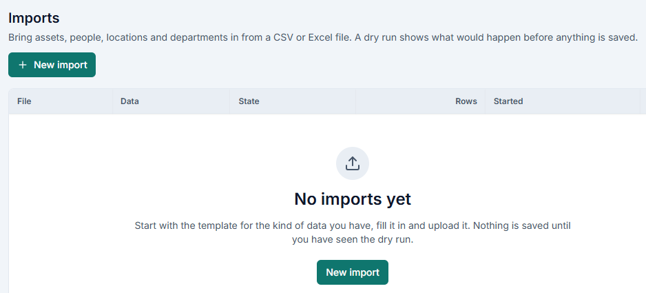
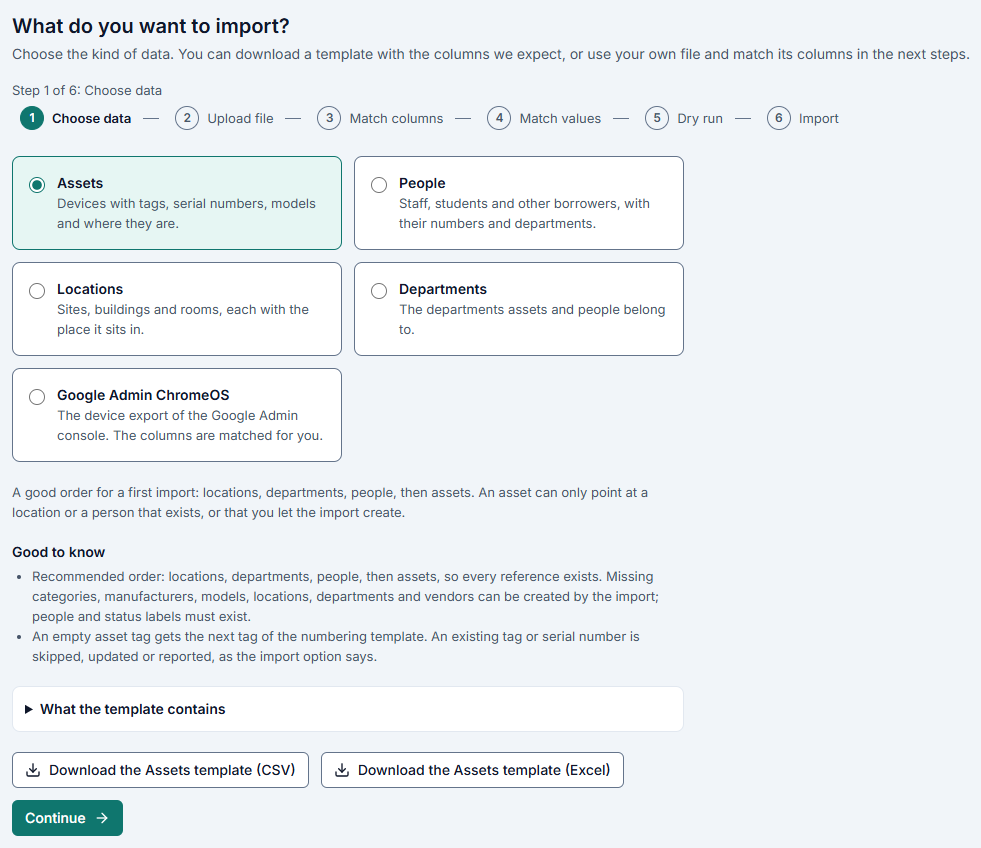
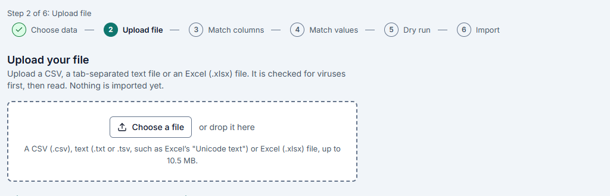
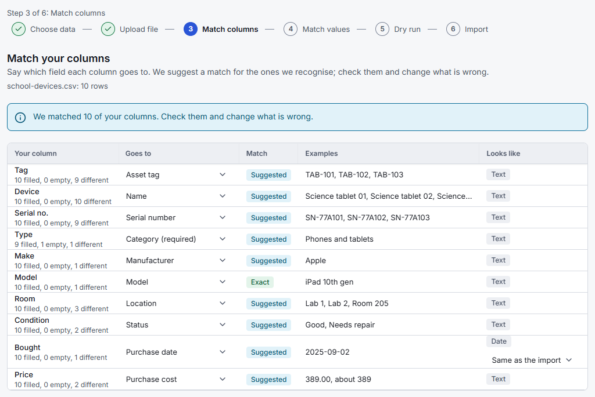
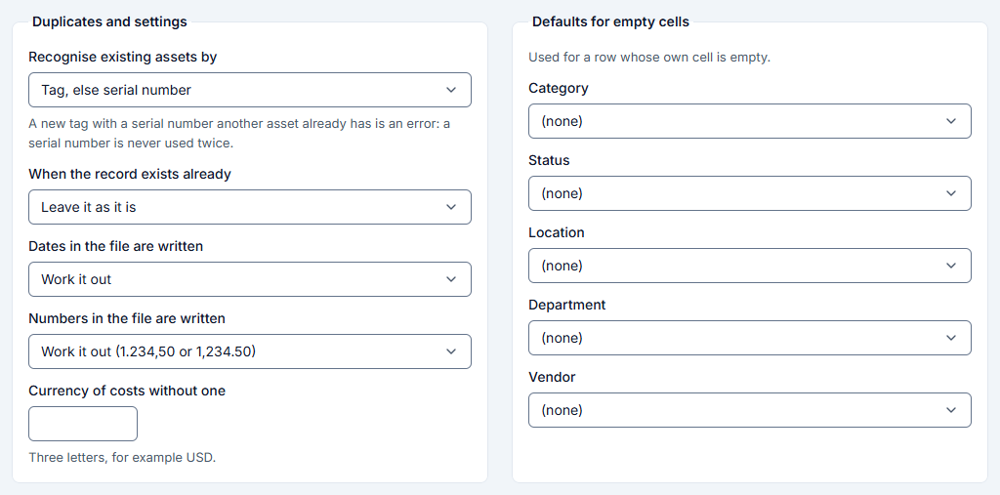
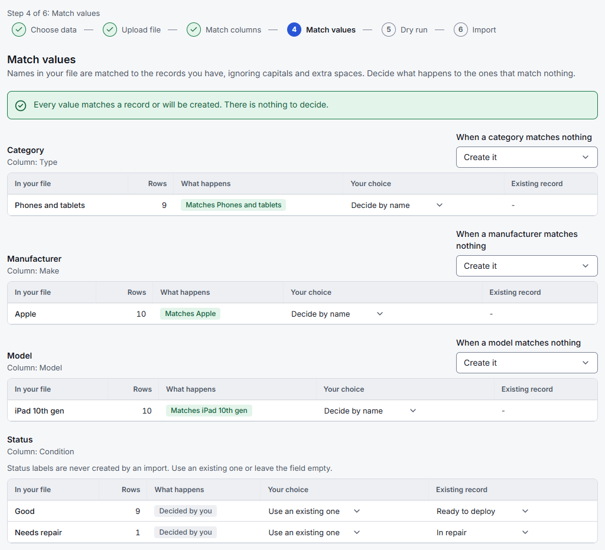
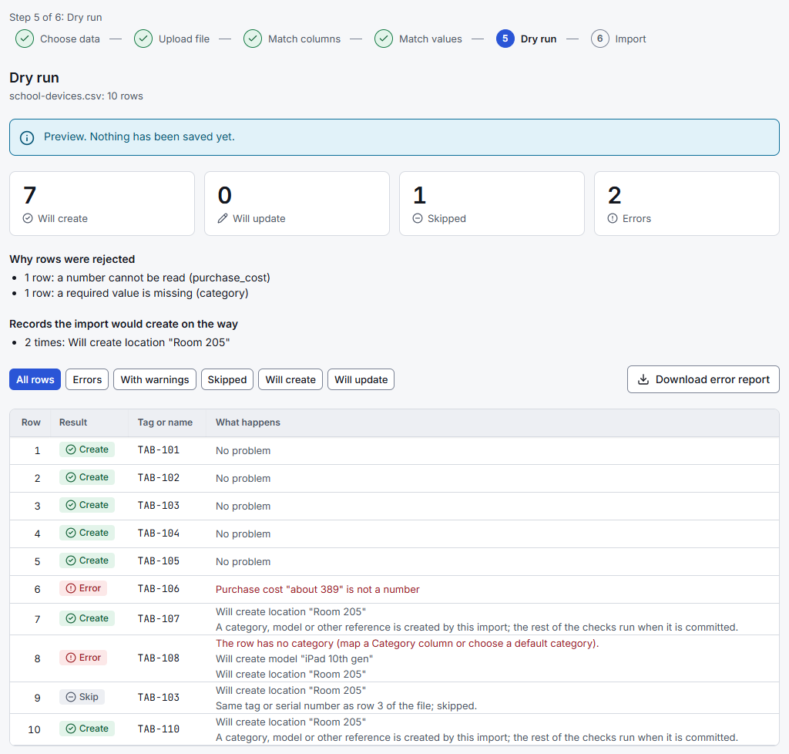
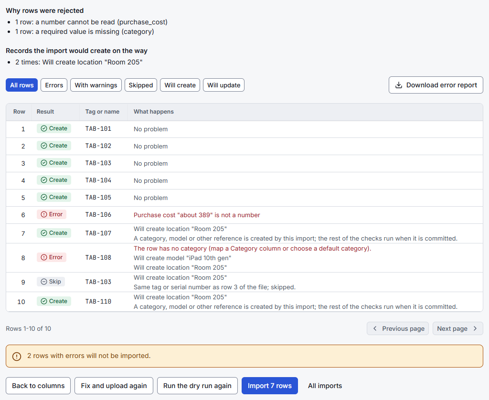
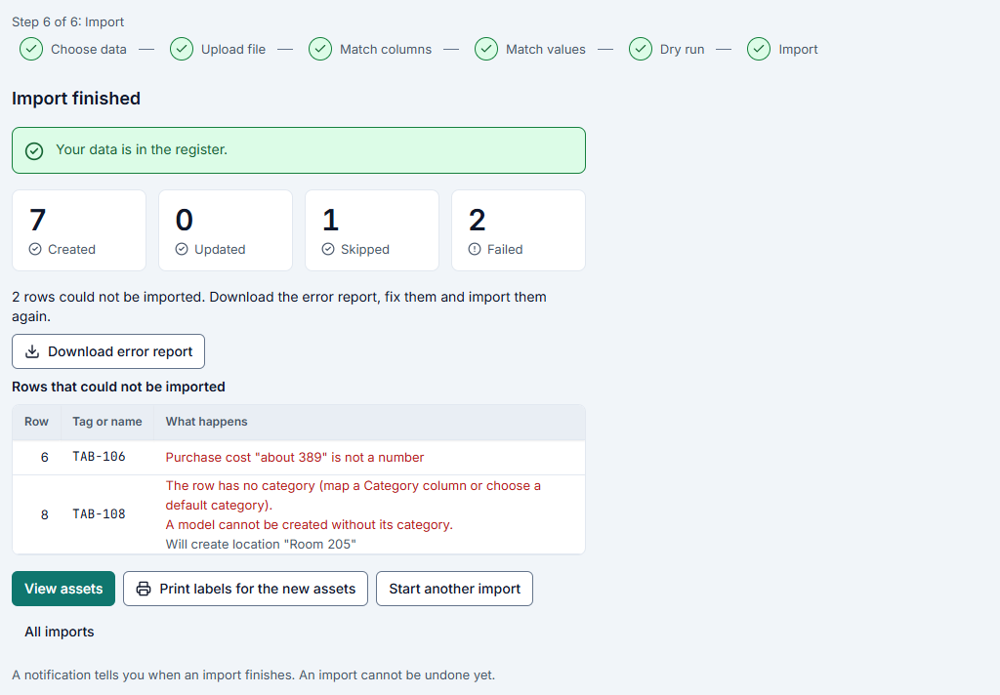

# Import your spreadsheet (CSV or Excel)

Bring the devices you already track in a spreadsheet into the Asset Tracker, in one go. You upload the file, say which
column is which, look at a preview, and only then save. This guide uses a small list of science tablets as the example.

**Who can do this:** Administrators and Asset managers (the people who may "run imports").
**How long it takes:** about ten minutes for a list you have already cleaned up.

## Before you start

- **Your file.** A CSV file or an Excel file saved as **.xlsx** (the old **.xls** format is refused: open it in Excel and
  use Save As). Keep the rows on the first sheet, with the column titles in the first row. A file can hold up to 100,000
  rows. The upload screen shows the size limit.
- **One row per device.** Every device needs a **category** (for example "Laptops" or "Phones and tablets"). If your
  sheet has no category column, you can choose one category for the whole file in step 4.
- **Get the order right.** An asset can only point at things that exist, or that the import is allowed to create:
  - Created for you if missing: categories, manufacturers, models, locations, departments and suppliers (vendors).
  - **Must exist already:** people (the "Assigned to" column) and status labels. Import your people first if you want
    devices checked out to them (use **People** on the first screen of the same wizard).
  - A good order for a first import: locations, departments, people, then assets.
- **A template helps.** The first screen offers a template with the columns the tracker expects (CSV or Excel). You do
  not have to use it: you can match your own column names in step 4.
- **Make a copy** of your spreadsheet. Nothing in it is changed, but it is good practice, and you will want it to fix
  mistakes.

> A sample file for this guide is in [`tools/samples/school-devices.csv`](tools/samples/school-devices.csv). It has two
> deliberate mistakes, so you can see how errors are shown.

## Steps

### 1. Open the import wizard

Go to **Assets** and press **Import** (top right), or open **Settings** and choose **Imports**, then press **New
import**. The list shows your earlier imports; on a new installation it is empty.

### 2. Choose the kind of data

Pick **Assets** and press **Continue**. If you want a template first, press **Download the Assets template (CSV)** or
**Download the Assets template (Excel)**. **What the template contains** explains every column.

### 3. Upload your file

Press **Choose a file** (or drop the file on the box). The file is checked for viruses and then read. This takes a few
seconds. Nothing is imported yet.

### 4. Match your columns

The screen lists every column of your file. For each one it suggests where it goes (the **Goes to** column) and shows
how sure it is: **Exact**, **Suggested** or **Chosen by you**. It also shows examples from your file, so you can check
at a glance.

1. Look at each row. If a suggestion is wrong, open the list in **Goes to** and pick the right field. Choose **(Do not
   import)** for a column you do not need.
2. Make sure the **Category (required)** field is matched to a column. No category column? Choose one under **Defaults
   for empty cells**.
3. Below the table, check **Duplicates and settings**:

   - **Recognise existing assets by**: how the tracker decides that a row is a device it already has (**Tag, else
     serial number** is a good choice: a row is the device with its tag, or with its serial number when the row has no
     tag). With this choice a row with a **new** tag whose serial number another device already has is an error
     ("Serial number ... is already used by ..."): the same serial number is never given to two devices. Check whether
     the row is that device with a new label, or a typing mistake.
   - **When the record exists already**: **Leave it as it is**, **Update it with the file**, or **Report an error**.
   - **Dates in the file are written**: if your dates are like `03/11/2025`, say whether that is day/month/year or
     month/day/year. If you leave **Work it out**, the tracker asks you when a date can be read two ways.
   - **Numbers in the file are written** and **Currency of costs without one**.

   

4. If you will import a file like this again, type a name under **Saved mappings** and press **Save this mapping**.
   Next time, choose it and your columns are matched at once.
5. Press **Continue**.

### 5. Match values

Now the tracker compares the _words_ in your file with the records it has: categories, manufacturers, models, statuses
and locations. Capital letters and extra spaces do not matter.

For each word the **What happens** column says one of:

- **Matches …**: it found the record, and the dry run will use it.
- **Will be created**: it does not exist yet and will be made (not allowed for statuses).
- **Not found: its rows will be errors**: you must decide. People are never created unless you say so: a name or
  e-mail address in the **Assigned to** column that is not in **People** makes its rows errors.
- **Needs a decision: its rows will be errors**, with the reason under it: a record of that name exists, but the rows
  would still fail. Two cases: a room name such as "Lab 1" that several places have (also when your file creates one,
  for example from "Main Building / Lab 1"), and a model that exists under another category than the rows' own.
  Choose the right record under **Use an existing one**, write the full path ("Main Building > Lab 1") in your file, or
  point the category at the model's category.

This screen uses the same rules as the dry run, so a word it shows as matched never fails later for its name. To
decide, use **Your choice**: **Use an existing one**, **Create it** or **Leave it empty**. Status labels are never
created by an import, so words such as "Good" or "Needs repair" must be pointed at a status you have (here **Ready to
deploy** and **In repair**). The shortcut **Create all that are missing** creates everything that can be created.

When every word is settled, press **Run the dry run**.

### 6. Read the dry run

The dry run checks every row exactly as the real import would, but **saves nothing**. The banner says so: **Preview.
Nothing has been saved yet.**

The four boxes tell you the story: **Will create**, **Will update**, **Skipped** and **Errors**. Under them:

- One line under the banner says what was checked now: every row, including against the categories, models, locations
  and departments the import creates on the way (they are made for the check and taken back). Only what can change
  before you press **Import** (a tag or serial number someone else takes, a record someone edits) is decided then. In a
  locations import, the rows below a parent location that the same import creates are counted in that line too: their
  last checks run when you import.

- **Why rows were rejected** lists the problems, in plain words, with the column they are about.
- **Records the import would create on the way** lists the places and models that will be made, for example the new
  room in the example.
- The buttons **All rows**, **Errors**, **With warnings**, **Skipped**, **Will create** and **Will update** filter the
  table. Every row shows its number in your file, the tag or name, and **What happens**.
- A row that repeats an earlier tag or serial number is **Skipped** (the message names the first row), not an error.
- A summary line at the end of the sheet, a single cell such as "TOTAL ITEMS: 120", is **Skipped** with "A summary
  line (...), not data; skipped."

### 7. Fix the errors, or leave them out

At the bottom of the preview you have three honest options:

- **Fix and upload again**: go back, correct your spreadsheet, upload it again. Best when there are many errors.
- **Download error report**: a CSV file with one line for each rejected row. Open it in Excel (see "The error report"
  below), correct the rows, and import them in a later run.
- **Import N rows**: import the good rows now. The rows with errors are **not** imported (an orange banner says how
  many). You can import the corrected rows afterwards.

**Back to columns** lets you change your matching, and **Run the dry run again** repeats the check after you changed
something.

### 8. Import

Press **Import 7 rows** (the number is the number of good rows). A progress bar shows **Imported x of y rows**. You can
leave the page: the import keeps running and you can come back from **All imports**. A notification in the bell tells you
when it is done.

### 9. Check the result

**Import finished** shows how many records were **Created**, **Updated**, **Skipped** and **Failed**, and lists the
rows that could not be imported.

- **View assets** opens the register.
- **Print labels for the new assets** opens the **Print labels** window for exactly the assets this import created
  ("7 assets match the current filter" in the example; see [Print and apply labels](03-print-and-apply-labels.md)).
- **Download error report** is here again.

An import cannot be undone yet. If something came in wrong, fix the assets in the register (or archive them).

## The error report

The error report is an ordinary CSV file. Each line starts with five extra columns, followed by **your own columns,
unchanged**, so you can correct the row in place:

| Column     | What it tells you                                   |
| ---------- | --------------------------------------------------- |
| `Row`      | The number of the row among your data rows          |
| `Line`     | The line in the file (it counts the title line too) |
| `Fields`   | The field the problem is about                      |
| `Problems` | What is wrong, in words                             |
| `Warnings` | Things the import will do on the way                |

For the example file the report says: row 6, field `purchase_cost`, "Purchase cost "about 389" is not a number", and
row 8, fields `category, model`, "The row has no category (map a Category column or choose a default category)" (the
model is named too, because it can only be matched once the device has a category). Correct those
two cells in your spreadsheet, then upload the file again. Rows that were already imported are **left as they are**
(with the default setting **Leave it as it is**), so only the two corrected devices are created.

## How long the details are kept

After an import has finished, the tracker keeps the **rows of your file, the sample cells and the uploaded file for 30
days**, then removes them. The counts, the settings and the history stay. After that, the import page says **The
details of this import were removed**, the table of rows is gone and the error report is empty. So:

- **Download the error report before the 30 days are over** if you still need it.
- The devices themselves are ordinary records and are never removed by this.
- The reason: the file can contain personal data (names, e-mail addresses), and keeping it forever would be a risk
  without a benefit. Whoever runs your installation can change the period.

## If something goes wrong

| What you see                                                               | What it means and what to do                                                                                                                      |
| -------------------------------------------------------------------------- | ------------------------------------------------------------------------------------------------------------------------------------------------- |
| "Old Excel files (.xls) are not supported."                                | Open the file in Excel and choose Save As, **Excel Workbook (.xlsx)** or **CSV**.                                                                 |
| "a number cannot be read"                                                  | A cost cell holds text such as "about 389". Make it a plain number.                                                                               |
| "a required value is missing (category)"                                   | The row has no category. Fill it in, or choose a default category in step 4.                                                                      |
| "a date can be read two ways"                                              | `03/11/2025` could be 3 November or 11 March. Choose how dates are written under **Dates in the file are written**.                               |
| "Not found: its rows will be errors" (step 5)                              | A word in your file matches nothing and cannot be created (statuses, people). Use **Use an existing one**, or **Leave it empty**.                 |
| "Same tag or serial number as row N of the file; skipped."                 | Two rows describe the same device. The first one wins. Remove the duplicate from your sheet if it is a mistake.                                   |
| "Serial number ... is already used by ..."                                 | The row has a new tag, but another device has that serial number. Use that device's tag, correct the serial number, or leave the row out.        |
| "Needs a decision: its rows will be errors" (step 5)                       | The name exists, but the rows would still fail (the reason is under it). Choose a record under **Use an existing one**, or write the full path.  |
| "... matches 2 locations ...; write the full path ..."                     | Several places have that room name. Write the whole path in your file, such as "Main Building > Lab 1", or decide it in step 5.                  |
| "a value is too long or too large"                                         | A cell is longer than its field allows; the row says the limit ("Too long: at most 200 characters."). Shorten it.                                |
| "The record was edited after the dry run"                                  | Somebody changed that asset between the preview and the import. It was left alone. Run the import again for that row.                             |
| "The file, your choices or the dry run changed after the one you reviewed" | Something changed after you looked at the preview. Press **Run the dry run again** and review the new result.                                     |
| "Too many imports are running at once."                                    | The organisation can run only a few imports at the same time. Wait a moment and try again.                                                        |
| "You can see where this import stands, but not the rows of the file."      | Your role may look at imports but not run them. Ask an Administrator or Asset manager.                                                            |
| The screen stays on "Reading your file..."                                 | The file is first checked for viruses and then read. Wait a minute. If an error appears instead, press **Check again**, or upload the file again. |
| **Nothing to import**                                                      | Every row has an error or is skipped. Fix the file and press **Fix and upload again**.                                                            |
| You pressed **Import** and want to stop                                    | Press **Cancel import**. The import stops after the current batch; rows already written stay in the register.                                     |
| You closed the page in the middle                                          | Nothing is lost. Open **Imports** and press **Continue** next to the unfinished import.                                                           |

## Related guides

- [Import from Google Admin (ChromeOS)](02-import-from-google-admin.md), the same wizard with the columns matched for
  you.
- [Schools (K-12): students, homerooms and carts](08-schools-k12-mapping.md), how to import students.
- [Print and apply labels](03-print-and-apply-labels.md), the next step after an import of assets.
