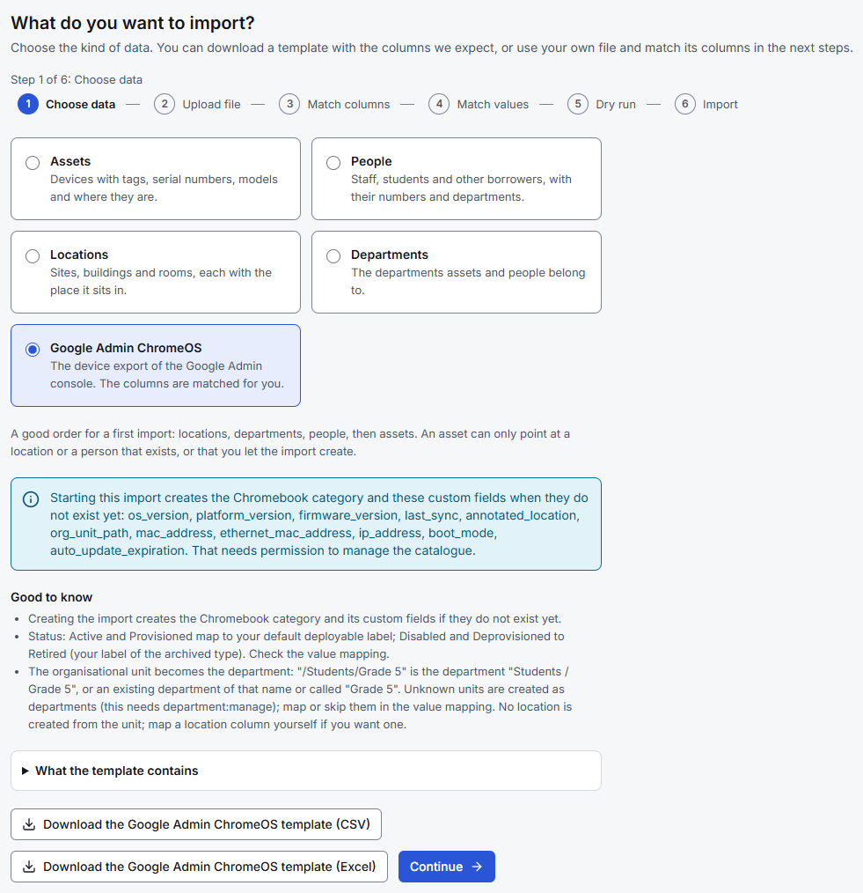
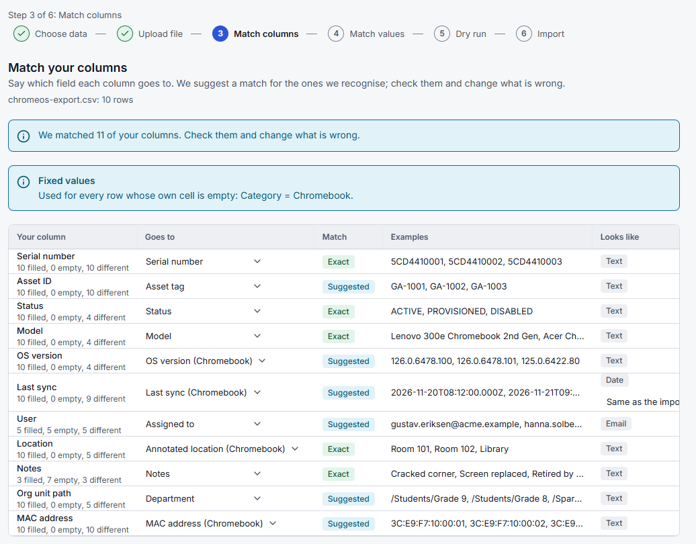
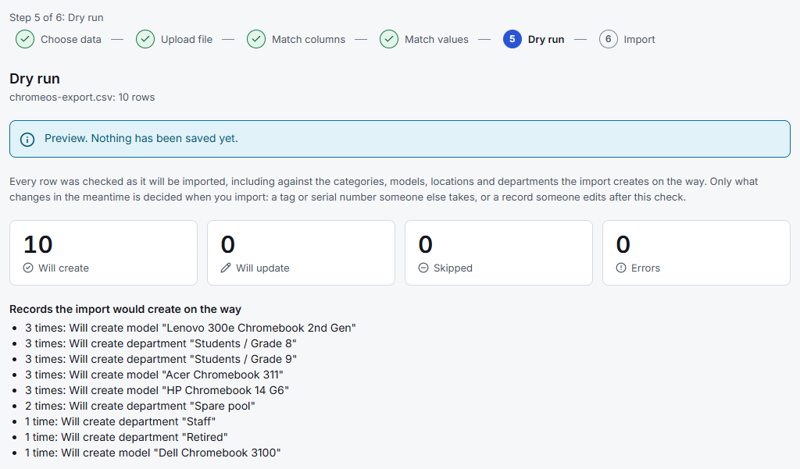
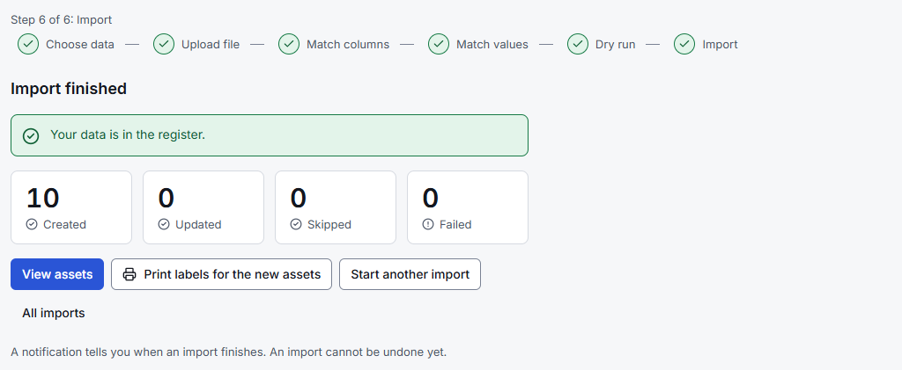
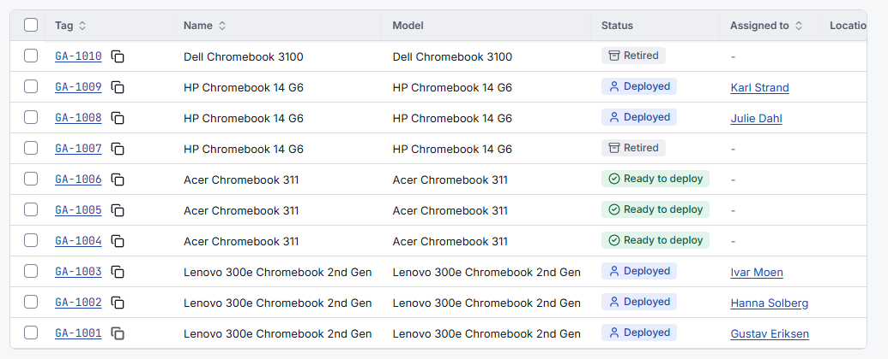

# Import from Google Admin (ChromeOS)

Bring every Chromebook your school manages in Google Admin into the Asset Tracker. The tracker already knows what the
Google device export looks like, so the columns are matched for you. This guide uses ten example Chromebooks.

**Who can do this:** an Administrator or an Asset manager. Both can run the first import, which creates the "Chromebook"
category (needs permission to manage the catalogue) and the departments of new organisational units (needs
`department:manage`). A role limited to one site cannot, because it never holds those two permissions.
**How long it takes:** about five minutes, plus the time Google needs to prepare the export.

## Before you start

- **Put the facts in Google Admin first.** In the Google Admin console you can write an **asset ID**, a **user** and a
  **location** (these are called annotations) on each device. They arrive in the export as the columns **Asset ID**,
  **User** and **Location**. The Asset ID becomes the asset tag on your label, so it is worth filling in.
- **Create the people first.** The **User** column is the person the Chromebook is checked out to. The tracker never
  makes people from an asset import: a user it does not know makes that row an error. Import your students and staff
  first (see [Schools (K-12)](08-schools-k12-mapping.md); use the **People** kind in the same wizard), matched by their
  e-mail address.
- **Know what it will create.** The first import creates the **Chromebook** category and a set of custom fields for it
  (OS version, platform version, firmware version, last sync, annotated location, organisational unit, MAC address,
  Ethernet MAC address, IP address, boot mode, auto-update expiration). Models are created as needed, and each
  organisational unit becomes a **department** (created if it does not exist yet, which needs `department:manage`). No
  location is created from the export: if you want the Chromebooks in a place, add a column with your own location (for
  example the school site) to the file and map it to **Location**.
- A sample file for this guide is in [`tools/samples/chromeos-export.csv`](tools/samples/chromeos-export.csv).

## Steps

### 1. Export the devices from Google Admin

1. Sign in to the Google Admin console as an administrator.
2. Open **Devices**, then **Chrome**, then **Devices**.
3. Narrow the list if you want only some devices (for example one organisational unit), then use the **Export**
   button above the list and choose the CSV download. Google may send the file to your Google Drive or by e-mail.
   (Google changes the wording of its console from time to time. What you need is the device list as a CSV file.)
4. Do not edit the file. The tracker reads Google's own column titles, such as **Serial number**, **Status**, **Model**
   and **Org unit path**.

### 2. Start the import

In the tracker, open **Assets** and press **Import**, or go to **Settings**, **Imports**, **New import**. Choose
**Google Admin ChromeOS** and read the blue box: it lists what the import will create. If you want the template (a file
with the right column titles) press **Download the Google Admin ChromeOS template (CSV)**. Then press **Continue**.

### 3. Upload the export

Press **Choose a file** and select the CSV. After a few seconds you see the columns, already matched:

Check these three things, which surprise people most:

- The blue box **Fixed values** says **Category = Chromebook**: every row becomes a Chromebook.
- Google's **Org unit path** (for example `/Students/Grade 9`) becomes the asset's **Department**, named
  **Students / Grade 9**. An existing department with the same name, or named after the last part (**Grade 9**), is
  used instead of a new one. Google's own **Location** note goes to the custom field **Annotated location
  (Chromebook)**; it does not create a location. To give the devices a location, add your own location column and map it
  to **Location**.
- **User** goes to **Assigned to**: the Chromebook is checked out to that person. (The setting **Check an asset out to
  the person in "Assigned to"** under **Duplicates and settings** is ticked for you. Untick it if you only want the
  devices, not who has them.)

Press **Continue**.

### 4. Check how the statuses are matched

If a **Match values** screen appears, look at the **Status** and **Department** rows. Google's statuses are matched
like this:

| Google says     | The tracker uses                                                    |
| --------------- | ------------------------------------------------------------------- |
| `ACTIVE`        | your default "ready" status (in the demo data: **Ready to deploy**) |
| `PROVISIONED`   | the same                                                            |
| `DISABLED`      | your archived status (in the demo data: **Retired**)                |
| `DEPROVISIONED` | the same                                                            |

Change any of them with **Your choice** if your school uses other words. A **Retired** Chromebook cannot be lent from a
loaner cart; the import writes no repair record for it (see [Log a repair](05-log-a-repair.md)).

Each organisational unit is a **Department** row. A unit that matches an existing department (same name, or the same last
part) uses it; any other unit is created as a new department. Point a unit at one of your existing departments with
**Use an existing one**, or skip it with **Leave it empty** (the devices of that unit get no department), if you do not
want a new department for it.

Press **Run the dry run**.

### 5. Read the dry run

Nothing is saved yet. The boxes show how many devices will be created or updated. The list **Records the import would
create on the way** shows the new models and departments (for example **Students / Grade 9**), and the table shows every
device.

Under the banner, one line says what was checked: every row was checked as it will be imported, including against the
category, models and departments the import creates on the way. Only what changes before you press **Import** (a tag
or serial number someone else takes in the meantime) is decided then. Rows that really have a problem are listed under
**Errors**; see [Import your spreadsheet](01-import-your-spreadsheet.md) for how to read and fix them.

### 6. Import

Press **Import 10 rows**. When it is done, **Import finished** shows what was created.

Press **View assets**. The Chromebooks are in the register, with their holder, department and status. The disabled and
deprovisioned ones show **Retired**, and the departments from the organisational units are listed under **Settings**,
**Departments**.

### 7. Next term: import again

Export the devices again from Google Admin and run the same import. For this kind of import the settings under
**Duplicates and settings** are already right: devices are **recognised by their serial number**, and **When the record
exists already** says **Update it with the file**. Nothing is made twice. A device that has not changed is listed as
**Skipped** ("Nothing to change; left as it is."); one that has (a new OS version, a new last sync, another user) is
updated. An asset that is checked out to somebody keeps its status.

## If something goes wrong

| What you see                                                                                            | What to do                                                                                                                                            |
| ------------------------------------------------------------------------------------------------------- | ----------------------------------------------------------------------------------------------------------------------------------------------------- |
| "Starting this import creates the Chromebook category … That needs permission to manage the catalogue." | Ask an Administrator or an Asset manager to run the first import (a site-limited role cannot create the category).                                                              |
| A row says a record "does not exist" for the **User**                                                   | That person is not in **People** yet, or the e-mail address is different. Import the people first, or fix the address, and run the import again.      |
| A device shows **Retired**                                                                              | It was **DISABLED** or **DEPROVISIONED** in Google. Re-enable it in Google and import again, or change its status in the register.                    |
| Devices have no asset tag you recognise                                                                 | Their **Asset ID** was empty in Google. The tracker gave them the next number of your tag numbering. Fill in the Asset ID in Google and import again. |
| New departments such as **Students / Grade 9** or **Staff** appeared                                    | They come from the **Org unit path**. Rename or merge them under **Departments**, or map the units to existing departments in **Match values**.       |
| The same device is listed twice                                                                         | Two rows have the same serial number: the first wins and the second is **Skipped**.                                                                   |

## Related guides

- [Import your spreadsheet (CSV or Excel)](01-import-your-spreadsheet.md): the same wizard in more detail, and the error
  report.
- [Run a loaner day](04-run-a-loaner-day.md): put the spare Chromebooks on a cart.
- [Print and apply labels](03-print-and-apply-labels.md).
