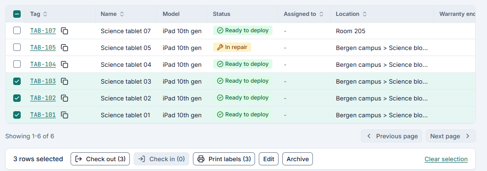
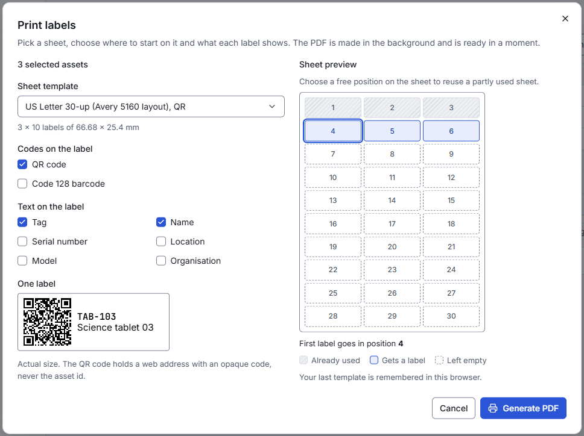
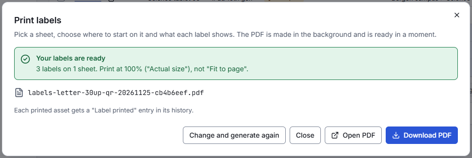

# Print and apply labels

Print a sheet of labels with a QR code (and, if you like, a barcode) for your devices, stick them on, and check that a
scan finds the device. This guide uses three science tablets and a sheet of 30 labels that was already partly used.

**Who can do this:** anyone who may print labels (Administrators, Asset managers and Technicians).
**How long it takes:** a few minutes, plus one test print.

## Before you start

- **Know your label stock.** Look at the box of your label sheets: the brand and number (for example "Avery 5160") and
  the paper size (US Letter or A4). The tracker has templates for the common sheets:

  | Template                                                            | Use for                                 |
  | ------------------------------------------------------------------- | --------------------------------------- |
  | US Letter 30-up (Avery 5160 layout), QR                             | 3 x 10 small address-size labels        |
  | A4 21-up (Avery L7160 layout), QR                                   | A4 sheets of 21                         |
  | A4 24-up, 3 x 8 (Avery L7159 layout), QR                            | A4 sheets of 24                         |
  | US Letter 10-up (Avery 5163 layout), QR and Code128                 | 2 x 5 larger labels, room for a barcode |
  | Single label 50 x 25 mm, QR (one per page)                          | a label printer that takes one per page |
  | Single label 2 x 1 inch for thermal / roll printers, QR and Code128 | a thermal roll printer                  |

- **Your assets need tags.** Every asset has a tag (the text such as `TAB-101`). If you imported your devices, they have
  one already.
- **A printer** that can print at exactly 100 % size. Check that the printer has the sheet in the right way round.
- **A plain sheet of paper** for the test print.

## Steps

### 1. Choose the assets

Open **Assets**. Use the search box and the filters to find the devices, then tick the box in front of each one. You can
also tick the box in the table heading to select the whole page.

A bar under the table says "3 rows selected" and offers **Print labels (3)** (the number is how many you ticked). To print a label for **every
asset the current search and filters show**, press **Print labels for this filter** instead (at most 2,000 labels in one
go). On one asset's page, the **Print labels** button prints just that asset.

### 2. Pick the sheet and where to start

Press **Print labels (3)**. The window **Print labels** opens.

1. **Sheet template**: choose the one that matches your label stock. The line under it tells you the grid, for example
   "3 x 10 labels of 66.68 x 25.4 mm".
2. **Codes on the label**: **QR code** is on by default. Add **Code 128 barcode** if you have a barcode scanner that
   reads barcodes (a QR code can be read by a phone camera or by a scanner that reads QR codes). With no code ticked,
   the labels carry text only.
3. **Text on the label**: choose what is printed next to the code: **Tag**, **Name**, **Serial number**, **Location**,
   **Model**, **Organisation**.
4. **One label** shows a preview at the real size. Check that the text fits.
5. **Sheet preview** shows the sheet. If the sheet was already used, click the first **free** position, so the labels
   fill the gaps. Positions you cannot choose are marked **Already used**, the ones that will be printed **Gets a
   label**, and the rest **Left empty**. If the batch needs more than one sheet, use the arrows (**Sheet 1 of 7**) to
   look at the others. The text **First label goes in position 4** confirms your choice.
6. Press **Generate PDF**.

The tracker remembers your last template in this browser.

### 3. Download the PDF

The PDF is made in the background and is usually ready in a few seconds. The window says **Your labels are ready**, for
example "3 labels on 1 sheet", and offers **Download PDF** and **Open PDF**. You can also close the window: a
notification **Labels ready** arrives in the bell.

### 4. Print a test page first

This is the step that saves your good label sheets.

1. Print the PDF on a **plain sheet of paper**.
2. **Print at 100 %**, also called **Actual size** or **No scaling**. Do not choose **Fit to page**: that shrinks the
   labels, and they will drift off the stickers more and more from top to bottom. The window reminds you of it.
3. Hold the printed page against a blank label sheet, up to a lamp or a window. Every box should sit inside a label,
   with a small margin all round.
4. If it fits, load the real label sheet and print again. Load it the way your printer manual says (many printers need
   the label side down or up, depending on the model).

If it does not fit, see "If something goes wrong" below.

### 5. Stick the labels on

- Pick the same spot on every kind of device (for example, the lid of a laptop, the back of a tablet), so people
  know where to look. A flat, clean, dry, smooth surface works best; wipe it first with a dry cloth.
- Press the label down from the middle outwards.
- Do not cover air vents, ports or serial-number plates.

### 6. Check that it scans

Use the box **Scan or type tag** at the top of every page (press `/` to jump to it). Scan the label with a USB barcode
scanner, or type the tag. The asset opens. A phone camera reads the QR code as a web address: it takes you to the
sign-in page first and then to the asset. The QR code holds a web address with an opaque code, never the asset's
internal number.

Every printed asset gets a **Label printed** entry in its history.

## If something goes wrong

| What you see                                                                     | What to do                                                                                                                                                                                                                    |
| -------------------------------------------------------------------------------- | ----------------------------------------------------------------------------------------------------------------------------------------------------------------------------------------------------------------------------- |
| Labels drift off the stickers, getting worse towards the bottom                  | Printed with **Fit to page** or scaling. Print again at 100 % (**Actual size**).                                                                                                                                              |
| Everything is shifted the same amount in one direction                           | Printers differ by a millimetre or two. Ask your administrator to correct the template; there is no screen for that yet, so they use the API. Meanwhile, test on plain paper and use a different template if one fits better. |
| The labels never match, whichever template you choose                            | The templates follow the published sizes of common stock, but have not yet been tested against every brand. Try a single-label template, or write down the brand and number of your sheets and tell your administrator.       |
| "One batch holds at most 2000 labels. Narrow the filter or select fewer assets." | Print in several batches.                                                                                                                                                                                                     |
| **The labels could not be made**                                                 | Press **Try again**. If it happens again, tell your administrator.                                                                                                                                                            |
| **This PDF has expired**                                                         | The file is only kept for 7 days. Press **Change and generate again**.                                                                                                                                                        |
| The scan does nothing                                                            | The scanner may be set to add a character or to use a different keyboard layout. Scan into a text editor to see what it types. See your scanner's manual.                                                                     |
| A QR code does not read from a distance                                          | Print a larger template (for example Avery 5163 instead of 5160) or use a single-label template.                                                                                                                              |
| A label has a smudge or the wrong tag                                            | Print it again: select that one asset, choose a free position on a used sheet.                                                                                                                                                |

## Related guides

- [Import your spreadsheet](01-import-your-spreadsheet.md): after an import, **Print labels for the new assets** takes
  you here.
- [Run a loaner day](04-run-a-loaner-day.md): the desk reads these labels.
