# Run a loaner day

A **loaner pool** is a set of spare devices (a cart of tablets, a drawer of laptops) that go out for a few days and come
back. This guide sets up a pool, shows how the desk lends and takes back devices by scanning, and explains the dashboard
and the reminders. The example is a cart of science tablets.

**Who can do this:** setting up pools needs Administrator or Asset manager. Lending and returning at the desk is also
open to Technicians. Everybody else can look at the dashboard.
**How long it takes:** about ten minutes to set up; a few seconds per device at the desk.

## Before you start

- **The devices are in the register, with tags and labels.** See [Import your spreadsheet](01-import-your-spreadsheet.md)
  and [Print and apply labels](03-print-and-apply-labels.md). The desk finds a device by the tag (or the label's code).
- **The borrowers are in People.** The desk finds a person by a scanned card or by typing a name, an e-mail address or a
  number. For students the number is the **Employee or student number**; see
  [Schools (K-12)](08-schools-k12-mapping.md).
- **A device that is not deployable cannot be lent.** A device that is **In repair**, **Broken** or **Retired** is
  refused at the desk the moment it is scanned: "CB-0007 is In repair and cannot be lent. Choose another device." See
  [Log a repair](05-log-a-repair.md).
- **A device is in one pool at most.**

## Part 1: Set up a pool

### 1. Look at the loan defaults

Open **Loaners**, then the **Pools** tab. At the top, **Loan defaults** has two numbers for the whole organisation:

- **Return date offered at check-out (days from today)**: the return date a regular check-out starts with, and the length
  of a loan for a pool that has no length of its own. The hint under it reads "Leave empty to offer no date at check-out.
  Loaner pools without their own length then lend for 7 days.": a pool with no length of its own, in an organisation that
  leaves this empty, lends for 7 days.
- **Remind the borrower (days before the due date)**: when the "due soon" reminder is sent. `0` sends no reminder.

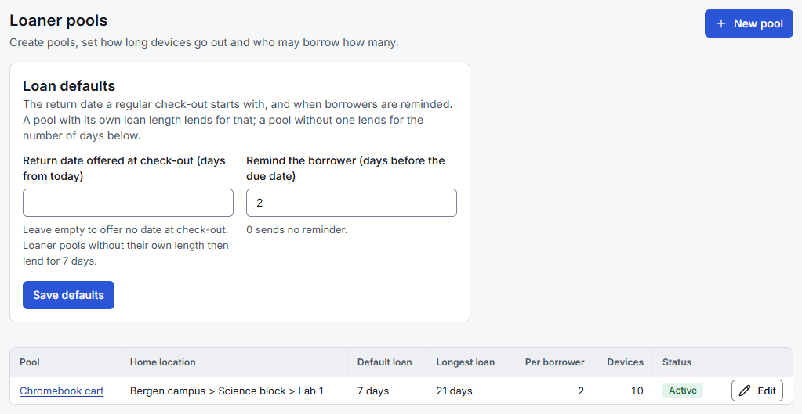

### 2. Create the pool

Press **New pool** and fill in the window **New loaner pool**:

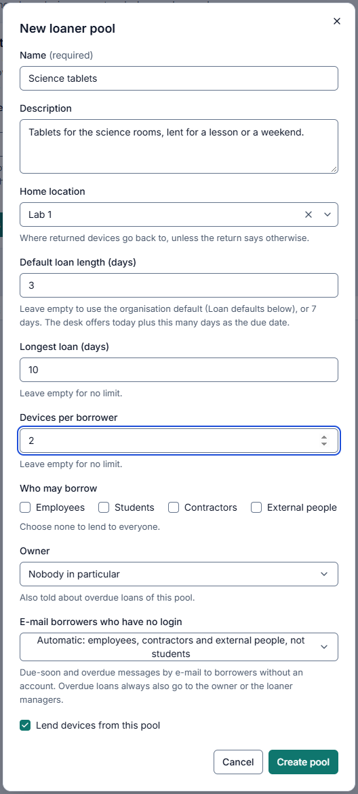

- **Name** and **Description**.
- **Home location**: where returned devices go back to, unless the return says otherwise.
- **Default loan length (days)**: how long a loan lasts. Leave it empty to use the organisation default; if that is
  empty too, the pool lends for 7 days.
- **Longest loan (days)**: no loan can be longer. Empty means no limit.
- **Devices per borrower**: for example 1 for a tablet cart. Empty means no limit.
- **Who may borrow**: tick the kinds of people (**Employees**, **Students**, **Contractors**, **External people**) the pool
  lends to. Tick none to lend to everyone.
- **Owner**: the person who is also told about overdue loans of this pool.
- **E-mail borrowers who have no login**: see "Reminders" below.
- **Lend devices from this pool**: untick to pause the pool.

Press **Create pool**.

**How the due date of a loan is chosen.** At the desk, the first of these that exists wins:

1. the date you pick at the desk (**Due date**, or the buttons **Tomorrow**, **In a week**, **Pool default**);
2. the pool's **Default loan length**;
3. the organisation's **Return date offered at check-out**;
4. 7 days.

A date that comes from 2 to 4 is cut to the pool's **Longest loan**. A date you type that is later than the longest
loan is refused. "Days" are counted from today, and "today" is the UTC date.

### 3. Add the devices

On the pool's page, press **Add device**, search by tag, serial number or name, choose the device, and press **Add to
pool**.

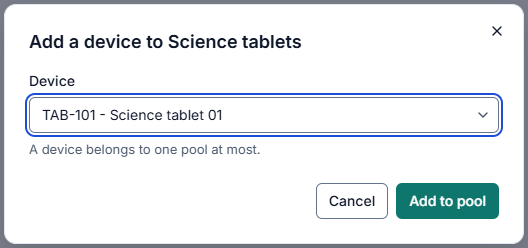

The page lists the devices with their **State**: **Available**, **On loan**, **Overdue**, **Due today**, or **Not
available** (the device is not deployable, for example **In repair**). The buttons **All**, **Available**, **On loan**,
**Overdue** and **Due today** filter the list.

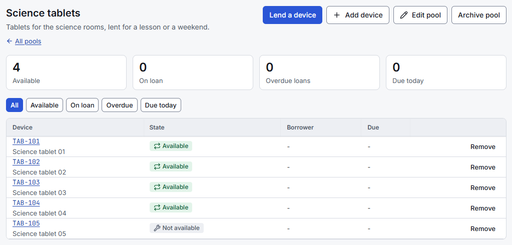

To take a device out of the pool, press **Remove** (it must be back first).

## Part 2: The desk

Open **Loaners** and press **Loaner desk** (or choose the **Desk** tab). It works with a USB barcode scanner from
anywhere on the page, and with a keyboard.

### Lend devices

1. Choose the pool in **Lend from**.
2. **Scan each device** (or type its tag and press Enter). The devices appear in a list. Remove a wrong one with the
   **x** next to it.
3. **Scan the borrower's card**, or type a name, e-mail address or number in **Borrower** and press Enter. If several
   people match, choose from the list. **Change borrower** starts again.
4. Check the **Due date**. It is already filled in from the pool ("The pool lends for 3 days. The latest date the pool
   allows is Dec 5, 2026."). Change it with the date box or the buttons.
5. Press **Lend 2 devices** (or press Enter).

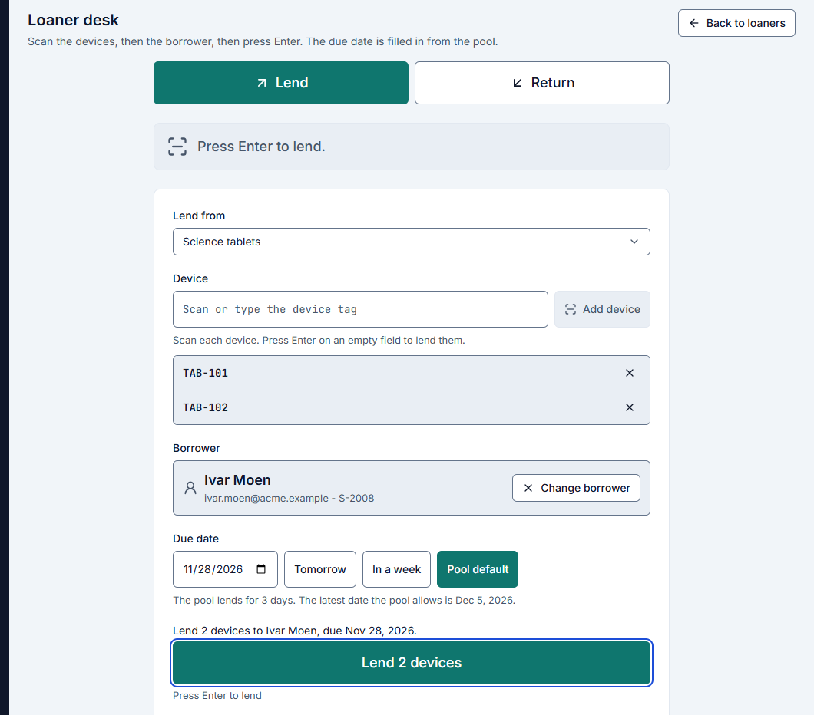

The desk confirms in green, for example "2 devices lent to Ivar Moen, due Nov 28, 2026." If some devices could not be
lent, the message says so and the list shows the reason next to each one (for instance "CHR-00006 is already out.").

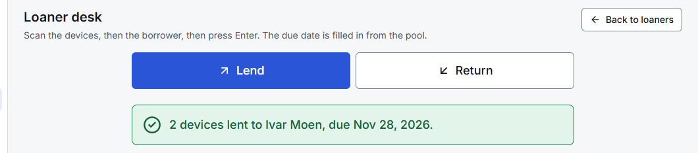

### Lend the next available device

No device in hand, or no preference? Let the pool choose:

1. Choose the pool in **Lend from** and find the **Borrower** (scan the card or type a name). The button needs a
   borrower; the device list stays empty.
2. Check the **Due date**.
3. Press **Lend next available device**.

The pool picks the device that has been idle the longest (one that was never lent comes first; between equals, the
lowest tag), so the wear is spread over the cart. It is lent to the borrower at once, and its tag is shown large: "TAB-103
is the next available device: lent to Ivar Moen, due Nov 28, 2026. Hand over TAB-103." Take that device from the cart.
If nothing is free, the desk says "No device of this pool is free."

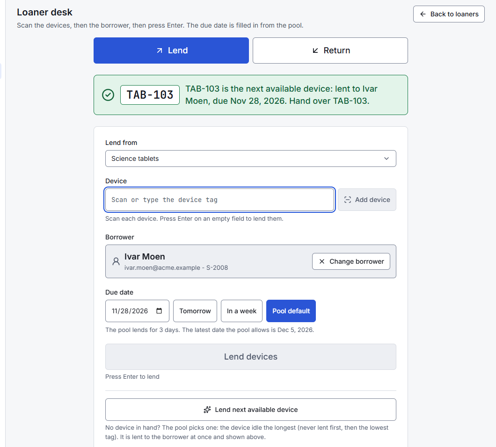

### Take devices back

1. Press **Return** at the top of the desk (or **Bulk return** on the Loaners page).
2. Scan each device as it comes back. Every scan returns it at once: "TAB-101 returned." A late device says so ("returned,
   2 days late").
3. Problems (a device that is not on loan, for example) are listed below the box. **This session** shows everything you
   scanned.

The device goes back to the pool's **Home location**.

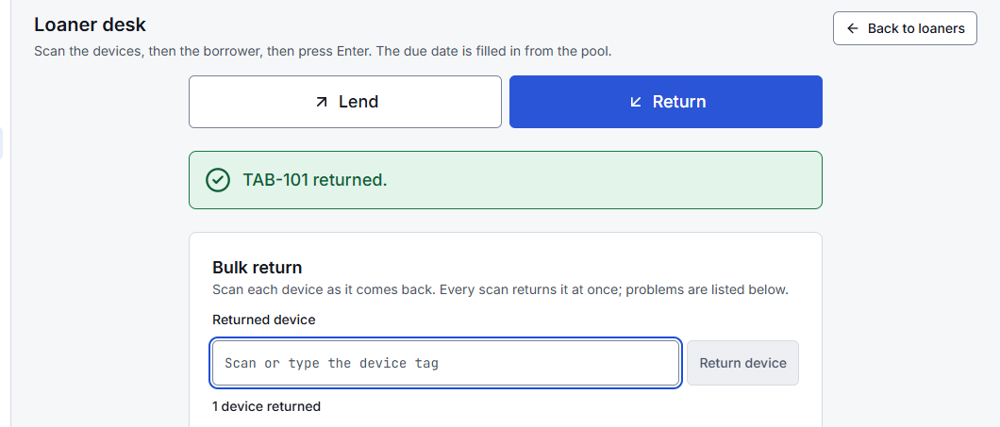

## Part 3: The dashboard and the alerts

### The dashboard

Open **Loaners**. At the top, the numbers for all pools together: **In pools**, **Available**, **On loan** and
**Overdue loans**. Each pool has a card with its own **Available**, **On loan**, **Overdue loans** and **Due today**.

Under it, **Overdue loans** lists every overdue device with the borrower, how to reach them (e-mail and number) and **how
late** it is. Use the list above the table to look at one pool. **Recent activity** shows the last loans and returns.

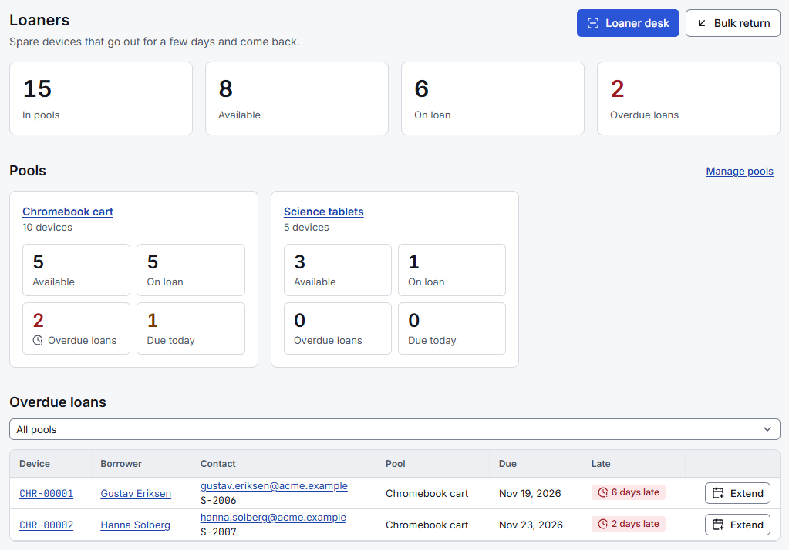

To give a borrower more time, press **Extend** next to the loan, choose **New due date** (it must be later than the
current one and within what the pool allows), add a reason if you want, and press **Extend loan**.

The main **Dashboard** has five tiles across the top (**All assets**, **Ready**, **Assigned**, **Not deployable** and
**Overdue check-outs**), two charts, and under **Needs attention** a table **Overdue check-outs** with the asset, the
holder, the due date and the status. It counts every checked-out device past its return date, loans included, as the line
under its title says, so its number can be higher than **Overdue loans**. The link **Overdue loans only** under the table
opens the loaner dashboard.

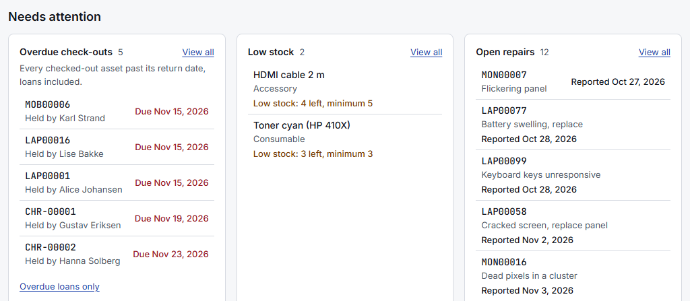

### Reminders

Once a day, the tracker looks at every open loan of a pool.

- **Due soon**: sent once, the number of days before the due date that you set in **Remind the borrower** (2 by default).
  A new due date from **Extend** starts the countdown again.
- **Overdue**: sent every day while the device is out, with firmer words after 7 and 14 days. It goes to the borrower
  **and** to the pool's owner (or, if the pool has no owner, to everybody who may manage loaners).

Where the reminders show up: in the **bell** at the top of the page, and by e-mail. Each person chooses in the **User
menu** (their name, top right), **Notification settings**, whether **Loan overdue** and **Loan due soon** arrive **Right
away**, as a **Daily summary**, or **Off**.

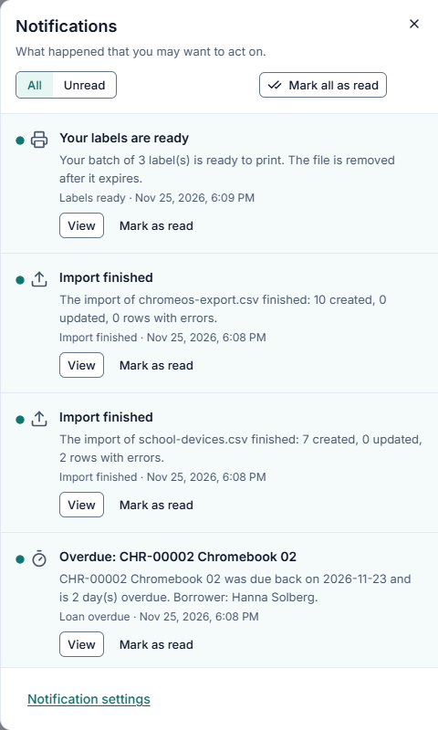

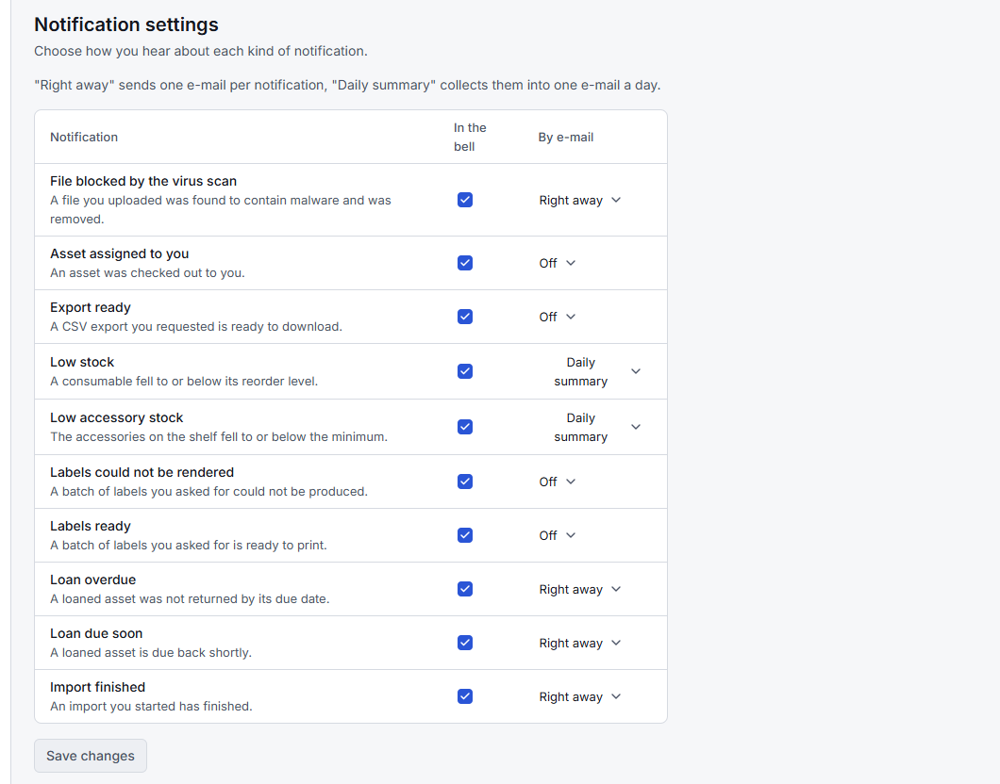

**Borrowers who have no login** (most students) cannot see the bell, so they can only get an e-mail. Whether they do is
decided per pool, under **E-mail borrowers who have no login**:

| Choice                                                              | Who is e-mailed                                                                     |
| ------------------------------------------------------------------- | ----------------------------------------------------------------------------------- |
| Automatic: employees, contractors and external people, not students | Everyone with an e-mail address, **except students**. This is the default.          |
| Always, students too                                                | Every borrower who has an e-mail address, students included.                        |
| Never                                                               | Nobody without a login. Overdue loans still go to the owner or the loaner managers. |

The mail has no link (they cannot sign in) and says the same as the bell message. Someone without an e-mail address is
simply not mailed. The default protects pupils' and parents' mailboxes; choose **Always** only when the school has agreed
to it.

## If something goes wrong

| What you see                                                | What to do                                                                                                                          |
| ----------------------------------------------------------- | ----------------------------------------------------------------------------------------------------------------------------------- |
| "No device matches …"                                       | The tag is wrong or the label is damaged. Type the tag by hand, or search for the device in **Assets**.                             |
| "… is not in this loaner pool. Add it to the pool first."   | Open the pool and press **Add device**.                                                                                             |
| "… is already out."                                         | The device is on loan. Return it first (it may have come back without being scanned).                                               |
| "… is In repair and cannot be lent. Choose another device." | The device is not deployable (**In repair**, **Broken**, **Retired**). Lend another one, or close the repair first.                 |
| "… already holds the most devices this pool allows."        | The borrower is at the limit. Take a device back first, or raise **Devices per borrower** (Administrators).                         |
| "… is not one of the people this pool lends to."            | The pool lends only to some kinds of people. Change **Who may borrow**, or check the person's **Kind**.                             |
| "… is inactive and cannot borrow."                          | The person is marked inactive in **People**. Make them active again.                                                                |
| "Nobody matches that borrower."                             | Type a name or the number differently, or add the person under **People**.                                                          |
| "This pool is switched off and lends nothing."              | Edit the pool and tick **Lend devices from this pool**.                                                                             |
| "No device of this pool is free."                           | Everything is out. Check **Overdue loans** and call the borrowers.                                                                  |
| "The new date must be later than the current one."          | Choose a later date when extending.                                                                                                 |
| Nobody got a reminder                                       | Check that the borrower has an e-mail address, that the pool's e-mail setting allows it, and that **Remind the borrower** is not 0. |

## Related guides

- [Log a repair](05-log-a-repair.md): a device in repair cannot be lent.
- [Schools (K-12)](08-schools-k12-mapping.md): student numbers, homerooms and carts.
- [Print and apply labels](03-print-and-apply-labels.md).
