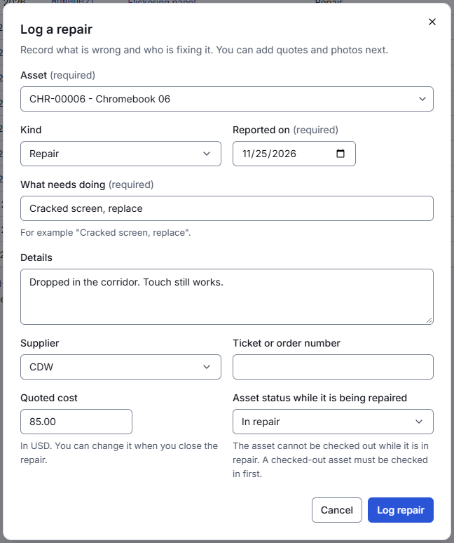
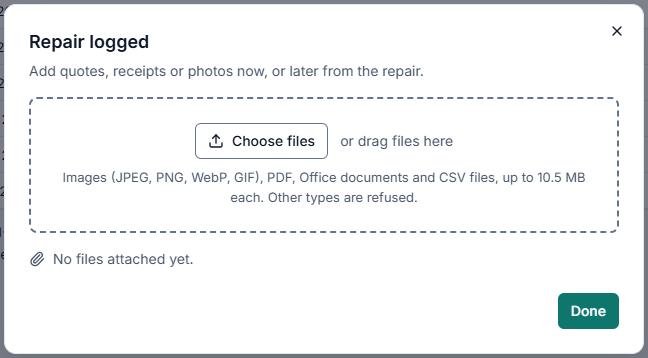
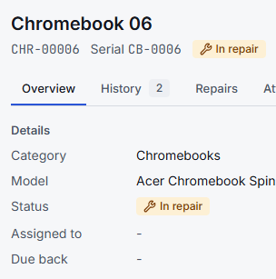
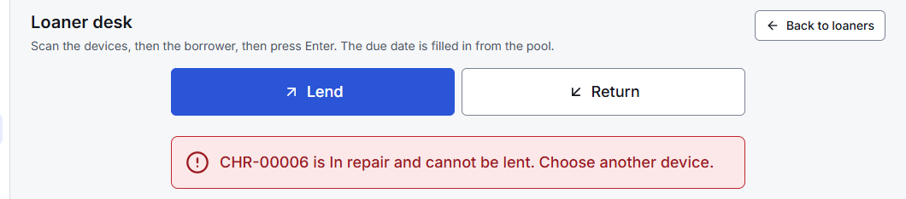
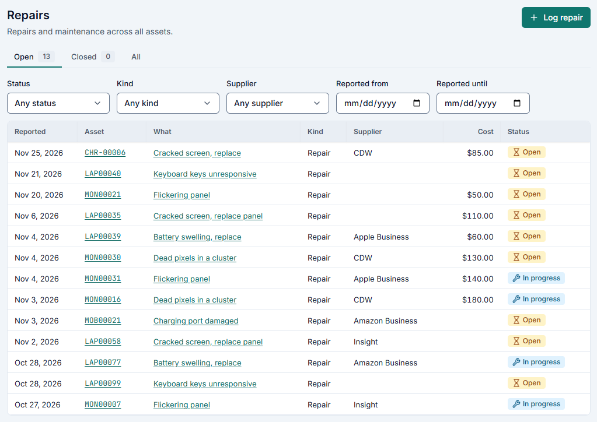
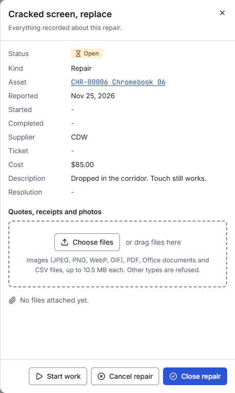
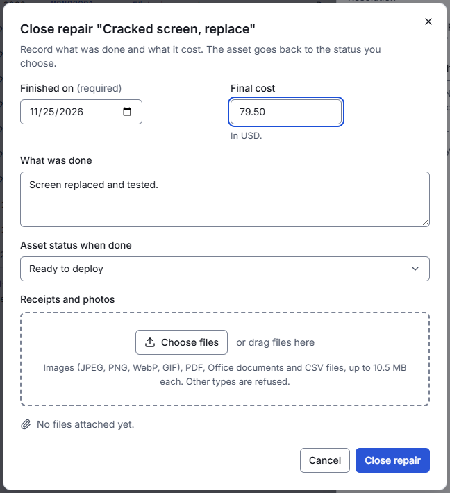
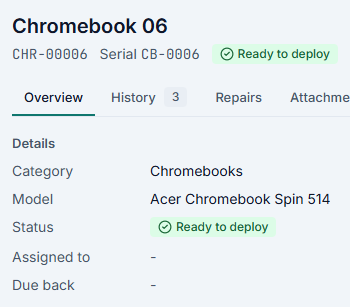

# Log a repair

When a device breaks or goes in for service, log a repair. It keeps what is wrong, who is fixing it, what it costs and
the receipts, and it keeps the device from being lent while it is away. When the repair is closed, the device goes
back to ready. The example is a Chromebook with a cracked screen.

**Who can do this:** Administrators, Asset managers and Technicians. Everybody can look at the repairs.
**How long it takes:** two minutes to log, one to close.

## Before you start

- **The device must be in the register.** Find its tag on its label (or search for it in **Assets**).
- **If the device is lent out, take it back first.** A device that is checked out or on loan must be checked in
  before it can go into repair. The window says so: "A checked-out asset must be checked in first."
- **Know how status and repair fit together.** A **status** is a label on the asset ("Ready to deploy", "Deployed", "In
  repair", "Broken"). Some statuses are **not deployable**: the device cannot be checked out or lent while it has one.
  A **repair** is a separate record with the problem, supplier, cost and files. Logging a repair puts the device into a
  not-deployable status; closing the repair puts it back.

  | You do this                           | The device's status                                                                                             |
  | ------------------------------------- | --------------------------------------------------------------------------------------------------------------- |
  | Log a repair                          | Changes to the status you choose (**In repair** by default), or stays if you choose **Keep its current status** |
  | Start work, or edit the repair        | Nothing changes                                                                                                 |
  | Close the repair                      | Goes to the status you choose when you close it; by default **the status it had before**                        |
  | Cancel the repair (nothing was fixed) | Goes back to the status it had before                                                                           |

## Steps

### 1. Log the repair

Open **Repairs** and press **Log repair** (top right). You can also open the asset and use the **Repairs** tab, **Log a
repair**.

1. **Asset**: start typing the tag, serial number or name, and choose the device.
2. **Kind**: **Repair**, **Maintenance**, **Inspection** or **Upgrade**.
3. **Reported on**: today, unless you are logging it later.
4. **What needs doing**: a short line, for example "Cracked screen, replace". This is what the list shows.
5. **Details**: anything useful for whoever fixes it.
6. **Supplier** (optional): who repairs it. Leave **In-house or not decided** if nobody has been chosen.
7. **Ticket or order number** and **Quoted cost** (optional). You can change the cost when you close the repair.
8. **Asset status while it is being repaired**: **In repair** or **Broken**, or **Keep its current status**. This is
   what keeps the device from being lent.

Press **Log repair**.

### 2. Add the quote or photos (optional)

The window now says **Repair logged** and offers **Choose files**: add the quote, a photo of the damage or a receipt
(images, PDF, Office documents or CSV, up to 10.5 MB each). You can also do it later. Press **Done**.

### 3. See what changed on the asset

Open the asset. Its status is now **In repair**.

From now on the device is **not deployable**. At the loaner desk it is refused:

The dashboard counts it under **Not deployable**, and the **Open repairs** panel lists it.

### 4. Follow the repair

The **Repairs** page lists open repairs. Use **Open**, **Closed** and **All**, and the filters **Status**, **Kind**,
**Supplier**, **Reported from** and **Reported until**. At the bottom, **Cost of the repairs shown** adds up the costs.

Click the repair's title to open its details. **Start work** marks it **In progress** (use it when the device has left
for the workshop). **Cancel repair** closes it as cancelled when nothing was fixed; the device returns to the status it
had before.

### 5. Close the repair

When the device is back, open the repair and press **Close repair**.

1. **Finished on**: the date it was done.
2. **Final cost**: what it really cost.
3. **What was done**: for example "Screen replaced and tested."
4. **Asset status when done**: leave **Ready to deploy** (the status it had before), or choose another, for example if
   the device should not go back to the cart.
5. **Receipts and photos**: add the invoice.
6. Press **Close repair**. The toast says **Repair closed.**

The device is deployable again:

## When a status says "in repair" but no repair exists

Changing a status by hand to **In repair** or **Broken** does **not** create a repair record. That also happens when
devices come in with such a status, for example **Disabled** Chromebooks in a Google Admin import. The asset form and
the asset page then say: "No repair is logged for this asset. Log a repair to track the problem, supplier and cost."
Press **Log a repair** there to open the repair window for that asset. Devices that are only **Broken** (nobody is fixing
them yet) need no repair record, but then nobody tracks the cost either.

## If something goes wrong

| What you see                                                  | What to do                                                                                                   |
| ------------------------------------------------------------- | ------------------------------------------------------------------------------------------------------------ |
| "A checked-out asset must be checked in first."               | Take the device back first (check it in, or return it at the loaner desk), then log the repair.              |
| The device is still lendable after you logged a repair        | You chose **Keep its current status**. Edit the asset and set a not-deployable status such as **In repair**. |
| You cannot find the asset in the list                         | Type the tag exactly as printed on the label, or the serial number.                                          |
| The device is **In repair** but not on the **Repairs** page   | Nobody logged a repair for it (see above). Press **Log a repair** on the asset.                              |
| You closed a repair and the device is not **Ready to deploy** | You chose another status in **Asset status when done**. Edit the asset to change it.                         |
| You logged the repair on the wrong device                     | Open the repair and press **Cancel repair**, then log it on the right device.                                |

## Related guides

- [Run a loaner day](04-run-a-loaner-day.md): a device in repair is shown as **Not available** in its pool.
- [Import from Google Admin (ChromeOS)](02-import-from-google-admin.md): disabled devices arrive as **In repair**.
