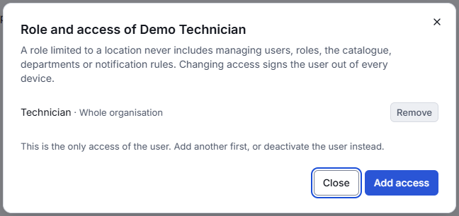
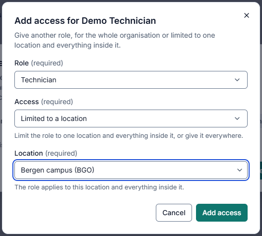
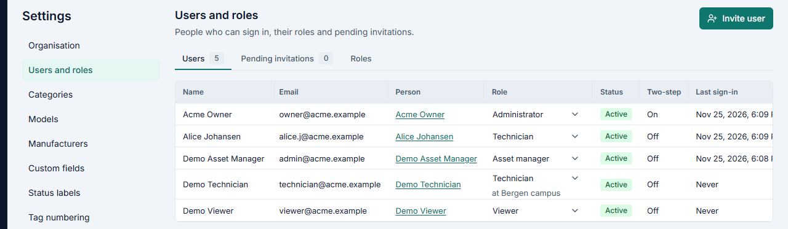
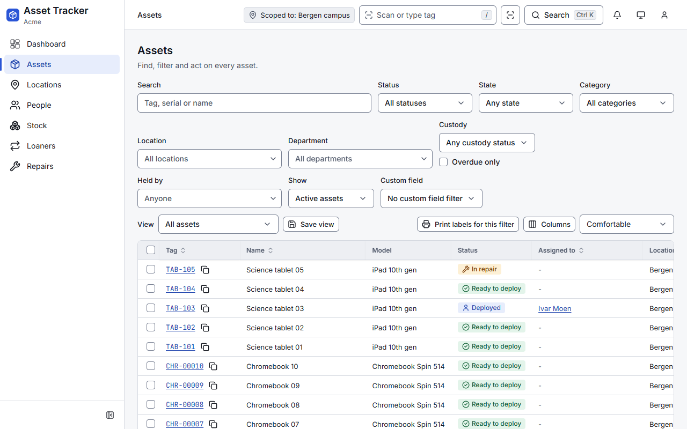
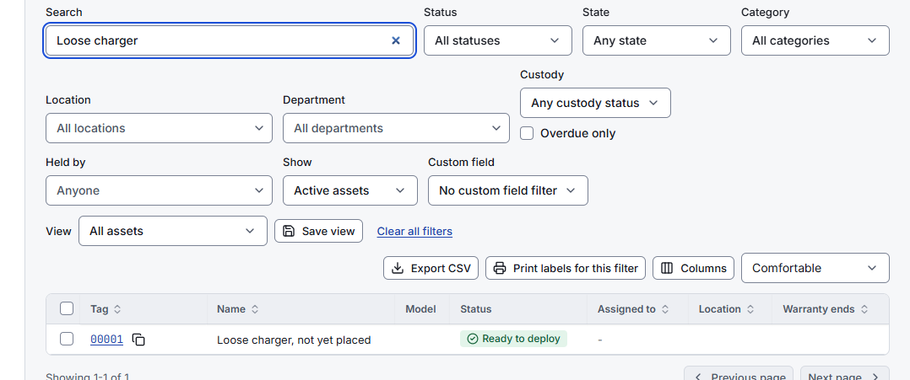
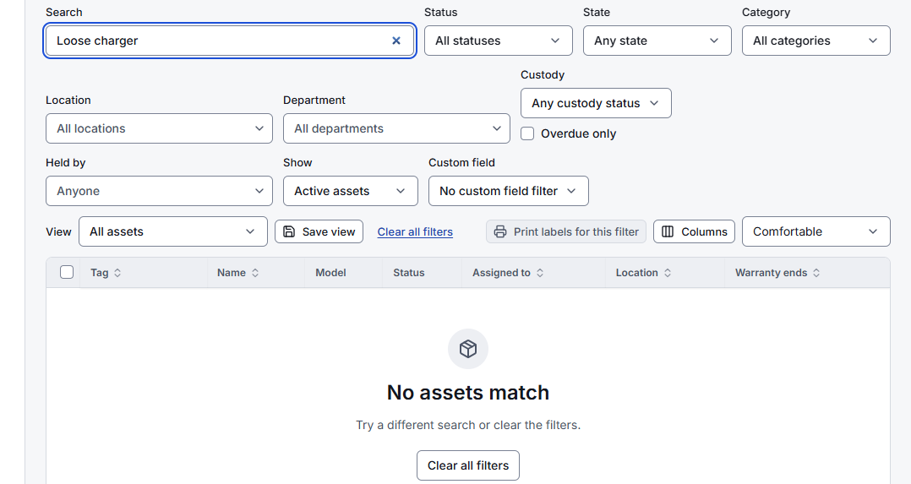
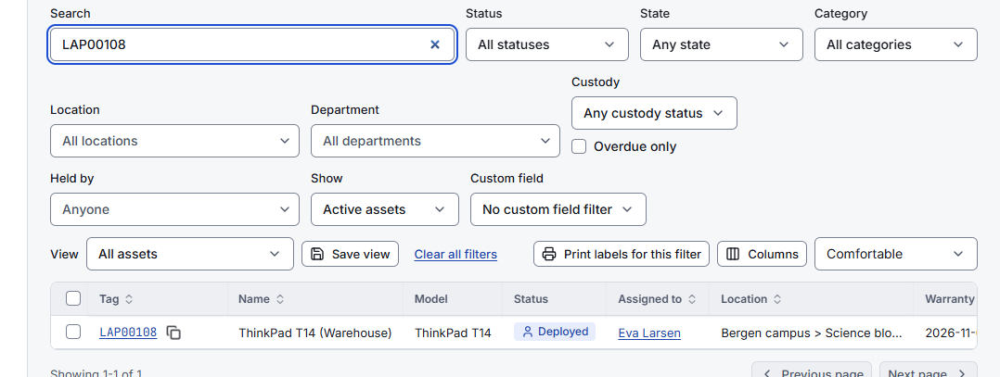
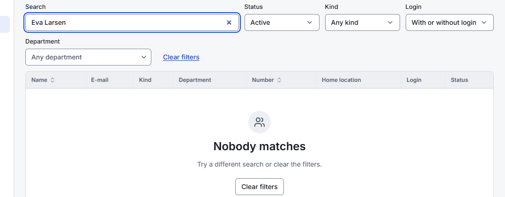
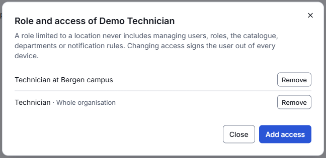

# Limit a user to a site (location scoping)

Give someone a role that works at **one site only**: the technician of the Bergen campus sees and handles the Bergen
campus and nothing else. This guide shows how to limit a role to a location, what that person then sees, how a "site
administrator" fits in, and how to undo it.

**Who can do this:** Administrators (the people who manage users).
**How long it takes:** a minute per person.

> **This guide will be refreshed.** The Users screen is being extended so that a person can hold several roles, each
> with its own site (add and remove a role assignment). The steps and the first two pictures below show the dialog as it
> is today, **Change role and access**; the rest of the guide does not change.

## Before you start

- **Your places must form a tree.** A role limited to a location covers that location **and everything inside it**: if
  you limit someone to "Bergen campus", they also work in its buildings and rooms. Check **Locations** first: sites at the
  top, buildings and rooms below them.
- **Give each record a location.** Assets, people, stock and loaner pools **with no location are invisible** to a limited
  user (see below). Before you limit people, make sure the records they should handle have a place.
- **Decide the role.** The role says _what_ the person may do (Technician, Asset manager, Administrator ...). The
  location says _where_.
- **You cannot give more than you have.** An Administrator limited to one site cannot give anyone a role for the whole
  organisation or for another site, and cannot widen their own access.

## Steps

### 1. Open the person's role

Go to **Settings**, **Users and roles**. In the row of the person, press the **...** button (**Actions for Demo
Technician**) and choose **Change role and access**.

### 2. Limit the role to a location

1. **Access**: choose **Limited to a location** (the other choice is **Whole organisation**).
2. **Location**: choose the site, for example **Bergen campus**. The text under it says: "The role applies to this
   location and everything inside it."
3. Press **Save**. The toast says "Role and access of Demo Technician saved."

On the **Users** tab, the role now shows the place: **Technician at Bergen campus**.

The window warns: "A role limited to a location never includes managing users, roles, the catalogue, departments or
notification rules."

## What a limited user sees

At the top of every page they see **Scoped to: Bergen campus**. The lists show only what
is at that site and inside it: assets, accessories and consumables, people (by their home location), loaner pools,
repairs, labels, imports and exports. Counts, the dashboard and search follow: their numbers are smaller than an
administrator's.

Good to know:

- **Something outside the site looks as if it does not exist.** A search finds nothing, a link to it says "not found", a
  scanned label of another site says nothing. This is on purpose: the person is not told that the record exists.
- **The tracker's catalogue is shared.** Categories, models, manufacturers, status labels, suppliers, custom fields and
  departments are the same for everybody who may read them.
- **Notifications** reach them only for things at their site (apart from what concerns them personally, such as their own
  check-outs).

### Records with no location are hidden

An asset, person, stock item or pool **with no location** belongs to no site, so a limited user cannot see it. Here an
asset without a location, "Loose charger, not yet placed", is found by the administrator and not by the technician:

The reverse is also true: a limited user must give every record they create a location inside their site. Creating an
asset without a location, or moving it outside the site, is refused.

If someone says "I cannot find the laptop", first check whether it has a location, and whether that location is inside
their site.

### The holder's name is shown

When an asset **inside** the site is held by a person who is **outside** it (a teacher from another campus borrowed a
laptop), the limited user still sees **who** has it. Without that, they could not tell where their own device is. The
person's own record stays hidden:

### A site administrator

Give the **Administrator** role limited to a site, and you have a site administrator: they can manage the assets, people,
locations, stock, loaners, repairs, imports and exports **of that site**. They cannot manage users, roles, the catalogue,
departments or notification rules, because those belong to the whole organisation. Only an administrator for the whole
organisation does that.

One person can hold more than one role: for example **Technician** at one site and **Viewer** for the whole organisation.
For each action the tracker uses the widest role that allows it, so this person reads everything but changes only their
own site.

## Undo: give the access back

Open **Change role and access** again, set **Access** to **Whole organisation**, and press **Save**.

The restriction is gone at once. To remove the access altogether, deactivate the user (**Actions**, **Deactivate**).

## If something goes wrong

| What you see                                                    | What to do                                                                                                                                      |
| --------------------------------------------------------------- | ----------------------------------------------------------------------------------------------------------------------------------------------- |
| "Scoped to: no location (ask an administrator)" at the top      | The person's location is no longer available (archived). Choose a new one in **Change role and access**.                                        |
| "I cannot find an asset that I know exists"                     | It is outside their site, or it has no location. Check the asset's **Location** as an administrator.                                            |
| Saving a role is refused                                        | You may give a role only for the places where you hold it yourself. Ask an Administrator for the whole organisation.                            |
| A limited user cannot create an asset or person                 | They must choose a location inside their site. Records without a location are refused.                                                          |
| A new tag is "already used" and the user cannot find that asset | The tag is in use at another site. Tags are unique across the organisation, so the message is correct; the person is only told that it is used. |
| A person at the site cannot open the Settings pages             | That is by design: a role limited to a location never includes the organisation-wide pages.                                                     |
| The **Location** list in the window is empty or wrong           | Locations are managed under **Locations**. Add or correct the place there first.                                                                |

## Related guides

- [People and logins](07-people-and-logins.md)
- [Run a loaner day](04-run-a-loaner-day.md): loaner pools are limited by their home location.
