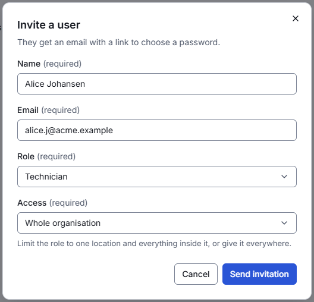
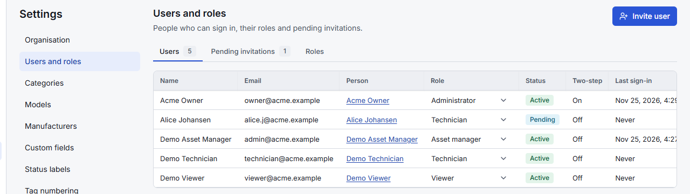
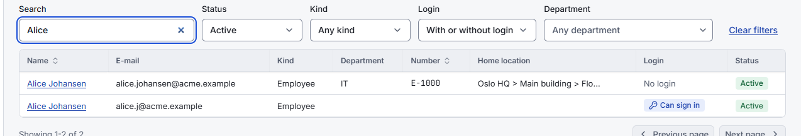
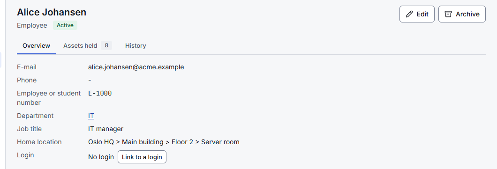
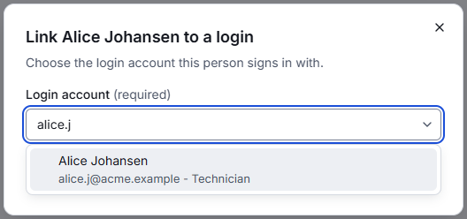
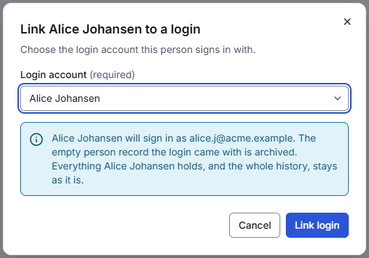
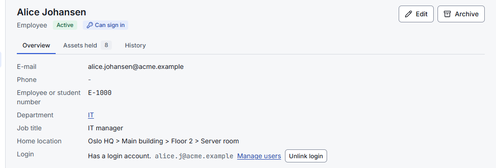
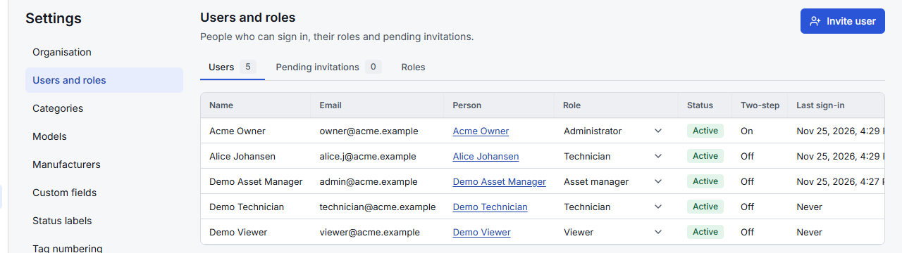
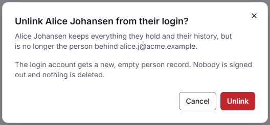

# People and logins

The Asset Tracker keeps two lists that look alike: **People** and **Users**. This guide explains the difference in plain
words, and shows when and how to **link** a person to a login, or **unlink** them.

**Who can do this:** Administrators (the people who manage users).
**How long it takes:** a minute.

## The difference in one minute

|                | **People**                                                                                 | **Users**                                                           |
| -------------- | ------------------------------------------------------------------------------------------ | ------------------------------------------------------------------- |
| What it is     | **Who holds things.** A record of a human being.                                           | **Who signs in.** An account with an e-mail address and a password. |
| Where          | **People** in the menu                                                                     | **Settings**, **Users and roles**                                   |
| Who is in it   | Staff, students, contractors, visitors: anybody who can be handed a device                 | Only the people who use the Asset Tracker itself                    |
| What it holds  | Name, e-mail, number, department, home location, the devices in their hands, their history | A role (what they may do), two-step verification, sign-in history   |
| Needs a login? | No. Most students are only ever in People.                                                 | Yes, by definition                                                  |

**Linking** says: "this person and this login are the **same human**." The devices someone holds belong to the
person; the sign-in belongs to the login; the link makes them one.

### An example

Alice Johansen is the school's IT manager. She has been in **People** since the first import: number E-1000, department
IT, and eight devices on her record. She never needed a login, because somebody else handled the tracker.

Now she should get a login of her own. The administrator invites her at **alice.j@acme.example** (her new school
address; the one on her person record is alice.johansen@acme.example), in **Settings**, **Users and roles**, **Invite
user**:

Until Alice accepts, the login is listed on the **Users** tab with a **Pending** badge. From its **...** menu you can
already give it access, link it to a person, resend or revoke the invitation.

Alice follows the link in her mail and chooses a password. Every login automatically gets a person record, so the
tracker made an **empty** one with her name. **People** now shows two Alices:

The first one holds the devices and has **No login**. The second one **Can sign in** but holds nothing. If you do
nothing, Alice signs in and sees an empty "my devices" list. Linking fixes that: the login moves to the real Alice, and
the empty record is archived.

## When to use it

- **The two e-mail addresses are different** (as above), or the person has no e-mail address on file. If a new login has
  **the same e-mail address** as an existing person who has no login, the tracker joins them by itself when the account
  is created, and you need do nothing.
- **A person already existed and later became a user**, for example a member of staff imported from a spreadsheet.
- **A login was linked to the wrong person** (unlink, then link the right one).

## Before you start

- The **login exists**. It may still be an invitation that has not been accepted yet: it is offered, marked
  "pending invitation", and it is on the **Users** tab with a **Pending** badge, so it can be linked from there too.
- The **person you want is not linked to another login**. A person has at most one login, and a login has one person.
- The **empty record the login came with holds no devices**. If somebody already checked a device out to it by mistake,
  check it in or transfer it first.

## Steps

### 1. Open the person

Go to **People**, search for the person, and open them. The line **Login** says **No login**.

### 2. Link the login

1. Press **Link to a login**. The window **Link Alice Johansen to a login** opens.
2. In **Login account** type a name or an e-mail address and choose the account. Under each name the list shows the
   e-mail address and the roles of the account (and "pending invitation" for one that is not accepted yet), so two
   accounts with the same name can be told apart.

   

3. Read the blue sentence. It says exactly what will happen: "Alice Johansen will sign in as alice.j@acme.example. The
   empty person record the login came with is archived. Everything Alice Johansen holds, and the whole history, stays as
   it is."
4. Press **Link login**.

The message says "Alice Johansen is now linked to alice.j@acme.example." The person page now says **Has a login account**
and shows the login, with a button **Unlink login**.

You can do the same from the other side: in **Settings**, **Users and roles**, press **...** at the login (a pending one
too), choose **Link to a person**, and choose the person (only people without a login are offered). The list now shows the person in the
**Person** column.

### What linking does, and does not do

- **Does:** the login now belongs to the real person. Everything they hold, their history and their department stay. The
  empty record the login came with is **archived** (not deleted), so the history stays truthful. A department that the
  empty record headed is now headed by the real person.
- **Does not:** it does not copy names or e-mail addresses between the two, it does not change the role, and it does not
  sign anybody out. Two real people are never merged.
- **Watch out:** if you later **rename the login account**, the linked person is renamed too.

## Unlink

Unlinking is for a link that is wrong. On the person page press **Unlink login**.

The window says: "Alice Johansen keeps everything they hold and their history, but is no longer the person behind
alice.j@acme.example. The login account gets a new, empty person record. Nobody is signed out and nothing is deleted."
Press **Unlink**. Afterwards you can link the login to somebody else.

Unlinking does **not** switch the login off. To stop someone signing in, deactivate the user on **Settings**, **Users and
roles**.

## If something goes wrong

| What you see                                                 | What to do                                                                                                             |
| ------------------------------------------------------------ | ---------------------------------------------------------------------------------------------------------------------- |
| The login you want is not in the list                        | Type more of the name or the e-mail address: the list shows the accounts that match what you typed, with their e-mail. |
| The person you want is not offered on the Users screen       | They already have a login. Open them under **People** and unlink first.                                                |
| A message says the person already has a login                | Unlink that login first, then link the new one.                                                                        |
| A message says the login already has a person somebody chose | The login is linked to a person that someone picked on purpose. Unlink it first.                                       |
| A message says the empty person record still holds assets    | Somebody checked devices out to the login's empty record. Check them in, or transfer them to the real person.          |
| You cannot see **Link to a login**                           | Only Administrators may link. Ask one.                                                                                 |
| The linked person was renamed unexpectedly                   | Renaming a login account renames the linked person. Rename it back from the person's page, or change the login's name. |
| You want to remove a person who has a login                  | A person with a login cannot be archived. Unlink or deactivate the login first.                                        |

## Related guides

- [Limit a user to a site](06-limit-a-user-to-a-site.md): the role of a login.
- [Schools (K-12)](08-schools-k12-mapping.md): why most students have no login.
