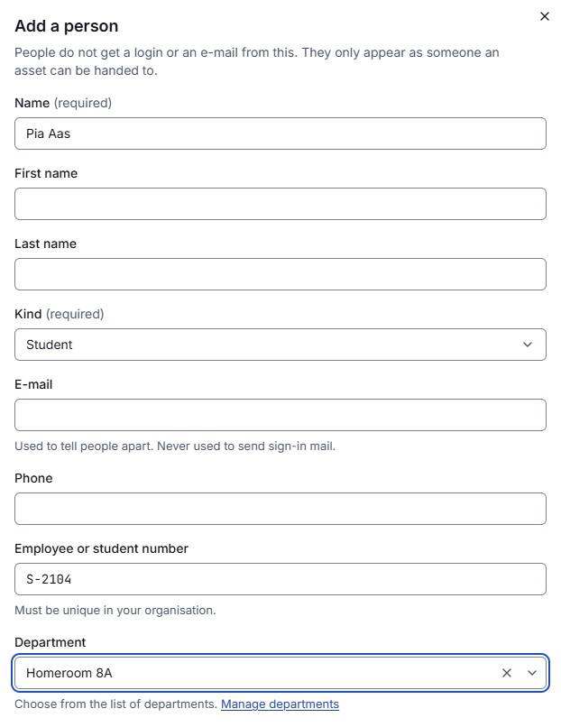
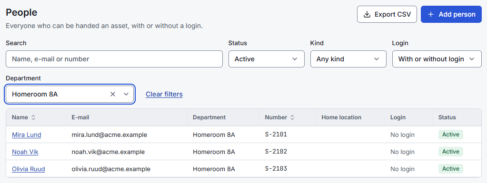
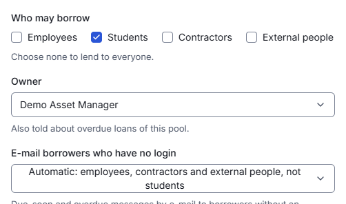
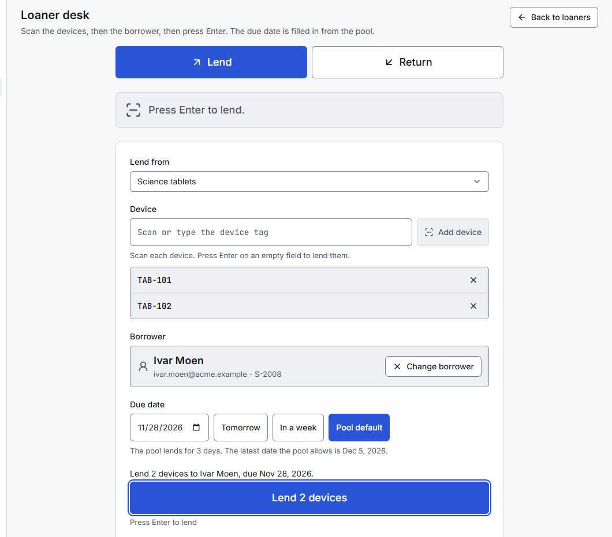

# Schools (K-12): students, homerooms and carts

The Asset Tracker has no special "school" fields. It does not need them: the things a school already has (student
numbers, homerooms, device and cart numbers) fit into fields that every organisation uses. This guide shows what goes
where, how to set it up, and how it looks at the loaner desk.

**Who can do this:** Administrators and Asset managers.
**How long it takes:** about half an hour for a first class and a first cart.

## What goes where

| In the school                            | In the Asset Tracker                                                                                                                                                                                               |
| ---------------------------------------- | ------------------------------------------------------------------------------------------------------------------------------------------------------------------------------------------------------------------ |
| **Student ID** (the number on the badge) | The person's **Employee or student number** (the **Number** column in People). The loaner desk finds the student when you scan or type it. The e-mail address works too. Set the person's **Kind** to **Student**. |
| **Homeroom or class**                    | The person's **Department** (one department per homeroom, or per grade), or the person's **Home location** (the room).                                                                                             |
| **Device number**                        | The asset's **Asset tag** (for example `CB-014`). The tag is what the label shows and what the desk scans.                                                                                                         |
| **Cart number**                          | A **custom field** on the device category (Settings, **Custom fields**), or simply the **name of the loaner pool** ("Cart 3").                                                                                     |
| **The cart itself**                      | A **loaner pool**, with the cart's room as its **Home location**, so a returned device goes back there.                                                                                                            |
| **Grade / year group**                   | A department too ("Grade 8"), or a level of your locations.                                                                                                                                                        |

The same thing as a picture: a student is a **person** of kind **Student**, with a number and a homeroom. They have no
login. A Chromebook is an **asset** with a tag. A cart is a **pool** that lends those assets to those students.

For the developer's version of this table, see the section ["Loaner pools in a school" of the getting-started
page](../getting-started.md#loaner-pools-in-a-school-m2-wave-3-loaners-menu).

## Before you start

- **Your student list** as a spreadsheet, with a student number and a homeroom for everyone. An export from your student
  information system is fine. If you do not want the e-mail addresses of children in the tracker, leave the column out:
  people are told apart by their number then.
- **Your device list** with a tag for every device. A tag such as `CB-014` is easy to read on a label. See
  [Import your spreadsheet](01-import-your-spreadsheet.md), or
  [Import from Google Admin](02-import-from-google-admin.md) for Chromebooks.
- **Decide on the privacy rule.** The tracker never e-mails students unless you say so (see step 5).

## Steps

### 1. Make a department for each homeroom (or grade)

Go to **Settings**, **Departments**, press **Add department** and add "Homeroom 8A", "Homeroom 8B" and so on. (You can
also let the people import create them in the next step.)

### 2. Import the students

Use the same wizard as for devices: **Assets**, **Import**, or **Settings**, **Imports**, **New import**. Choose
**People**. Download the template if you want to see the columns: **Name**, **First name**, **Last name**, **Email**,
**Phone**, **Employee number**, **Department**, **Job title**, **Kind**, **Status**, **Location**, **Notes**.

Put your columns like this in step 3 of the wizard ("Match columns"):

| Your column                                                     | Goes to         |
| --------------------------------------------------------------- | --------------- |
| Student ID                                                      | Employee number |
| Student name                                                    | Name            |
| Homeroom                                                        | Department      |
| (a column that says "student" on every row, or set the default) | Kind            |

Students are matched by e-mail address first and by number second, so running the import again later updates them
instead of making doubles. Departments that do not exist are created. **Run the dry run, read it, then import.** The
wizard is the same as in [Import your spreadsheet](01-import-your-spreadsheet.md).

You can also add a single student by hand: **People**, **Add person**. Choose **Kind** **Student**, type the **Employee
or student number**, and choose the **Department**.

Check the result in **People**: filter by **Department** to see a homeroom.

### 3. Import the devices and give each a tag

Import the devices with the **Asset tag** column set to your device number. In **Settings**, **Tag numbering** you can set
how new tags are numbered when a device has none. Print the labels afterwards
([Print and apply labels](03-print-and-apply-labels.md)).

If you want a **cart number** on every device, add it as a custom field on the category (**Settings**, **Custom fields**)
and import it as a column named `cf:<field key>`, as the asset template shows. Often the pool's name is enough.

### 4. Make the cart a loaner pool

Go to **Loaners**, **Pools**, **New pool**. Name it ("Cart 3"), set its **Home location** to the cart's room, and put the
devices into it. [Run a loaner day](04-run-a-loaner-day.md) explains every field. For a student cart, the usual choices
are:

- **Default loan length (days)**: for example 1 for a day, 7 for a week.
- **Devices per borrower**: 1.
- **Who may borrow**: tick **Students** (and **Employees** if teachers may borrow from the same cart). Only people whose
  **Kind** is among those can borrow.

### 5. Decide who gets reminder e-mails

Students have no login, so they cannot see the bell in the tracker. The pool's setting **E-mail borrowers who have no
login** decides whether they get an e-mail instead:

- **Automatic** (the default): staff, contractors and external people are e-mailed, **students are not**.
- **Always, students too**: students are e-mailed if they have an address on file.
- **Never**: nobody without a login.

Overdue loans always also go to the pool's **Owner**, or if there is none to the people who manage loaners, whatever you
choose here. So a teacher can call the student.

### 6. At the desk

At the **Loaner desk**, scan the Chromebook's label, then **scan the student's badge** (or type the student number or
name). The due date comes from the pool.

## If something goes wrong

| What you see                                     | What to do                                                                                                                    |
| ------------------------------------------------ | ----------------------------------------------------------------------------------------------------------------------------- |
| "Nobody matches that borrower."                  | The number on the badge is not the **Employee number** in People, or the student is missing. Check the person.                |
| "… is not one of the people this pool lends to." | The student's **Kind** is not **Student**, or the pool's **Who may borrow** does not include students.                        |
| The import says "not found" for the department   | In the wizard, set **When a department matches nothing** to **Create it**, or add the department first.                       |
| Two students share a number                      | A number must be unique in your organisation, so the second student is refused. Fix the list.                                 |
| A parent asks why their child gets mail          | Open the cart under **Loaners**, **Pools**, **Edit**, and set **E-mail borrowers who have no login** to **Never**.            |
| A student left the school                        | Open them in **People**, **Edit**, and set **Status** to **Inactive**. They can no longer borrow; the history stays.          |
| New school year: new homerooms                   | Rename the departments, or add new ones and change each student's **Department**, or re-run the import: it updates by number. |

## Related guides

- [Import your spreadsheet](01-import-your-spreadsheet.md)
- [Import from Google Admin](02-import-from-google-admin.md)
- [Run a loaner day](04-run-a-loaner-day.md)
- [People and logins](07-people-and-logins.md)
